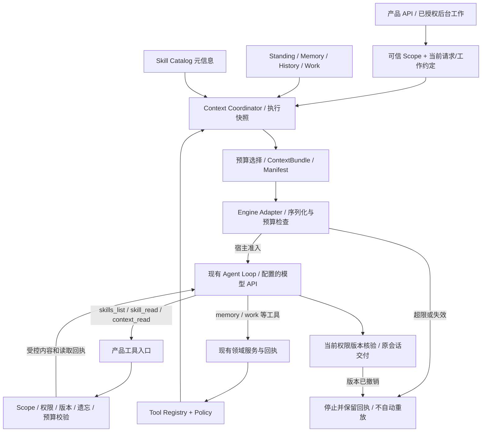

# Kleio 上下文与加载机制整改方案

2026-10-17 · **续审 v2：用户授权设计就绪后分小任务实施** · 本轮唯一工程决策稿

**2026-10-19 当前结论：后台研究结果在当前原会话无需刷新即可显示，支持断网补齐、切换返回、草稿与前台回复保留。§19已完成源码/设计、Codex+6.1 Sol小任务实施、独立审查及本地产品验收：285项相关回归、33项前端相关检查（部分重叠）、runtime tsc与Web构建通过；真实DSH/模型研究及4个浏览器场景通过。最新交付、返工、证据和边界看§19.6；history/review修复见§18.8，G5/G6机制见§17.11。没有部署ECS，移动端全量类型检查仍有一处既有Computer错误。** 这不是完整 Muse 行为融合或整款产品已完成。前文初次调研和历史批次记录保留各自时点，不代表当前仍缺相同机制。

2026-10-19 最新授权：改用 **Codex + GPT-6.1 Sol**，源码调研、设计、验收先补入本文，设计者判断单项就绪后分小任务实施；开发与独立审查分开，记录耗时和返工。此前 Cursor 记录作为历史证据保留，不再是当前派发方式。G2 已验收边界见 §14，G3 见 §15，G4 见 §16；G5/G6 的源码、决策、分项任务与证据见 §17，后续history/review修复见 §18，后台研究交付实时更新与本地产品验证见 §19。**设计确定、引擎门槛验证、产品实现完成是三个不同状态。** 本文不是全量 T0–T8 的一次性执行指令。证据细节见 [源码核查](context-loading-source-audit-2026-10-17.md)；产品总方向仍见 [统一总稿](../../reference/kleio-design/README.md)。本轮已授权本地前后端验证及相关显示兼容修复；ECS、UI功能重构、多用户迁库仍不在实施范围。

## 1. 建议确认的产品范围

用户应获得三项能力：修改个人配置后下一次执行按新配置工作；添加符合约定的技能后，无需开发者改选择器即可被发现和读取；处理任务时能继续获取必要的技能参考资料和历史依据，且不虚构权限或已完成动作。

| 本轮建议完成 | 仍不代表什么 |
| --- | --- |
| 五份 standing 的明确职责、快照、生效时机；Muse 行为逐项适配 | 不复制 Muse 全量提示词/用户档案，不做自动人格进化 |
| 数据驱动技能目录 → 按需正文 → 按需关联文本资源 | 不是技能市场、自动安装、脚本执行器或自生成技能系统 |
| 统一的结构化 ContextBundle，覆盖对话/研究/review/记忆抽取的不同配置 | 不重写 Agent loop；不同执行类型不注入同一套内容 |
| 工具定义/能力说明/skill 资格来自同一注册源；读取时再校验 | 不新增外部服务、邮件、日历、Computer、Goals 或任意 MCP 连接 |
| 初始预算、加载预算、每次模型请求的预算检查与可解释停止 | 不宣称已有长期摘要、无限长任务或跨引擎无损中途恢复 |
| 兼容已有身份、记忆和工作契约；修复后台记忆开关漏检 | 不在本轮迁 PostgreSQL、实现登录多用户、重构 Web/iOS 或部署 ECS |

数据库目标仍是 PostgreSQL，多用户仍是发布前置要求。本轮只为其留下可信 scope 和存储接口，不新增面向多用户的 SQLite 结构，更不把当前本地单用户实现作为服务端多用户方案。

模型/API 可配置固定模型或外部 Auto，**不要求 OpenRouter，不做内部难度路由**。预算使用实际模型的能力/容量；外部 Auto 没有可信容量说明时须配置保守下限，不能猜它最终路由到哪个模型。

## 2. 当前差距及整改优先级

本表保留 2026-10-17 整改基线；后续 G2–G6 及兼容修复的交付与尚未交付范围以 §14–§18 为准，旧行号仅定位当时源码。

| 现状与位置 | 状态 | 影响 / 本轮处理 |
| --- | --- | --- |
| `standing.ts:95/110` 补短模板并每次读取；`identity.ts:30/40/57` 桥接身份 | 部分实现 | 保留有效链路；补内容职责、组合快照和诊断，不用“模板变长”冒充行为融合 |
| `skills.ts:14/137` 三个固定关键词意图 | 部分实现 | 任意新增 skill 无法进入；改为目录发现，模型根据元信息选择，显式点名也走同一读取机制 |
| `skills.ts:155` 直接读正文；`compile.ts:24` 拼正文 | 渐进加载未实现 | 未使用正文不进 prompt；增加受控正文/资源工具与加载回执 |
| `host.ts:82–101` 历史字符截断、记忆字符串、工作 JSON | 部分实现 | 分别返回有来源对象，compiler 统一选择/计量；丢弃的历史有可查句柄 |
| `host.ts:372/376/381` 后台召回记忆 | G1 已复现并修复启动时漏检 | 三处复用现有 memoryContext 开关；统一 provider 和在途失效尚未实现，见 §12 |
| `capabilities.ts`、`KNOWN_TOOLS`、host 工具数组各自描述能力 | 部分实现 | 后台 observed research 关闭记忆仍展示 schema，但 handler 拒绝调用；G4 归并目录/说明/实际权限，不能把 G1 当作注册表整改完成 |
| `contracts.ts:9` 只有 context string；`dsh.ts:94` flatten | 部分实现 | 产品端采用 ContextBundle；只有适配器序列化；如实标记 DSH 的历史引用模式 |
| DSH 原生压缩/工具结果裁剪仍启用 | 引擎有机制，产品未管理 | 本轮明确计量和裁剪所有权，禁止隐式吞掉已加载技能；完整语义压缩暂缓，见 §6 |

此前 12 项测试与 7 轮模型/API/数据库证据仍有效，但只证明对应场景。本轮至少增加目录开放性、分阶段读取、权限撤销、后台开关、预算与适配契约证据。

## 3. 参考选型：借用机制，保持产品所有权

| 选择 | 采用方式与理由 | 明确不采用 |
| --- | --- | --- |
| Muse 的真实状态、自我认知、少打断、研究覆盖、遗忘诚实规则 | **适配内容**。来源是导出 prompt/skills，逐项建立行为→工具/状态→验收映射 | 其私有工具名、shell 探测、默认拥有邮件/设备、全产品永久删除承诺；不声称获得其后端 |
| Codex `SkillMetadata / HostSkillsSnapshot / skills.read` | **移植机制**：元信息、内容与定位符分开；显式点名与隐式选择共享可读源；内容版本与分页 | Rust core、账户插件体系、通用宿主文件访问 |
| OpenClaw snapshot / bootstrap / tool policy pipeline | **适配机制**：有资格的目录、配置快照、分块预算、诊断、权限交集 | 自动环境变量注入、渠道矩阵、整套 skill 安装系统 |
| Hermes `skills_list / skill_view / linked_files` | **移植读取模型**：目录工具、正文工具、关联资源再读取 | reader 内联 shell、包安装、凭据准备、默认“沾边就全加载” |
| Kleio 现有 MCP bridge、schema validator、领域服务 | **直接复用并收敛接口**。已有真实权限和回执基础 | 新建一个绕过 RuntimeHost / Memory / Work 的技能工具后门 |
| 成熟 YAML 库、pinned DSH token-meter | **直接复用库/服务**，业务 schema、预算决策由 Kleio 持有 | 自制 YAML 行解析、盲信字符数等于 token、让计量库替代产品策略 |

这些机制的真实调用链、版本、路径和函数在 [核查 §3–7](context-loading-source-audit-2026-10-17.md)。自研范围限定为 Kleio 的领域契约、权限/版本绑定和预算策略；现成框架都包含不同的状态真相、部署/工具假设，整套引入会造成第二套记忆、配置或执行所有权。

## 4. 架构与数据所有权

Runtime 是产品后端整体；Harness 是它内部组织 Agent 工作的部分。本轮不拆成两个服务。对外 API 和内部工具继续调用同一领域服务，协议类型单独放在 `packages/context-contracts/`，不依赖 DSH、数据库或文件路径。

图表示 **v2 拟议设计**，不是现有模块都已实现。可浏览的 [加载流程图](../../reference/kleio-design/diagrams/context-loading-v2/loading.html) 区分每次请求准入与最终交付资格，实际完成状态见 §12–§17，图中的规则不等于每项都已经验收。

### 4.1 各类内容由谁管理、何时进入

| 内容 | 权威所有者 | 进入上下文的时机与形式 | 权限与失效 |
| --- | --- | --- | --- |
| 产品规则 | 版本化 ProductPolicyBundle | 每次执行必需的指令块；按 kind 选择输出契约 | 用户配置/skill/网页不能覆盖；不能把源码协作 AGENTS 注入产品 |
| standing | StandingStore，先为现有数据目录文件适配器 | 执行实际开始读一次，得到五文件版本与有效身份；用户配置块 | 不是工具授权；修改下一执行生效；旧排队任务开始时取新版本 |
| 记忆 | Memory Service | 仅开关允许时按请求/工作召回，返回 claim ID/version/source 的数据片段 | 召回和按需读取都检查开关/遗忘；已知 ID 纠正/遗忘保留可用 |
| 历史 | Conversation Store | 当前请求独立保留；近期完整消息组按预算选择，较早部分仅给可读句柄 | 范围和遗忘检查；历史不充当本轮新授权 |
| 工作状态 | Work Service | 当前工作约定/版本/原会话为必要块；其他近期任务按相关性给摘要 | 执行和交付重新核对有效约定；摘要不是可变更任务的权限 |
| skill 元信息 | SkillCatalog + 用户启停配置 | 执行开始给可用目录；目录过大通过 skills_list 查询/分页 | 数据内容而非高优先级指令；name/description 不创造工具 |
| skill 正文 | SkillStore | 模型选中后 skill_read，返回带版本的工具结果 | 同一执行快照；正文不自动注册工具、安装依赖或执行脚本 |
| skill 参考资源 | 同一 SkillStore 包内资源 | 根据正文指引再 skill_read(resource) | 包内受控文本与版本；可在宿主冻结有限快照，未请求资源不发给模型 |
| 工具 schema | ToolRegistry 派生的 EffectiveToolSet | 发给引擎的独立工具定义数组 | 当前 capability ∩ 用户授权 ∩ kind ∩ 服务可用；调用时再次检查 |
| MCP 连接配置/凭据 | 产品连接配置服务/运行环境 | **不进入模型上下文**；本轮只管理已有产品 bridge 的连接生命周期 | 公开描述与 secret 分离；skill toolBindings 不能建立连接 |

`TOOLS.md` 只放用户术语和使用偏好，不负责开启工具；`USER.md` 保存用户主动配置，不作为 claim 数据库的替代。`SOUL.md` 是人格偏好，`IDENTITY.md` 是身份，`AGENTS.md` 是运行时工作约定。稳定的诚实/授权/交付规则由产品规则持有，不能依赖某份用户文件恰好包含它们。

建议将记忆开关语义固定为：关闭长期 claim 召回、跨会话检索和由旧记忆触发的补充读取；当前会话的近期对话和用户主动配置的 standing 仍可用，所有入口继续遵守遗忘屏障。不能把“关闭记忆”实现成“没有任何上下文”，也不能借 standing 或 context_read 绕回已禁用的长期召回。

### 4.2 核心接口契约（设计，不是本轮代码）

| 接口/对象 | 输入 | 输出和约束 |
| --- | --- | --- |
| `ContextScope` | 由 API 认证/本地配置或持久工作解析得到 | `scopeId, conversationId?, workId?, executionId`；模型参数不能指定 scope；本轮只接受受信任 local scope |
| `ContextSource.snapshot` | scope、kind、请求引用、有效配置 | `ContextPart[]`；不同 provider 分别持有 Memory/History/Work/Standing 的读取权限 |
| `ContextPart` | provider 产出 | `id, kind, authority, sourceRef, sourceVersion, content, required, estimatedTokens`；kind 区分 policy/config/evidence/history/work/catalog，content 为文本/结构化引用等判别联合 |
| `ContextBundleV1` | 所选 parts + 当前请求 | `version, executionId, scopeRef, snapshotId, policyVersion, request, parts, history, tools, outputContract, budget`；scopeRef 为宿主使用，不把凭据或完整权限令牌给模型 |
| `ContextManifest` | compiler/loader 决策 | 每块 inclusion/omission 原因、hash/version、估计成本、工具集版本、读取回执；默认只记录元信息，不另存个人正文 |
| `SkillCatalog.snapshot` | scope、kind、EffectiveToolSet | eligible/disabled/invalid/unavailable 元信息与原因；模型只看 eligible，明确点名不可用时给精确原因 |
| `SkillStore.read` | scope、执行快照、skillId、版本、resource?、cursor? | `content?, resourceRef, version, nextCursor?, resourceComplete, relatedResources, receiptId, alreadyDelivered?` 或明确错误；重复页只给回执引用；禁止调用者传主机绝对路径 |
| `Engine.describeContextCapabilities` | 已配置的 engine/model profile | 输入映射、工具读取、估算/用量、上下文改写能力；无法兑现时拒绝，不静默退回旧拼串路径 |
| `EngineContextAdapter.encode` | Bundle + 真实 schema | 原生系统指令/消息/工具或受控引用文本；返回映射报告与最终预算估计 |

不要求 `ContextPart` 直接成为供应商的 API 字段。结构化的价值在选择、追踪、失效、权限和计量；最终某些内容必然序列化为文字，但该行为只能发生在适配边界。

## 5. 技能协议与执行时继续加载

### 5.1 技能约定

继续使用产品 data dir 的 `skills/<id>/SKILL.md`；目录名为稳定 id。采用标准 YAML frontmatter：必需 `name`、`description`，`metadata.kleio` 下可有 `requiresTools`、`toolBindings`、`executionKinds`。兼容旧 `id + description`，转换为同一内部模型。未知普通 metadata 可保留为扩展数据，未知影响权限/执行的配置必须报错，不能偷偷启用。

`skills-index.json` 从“唯一的三个技能目录”变为兼容的启停/覆盖配置。**发现以受信任数据目录中的有效 SKILL.md 为准**，未知条目不要求改源码；用户手动放入该目录的合法技能默认启用，外部网络下载/自动安装本轮不存在。既有 `enabled:false` 必须持续生效。重复 id、非法 YAML、缺正文、同名冲突产生诊断，不随机选一个。

读取目录只把元信息发给模型，允许系统在磁盘上读取完整文件做解析/hash。二者要分别测试，不能以“扫描时 readFile 了正文”误判为“全量占上下文”，也不能把“未发模型”说成“从未读磁盘”。

`requiresTools` 是资格条件；`toolBindings` 只把 skill 中的逻辑工具别名解析到 registry 已有的真实工具。绑定到未知工具或不可用必需工具，标记 unavailable，不能隐式扩大 EffectiveToolSet。正文中出现未配置工具的名字，也不产生执行能力。

### 5.2 三个受控读取工具

| 工具 | 模型可提供的参数 | 行为 |
| --- | --- | --- |
| `skills_list` | 可选 query、cursor | 搜索 name/description 或分页列出本轮 eligible 目录；按稳定 id 排序/分页；不搜索正文、不内置技能名规则 |
| `skill_read` | skillId、expectedVersion、resource?、cursor? | 默认读 SKILL.md；首次返回关联文本资源的定位符；后续按包内资源读取；分页绑定内容版本与执行 |
| `context_read` | 已发放的 sourceRef、cursor；或受控 standing 文件枚举 | 补读本轮可见历史证据/standing；不能任意查另一个 scope 或枚举主机文件；work_status、memory_search/explain 保留原领域入口 |

新增工具走现有产品 MCP bridge，使用同一 schema 校验和宿主授权。第一次执行开始默认装 **零份正文**；模型根据目录判断需要的最少技能并读取。显式用户点名直接定位目录条目，仍走同一 reader。原“0–2 个”改为使用倾向和可配置预算，而不是把第三个相关技能永远丢弃的硬编码架构。

正文/资源读取为纯读取：不执行代码，不进行 shell 模板替换，不安装 `deps`，不导出环境变量，不加载另一个技能目录的文件。资源限 UTF-8 文本（md/txt/json/yaml）；脚本、二进制素材与可执行模板不在本轮。绝对路径、`..`、符号/硬链接逃逸和编码变体须拒绝。可复用当前 `files.ts` 的边界，但新增路径能力必须重新验证。

每份内容建立 hash/version。正文分页未读完时记录 partial，返回续读 cursor，产品指引要求读完再按该技能执行；这个回执证明“模型已收到完整内容”，不证明模型语义上遵循了它。不要把 `complete:true` 当执行授权。**采用 §13.2 的执行期不可变快照**：快照创建后文件普通编辑在下一执行生效；创建前版本变化返回 `STALE_RESOURCE`，同次执行不自动混入新版本。并行读取要原子预留预算，避免同时穿透额度。

### 5.3 完整时序与失效

1. 接收当前消息或有效工作约定，得到可信 scope；排队阶段不固定 standing 内容。
2. 开始执行时读取配置/政策版本、standing、工具集、skill 元信息；按 kind 取相关记忆/历史/工作对象。
3. 编译预算和 manifest；必要内容放不下则明确失败，不开始模型调用。
4. 适配器传递产品规则、引用数据、请求和工具 schema，执行已有 loop。
5. 模型请求 `skill_read/context_read`；宿主复核 scope、有效授权/开关、版本、文件边界、遗忘过滤和剩余预算，返回带来源的结果。
6. 读取继续进入该次执行的工具结果，随后模型可以请求关联资源；加载事件仅是观察记录，**不能反过来再触发一次读取/写入**。
7. 每次后续模型请求检查总输入与输出预留；完成后仍走现有结果核验/原会话写回。

每次新读取都使用当前权限和遗忘屏障；执行开始的 snapshot 不能让已撤销权限继续有效。standing 普通编辑下一执行生效；权限撤销/记忆关闭/遗忘按 §13.3 增加 epoch、撤销输出与完成资格并停止受影响执行。已经发出的请求和已经显示的文本无法回收，但不允许后续请求继续复用失效执行。完整的在途上下文重建/自动恢复仍暂缓，替代行为是明确停止，不是带旧内容继续。该机制尚未实施；当前前台文本流仍没有统一的失效控制。

## 6. 预算、压缩与引擎边界：明确的本轮取舍

### 6.1 建议先交付可观测的有界上下文

预算至少计算产品规则、standing、目录、记忆、工作、历史、当前请求、工具 schema、工具结果及后续 assistant/tool 轮次。设 `C` 为已配置/协商的窗口，`R` 为输出上限预留，`S=max(2048, ceil(0.1*C))` 为估算余量，输入额度 `B=C-R-S`；B 非正即配置错误。计量是 estimate 时明确标识，不声称精确 token。模型实际报 context overflow 时转成明确错误，不无限重试。

以下数值为受控 profile 的初始策略，尚未在产品启用：目录初始额度不超过 `min(2048, floor(B*0.1))`；动态读取保留至少 `floor(B*0.25)`；单次完整读取响应（含 JSON envelope）上限 4,096 个 UTF-8 字节并再按 token 额度收紧。固定值是可配置策略，不是 skill ID/意图硬编码。超大正文在读取前估算全篇及分页 envelope 是否能够完整装入；放不下则 `CONTENT_TOO_LARGE`，不能发一半后假称已加载。

| 内容 | 预算不足时的规定 |
| --- | --- |
| 产品规则、当前请求、当前有效工作约定、有效身份/关键配置 | 不静默丢弃或摘要成另一条规则；必须项总量超限返回 `CONTEXT_BUDGET_EXCEEDED`，给诊断 |
| standing 自由文本 | 文件有效但整体无法容纳时返回配置超限诊断，不能悄悄忽略用户约定；空白/非法 Name/Tone 仍保留现有默认值规则 |
| skill 元信息 | 缩短描述后仍超限，初始给目录查询工具与分页说明；完整目录仍可查，不按“前 N 个永远可用”截断 |
| 相关记忆与其他工作 | 在各自预算内按相关性/有效性选择，携带来源和省略信息；不把选中摘要写回长期记忆 |
| 历史 | 优先完整近期消息组，较早组保留引用和缺失说明；通过 context_read 补读；本轮不生成模型长期摘要 |
| 正文/参考资料 | 按需、分页、完整性回执；所选必要文件放不下明确拒绝，不能静默截断指令或只读标题 |
| 后续循环/工具结果 | 宿主先限流量，适配器再检查真实请求 envelope；触达上限返回 `CONTEXT_BUDGET_EXCEEDED`，已有工具效果保留，不自动重跑外部动作 |

### 6.2 DSH 的具体处理建议

1. 保留 DSH loop、MCP bridge 和 token-meter；在适配器的 `llm/stream` 边界检查最终 messages/tools，覆盖**首个**请求与每个后续请求。不能只检查可能仍是旧 header 的 pre-step 估计。
2. 本轮的受控执行 profile **显式关闭 `compaction-basic` 和 `tool-result-pruner`**，由产品受控分页/引用替代任意截断。原因是目前它们无法给 Kleio 可靠的正文完整性、来源失效和重载回执。保留计量不是同时保留隐式改写。
3. 超限停止需映射为产品可识别的原因；不能把它视为成功完成，也不能自动重新提交原用户请求导致重复记忆写入或重复 work。后台根据现有失败流程处理，保留工具回执。
4. 这是明确的功能取舍：长任务可能有界停止，优于无声丢弃约束。**完整自动压缩不算本轮交付**。若希望本轮必须支持长任务自动续跑，需要在实施前扩展方案并确认，补摘要 provenance、配对保留、skill 重载、当前工作/权限重注入与恢复去重。

后续压缩参考 Hermes 的 `SKILL_PRUNED → reload`、Codex history generation、OpenClaw summarizer sanitize。选择压缩前必须证明压缩后保留的任务和授权仍有效；摘要不得作为新的授权、不得复活遗忘信息。不能只把 DSH 原生开关打开就将该项验收勾选。

### 6.3 输入协议与兼容能力

`ContextBundleV1`、工具请求/结果、输出契约分别传递。DSH 适配器把可信产品规则放进其已有 `system-prompt` 配置，standing/记忆/技能/历史保持引用数据；历史目前仍可映射为 quoted transcript，并在能力报告说明。技能正文经工具结果继续加载。不要给正文加 `system` 标签就宣称有了系统权限隔离。

产品侧不 import DSH 类型；通用预算策略不按供应商名分支。DSH 的 hook/计量/ACP 错误翻译只在 `packages/engines` 和 `harness-dsh` 内。备用的记录型测试 Engine 接收同一 Bundle，证明产品层无 DSH 依赖；**这不等于已经适配第二个真实引擎**。

本轮只增必要的 typed context 事件：`context.prepared`、`context.resource_loaded`、`context.resource_rejected`、`context.budget_exceeded`，含 execution/snapshot/resource/version 与原因/成本，不记录敏感正文。`onEvent` 仍是回调运载方式；请求正文的 `callTool` 有对应结果。完整协议里的 steer/wait/resume/外部回调仍按既有协议专题后续实施。

## 7. Muse 行为内容如何真正进入产品

| 行为 | 放置与依赖 | 本轮验收与边界 |
| --- | --- | --- |
| 自然沟通、少打断、先做授权范围内可行工作 | 产品默认行为 + SOUL 用户覆盖；权限仍由宿主管 | 任务型/闲聊型合成对话分别评审；不强制每次追问/解释工具；无实际动作时不说“已完成” |
| 持续记忆、纠正、遗忘诚实 | 产品规则 + memory 服务 + forget 正文/参考资料 | 工具成功与失败各走一次；范围用用户语言解释；不引入 Muse 全产品删除或二次确认仪式 |
| 能力自知 | self-awareness 正文 + question-types 参考文档 + standing/registry | 身份、能力、已连接服务问题读取对应最小资料；不把可发现/已配置/本次可调用/实际成功混为一谈 |
| 研究方法与交付 | wide-research 正文 + research-method 参考资料 + Work Service | 拆出比较项和输出字段，报告来源/覆盖/缺口，原会话交付；本轮仅适配已有单 work 执行，不声称实现 Muse 并行 manager/worker |
| 相关性与来源 | Memory/History providers + context_read | 无关个人信息不硬塞，缺依据回读来源；不用用户画像创造新授权 |

三份技能应包含操作步骤、失败/缺能力分支和可选 references，而不只是重新叙述工具名。产品维护的行为包与用户可编辑文件分开升级，避免升级覆盖用户自定义内容。原始 Muse 私人 standing、品牌限定、路径、连接器信息不进入运行时模板。

## 8. 原始工程任务（初审规划）

以下是完整整改的工作分解，**不能整体下发**。本轮按最新授权和 §12 的就绪门槛逐项派发；§13 固定关键选择，T6 的引擎验证前置。通过门槛后，主体依赖顺序为 T0 → T1 → T2 → T4 → T3 → T5 → T6 完整集成 → T7 → T8；T1 同时固定供 T5/T6 使用的预算接口。共享模块的修改串行；每个执行者只接收当前小任务。

### T0：冻结约束和验收夹具

- 能力：让后续实现受本方案约束，不以旧通过结论代替机制验收。
- 依据：本核查 §2；保存当前 dirty baseline 与旧 12/7/98 证据。
- 模块/输入输出：只新增隔离夹具与契约测试，输入现有配置/三技能/记忆工作数据，输出基线报告；不使用真实用户数据。
- 依赖：用户确认；必要时先固定 Node engines 与 Cursor 环境。
- 验收：既有 L0/身份 API 语义仍有对照；记录旧三项失败为基线；新增机制测试应能揭示当前缺陷。
- 禁止：改旧断言来迁就新代码，把 Fake Engine 结果说成真实模型效果。

### T1：产品上下文契约与来源适配

- 能力：结构化上下文所有权。参考 Codex `Prompt/ResponseItem` 与 snapshot，核查 §4。
- 模块：新增 `packages/context-contracts/`；`product-context` 的 providers/coordinator；修改 runtime 合约接 Bundle。
- 输入输出：scope/kind/请求引用 → typed parts/Bundle/Manifest；Memory、History、Work 用接口返回数据，不在 provider 拼 prompt；memory/review 使用专用输出契约。
- 依赖：T0；先定接口后移动编排。
- 验收：同一 provider 在前后台遵守 memoryEnabled；历史组完整、来源可追；关闭记忆时 research 的初始/动态读取均无 claim 内容。
- 禁止：只把原 string 改名 bundle；在 host 新增第二套拼接；把本轮 scope 当已完成多用户认证。

### T2：Standing 与行为规则分层

- 能力：下一执行生效、可追溯人格和规则。参考 Muse 文件职责、OpenClaw bootstrap，核查 §3/5。
- 模块：`standing.ts`/新 StandingStore、`rules.ts`、`runtime/identity.ts`；行为资源放产品维护目录，与用户文件分开。
- 输入输出：五文件/旧身份 → 有内容版本的 StandingSnapshot；保留 identity API 响应、头像字段及既有 Name/Tone 规则；记录读取异常与默认原因。
- 依赖：T1 的类型；扫描前后文件版本不一致时最多重读一次，再返回 `CONFIG_CHANGED`，不静默拼混合版本。
- 验收：API 改名、文件修改、已排队未执行、重启、空/坏字段、超限、用户自定义正文保留；对比下一执行 manifest 与实际请求。
- 禁止：复制 Muse 私人档案、自动覆写自定义 SOUL、借 TOOLS.md 开工具、把工程 AGENTS 当运行时内容。

### T3：开放技能目录和资格解析

- 能力：新增技能零选择器改动。参考 Codex metadata、OpenClaw discovery、Hermes catalog，核查 §4–6。
- 模块：`product-context/skills` 拆 catalog/store/format；复用正式 YAML parser（固定版本、限制别名膨胀、校验 schema），兼容旧索引。
- 输入输出：受控 roots + index overrides + registry/kind → 目录快照、版本、资格与错误；列表不含正文。
- 依赖：T1/T2 与 T4 registry 契约。
- 验收：在进程运行中新增第四份合成技能、下一执行发现；更改描述/禁用生效；同名/坏 YAML 可诊断；不在初始请求出现任何未读正文哨兵。
- 禁止：保留 INTENTS/新增关键词表/固定 skill ID switch；只支持三个内置文件；用 allowed tools 文案当注册依据。

### T4：工具注册与能力状态归一

- 能力：schema、skill eligibility、能力回答和调用校验同源。参考 Codex ToolInfo/filter、OpenClaw policy pipeline，直接保留 Kleio bridge。
- 模块：runtime 新 ToolRegistry/EffectiveToolSet；迁入现有工具定义和 handler 绑定；capabilities.ts 改为 registry 投影；product-mcp 使用同一集合。
- 输入输出：定义 + 当前配置/政策/kind → 实际 schema/可用状态/不公开 secret 的能力说明；调用再次鉴权。
- 依赖：T1；不能改变 memory/work 领域规则。
- 验收：未注册、已禁用、记忆关闭、kind 不允许、执行中撤销分别拒绝；读取 skill 后工具集合不变；真实搜索 keyless 模式仍如实显示。
- 禁止：新增 KNOWN_TOOLS 第二清单；skill frontmatter 注册新 handler；自动配置 MCP；顺带大改 UI 静态表（本轮只明确尚未共源）。

### T5：渐进读取工具与资源回执

- 能力：目录→正文→references。参考 Hermes skill_view、Codex 分页读；见 §5 的精确工具契约。
- 模块：SkillStore、ContextResourceStore、runtime 三个读取 handler、现有 MCP bridge；只新增只读能力。
- 输入输出：执行绑定的 locator/version/cursor → 有来源的内容页/相关资源清单/完整性回执；错误使用 `UNAVAILABLE`、`DENIED`、`STALE_RESOURCE`、`CONTENT_TOO_LARGE`、`BUDGET_EXCEEDED`。
- 依赖：T3/T4、T6 budget 接口；body 和 refs 以同一执行版本读取，游标不得跨 scope/执行复用。
- 验收：正文和相关文件各有独立读取事件；未用资源哨兵不入上下文；恶意路径/链接/伪造 cursor 拒绝；重复读不把重复内容无限加入模型上下文；并行调用预算原子扣减。
- 禁止：给模型 shell/read 任意文件作为捷径；读 body 时递归塞完 refs；截断后仍标完整；读取时安装依赖或执行模板。

### T6：统一预算与 DSH 映射

- 能力：初始与执行中都受预算控制，产品与引擎解耦。参考 Codex 请求分层、DSH token-meter/llm stream，§6 为选定策略。
- 模块：ContextBudgetPlanner、EngineContextAdapter、`engines/dsh.ts`、`harness-dsh/headless.ts`/受控插件；保持 loop 为 DSH。
- 输入输出：Bundle/读取请求/最终 envelope → inclusion manifest、计量事件或确定的超限结算；hook 错误经适配器映射为 RuntimeError。
- 依赖：T1/T4/T5 接口。先用隔离 fake provider 验证 **llm/stream 在首请求及后续请求发往网络前拦截**；如 pinned DSH 无法兑现，报告阻塞并回到设计，不能暗改 node_modules 或绕过门槛。
- 验收：小窗口、大 schema、大 standing、大 skill、多轮工具读；没有未经批准的压缩/裁剪；已执行写操作不因超限重放；记录型第二 Engine 通过同一 ContextBundle 合约；实际 DSH 请求规则/数据/工具映射可查。
- 禁止：只测第一轮字符数；盲用默认 128k 当能力事实；由 provider 溢出后无限重试；悄悄启用原生技能或本机工具。

### T7：三份技能与 Muse 行为适配

- 能力：方法和行为由实际能力兑现。来源：核查 §3 的原技能、question_types、artifact-inventory。
- 模块：产品维护的 built-in skill 资源包及引用资料；提供初始化/升级清单，用户副本单独保留。
- 输入输出：行为映射表 → 三份标准 SKILL.md 和所需 references；forget 写明实际遗忘范围，self-awareness 读真实快照，wide-research 明示当前 work 边界。
- 依赖：T2–T6；先审改写内容再接模型。
- 验收：模型按问题读取对应正文/参考资源；解释能力无 Computer/邮件幻想；遗忘失败不成功；研究输出能说明证据与缺口；检测残留 Muse 路径/工具名但不把字符串扫描当唯一审查。
- 禁止：只把当前短段落搬到文件当完成；照抄原忘记流程额外要求用户确认；宣称存在未实现并行子代理。

### T8：兼容迁移、架构审查与分层验收

- 能力：安全地替换旧加载路径，保持 L0。
- 模块：配置/skill 兼容层、身份 API、runtime/engine tests、独立验证脚本与交付报告。
- 输入输出：原 data dir / v1 index / 当前 API → 新加载运行状态、备份与诊断；无需手改 DB，不改变 Memory/Work schema。
- 依赖：T1–T7；迁移规则见 §9。
- 验收：§10 全表；先本地 API/数据库/隔离 provider，再经批准范围内必要真实模型；未做前端/第二真实引擎/ECS 明示。
- 禁止：只看 test exit code；把已有 3 项基线失败隐藏；为了交付删掉机制验收；将整个模块标“完整完成”。

## 9. 迁移与兼容约定

1. **Standing 不覆盖。** 现有五文件原样保留，Name/Tone 的现有 API 与默认规则保留；文件仍为权威，`kleio.identity` 只做新建文件时的一次播种和展示镜像。新产品行为规则独立发布，不向用户文件强灌长文。
2. **技能格式兼容读。** v1 index 的 enabled/requiresTools/toolBindings 读取并归一；旧 `id` frontmatter 保持有效。初次不强制改写用户文件。内置包更新仅对“与已知旧模板 hash 完全相同”的副本进行版本化迁移且先备份；有自定义内容则保留并提示适配诊断，不假装升级成功。
3. **唯一运行路径。** 新旧格式在输入层归一后都走同一个 catalog/reader/compiler，不能保留关键词 selector 作为悄悄兜底。功能切换回滚按明确配置和备份进行；诊断清楚显示旧模式，没有双份状态真相。
4. **记忆不迁库。** claims/provenance/纠正链/遗忘屏障、历史消息和工作数据保留；记忆关闭漏检修复纳入本轮。新版 sourceRef/manifest 必须可通过领域服务复查，不能用快照绕过屏障。
5. **工作契约不改。** 研究仍原会话写回、交付去重；周期检查比较有效事实，无变化安静；无法判断/失败按现有约定处理。review JSON 和 memory extraction schema 保持精确。
6. **API 保持。** 现有客户端身份、会话、记忆、工作 API 不因上下文内部重构改语义；内部 Engine API 可升级，由统一测试覆盖所有本仓适配器。新 context 事件只增不删，客户端未知事件可忽略；不本轮重造全部协议。
7. **用户隔离边界。** 所有 store/read/cache/cursor 带可信 scope；本轮 local adapter 明确拒绝其他 scope，不让模型传 userId。测试可用两个隔离 fixture store 验证引用不串，但这不是多用户认证/数据库隔离完成。
8. **引擎切换边界。** 切换发生在新执行，读同一产品状态和技能目录；本轮只验证合约兼容。引擎原生 session、隐藏推理或执行中 checkpoint 不承诺可搬迁。

## 10. 完整整改的机制验收矩阵（不等于本批已通过）

| 编号 | 场景与判定 | 必要证据 |
| --- | --- | --- |
| A1 开放发现 | 新增第 4 份合成技能，不改选择代码/工具表，下一执行目录出现且可读；使用无原关键词的任务 | catalog 快照 + 请求 manifest + 读取事件；真实模型记录其选择是否正确 |
| A2 未用正文不占用 | 每份未用正文/资源放唯一合成哨兵，初始请求及工具历史均不含它们 | 适配前 Bundle 和适配后实际请求对照；不能只检查 loaded.length |
| A3 渐进加载 | 任务所需信息仅在 references 中；先读正文，再读准确资源，其他资源不出现 | 分阶段 tool call/result、version/cursor、最终回答依据；body 完整性单独断言 |
| A4 权限不升级 | skill 声称可发邮件/给自己新工具/建立 MCP，或调用已撤销工具 | 实际 tool catalog 不变；宿主 DENIED；无服务副作用。模型文本诚实另行人工审阅 |
| A5 Standing 时机 | 开始前改、排队后改、执行中改、重启、API 改和直接文件改 | 已开始执行版本稳定，下一执行取新版本；同一会话真实模型身份问句不提示预期答案 |
| A6 预算 | 小窗口/大 schema/大 standing/长正文/并行读取/多轮循环 | 预算包括所有输入；首请求与后续都可拦截；超限原因可查、无无声截断、无重复写操作 |
| A7 耦合 | 记录型第二 Engine 接同一 Bundle，切换固定模型配置 | 产品模块无 DSH import/模型分支；适配映射合约通过；不宣称第二真实引擎完成 |
| A8 作用域/路径 | 跨 fixture scope、伪 cursor、绝对路径、穿越、symlink/hardlink、资源变更 | 返回明确拒绝/过期；未读到范围外字节；无混合版本 |
| A9 前后台一致 | 记忆关闭后对话、一次研究、周期研究、review/抽取各入口核查 | 初始 parts 与按需读无违规召回；已知 ID forget/correct 仍可成功 |
| A10 L0 契约 | remember/correct/forget 成功与失败、原会话交付、周期字段无变化 | 工具回执 + DB 状态 + 原会话消息 + 安静记录；不是只比模型措辞 |
| A11 配置迁移 | 旧 index/自定义 body/禁用项/旧 identity/损坏文件 | 内容保持、兼容规范化、升级备份与诊断；无新旧 selector 双路径 |
| A12 行为质量 | 自我认知、闲聊、个人信息问答、缺资料研究、遗忘失败 | 合成真实模型记录及人工审查：恰当读取、少打断、无虚构权限、来源与完成状态诚实 |

确定性测试证明机制；真实模型验证其是否会正确使用机制，两类证据都要有。真实调用使用隔离数据和已配置模型，数量由具体失败/不确定性决定，不为了凑通过次数反复跑。前端验证排在后端通过后；ECS 另行明确。

## 11. 审阅决定与交付口径

上一轮复核指出以下五项缺口。**本次补充决策见 §13，实施状态和证据见 §12**；下表保留问题与闭合标准，不能把设计已明确写成机制已实现。

| 初次审阅的缺口 | v2 决策与当前边界 |
| --- | --- |
| DSH 最终请求拦截与错误传播 | §13.1 选定发送前门槛和宿主可信拒绝回执；G0 运行验证、G2 生产集成分开。不是读到 hook 就算通过。 |
| 文件快照、过期与重复读取 | §13.2 固定执行期包快照、宿主 cursor、页回执与实际请求保留检查；文件编辑下一执行生效，同执行不刷新半套内容。尚待 G5/G6 实现。 |
| 执行中权限撤销和遗忘 | §13.3 先撤销输出/完成资格再取消旧执行；记忆动作由已持久化回执确认；不热修补旧上下文或自动续跑。无法回收已发送内容，当前生产机制尚未实现。 |
| 禁用原生压缩后的使用体验 | §13.4 明确超限文案、保留回执、禁止自动重放；请求门槛就绪后才一起启用受控 profile，自动摘要续跑暂缓。数值需验证校准。 |
| Muse 行为的交付标准 | §13.5 已给出三技能/基础规则的放置、正反例和实际能力边界；内容适配与真实模型行为验证在 reader 完成后独立执行。 |

上述工程选择由设计者负责，按本轮用户授权逐项落地。用户可继续调整长任务超限、在途撤销等可感知行为；在当前范围内不重复索要批准。明确暂缓的 PostgreSQL、多用户、L2、第二真实引擎不属于本轮必须顺带实现的缺口，也不算已经解决。

建议分四批交付：①设计闭合与经授权的引擎可行性验证；②standing/行为规则及同源工具注册；③开放技能目录、正文和资源读取的完整闭环；④前后台上下文整合、全程预算、迁移和 L0 回归。每批只有通过架构与机制审查后才推进下一批；第三批闭环也必须带必要的结构化上下文和预算防线，不能先做临时全量拼接。

实现仍建议由 Cursor CLI 分批承担，本执行者负责方案、集成审查和独立验证。Codex sub-agent 可在用户授权后负责彼此独立的源码核查或审查；当前共享 host/registry/context 契约的改动不宜多人同时写。先用一个完整闭环检验任务约束遵循情况，再决定是否扩大委派；不以执行工具品牌或测试绿灯作为质量保证。

尚未纳入：完整 Muse 行为生态、技能市场/脚本执行、自学习、长期语义摘要与在途失效重建、真实第二引擎、多用户/PG 迁移、外部 MCP 服务接入、L2 主动闭环、UI 重构、ECS。各项分别依赖对应产品范围、权限/恢复和迁移验收，不能借本轮完成宣称已兑现。

初次审阅仅交付了源码核查、方案、图与协作规范；本次按最新授权开始 §12 的小任务。后续完成报告仍分别说明实际能力、证据、剩余架构差距、暂缓原因，不沿用初次“功能代码未变”的时点结论。

## 12. 第一批执行门槛与小任务（2026-10-17 续审）

授权记录：用户本轮允许设计者补齐缺口后自行判断单项就绪，再逐项交给 Cursor；指定 `grok-4.7-xhigh`，效果不好可接手。此处记录已派发边界，不代表整轮整改已实现。

### G0：真实 DSH 请求拦截的隔离验证

- 状态：**已完成隔离验证，3 项通过**；不改变生产 profile 或任何用户行为。Cursor 未产出后由设计者按授权接手，记录见本节末。
- 能力：核实 T6 前提——最终请求在网络发送前可拦截，首轮和工具后续轮次一致，拒绝不重放已执行工具。
- 源码依据：pinned `dsh-llm/lib/index.js:2374` 的 `streamWithRegistration`；`dsh-session-checkpoint-policy/lib/index.js:25/61` 用异步 generator 先等待持久化再 `yield* next()`；`dsh-agent-loop/lib/index.js:1000` 左右记录 turn error；`dsh-acp/lib/index.js:1058` 将失败变成 RPC error。保留现有 `prepareHeadlessLaunch`、ACP client 与 product MCP bridge，只在测试生成的临时 patch 插入验证插件。
- 允许修改：`packages/harness-dsh/test/context-boundary.test.ts`、`packages/harness-dsh/test/context-boundary-fixture.mjs` 两个新增文件。禁止改生产模块、依赖、node_modules、旧测试、真实配置或数据。
- 输入输出：本地 OpenAI-compatible 脚本模型、合成工具与临时目录 → hook 观测记录、HTTP 请求计数、工具实际执行计数、ACP 终态；原文只用合成哨兵，禁止凭证或真实用户材料。
- 必须验证：正常两轮透传；第一轮拒绝时 HTTP=0/tool=0；执行一个合成写工具后第二轮拒绝时 HTTP=1/tool=1 且 prompt 确认失败；hook 看到实际 system/messages/tools 与第二轮 tool result；请求对象只读不改写；明确关闭本测试的 compaction-basic/tool-result-pruner 并保留 token-meter；使用真实 pinned DSH 子进程，不能用 fake ACP 代替。
- 错误边界：记录真实 RPC code 和安全的合成错误哨兵，不假装已有产品 `CONTEXT_BUDGET_EXCEEDED` 映射。当前 `DshEngine` 会将提示阶段 ACP error 归类为 `ENGINE_OUTCOME_UNKNOWN`，在 G0 之后决定可信终止回执的集成方式。
- 验收方法：Node 24.19 执行新增测试；由设计者独立重跑、审源码和实际请求计数。运行时缺失应明确失败而非 skip 通过；清理所有子进程、端口与临时目录。无真实供应商调用、无 ECS。
- 禁止替代：不能只调用 hook 函数做单测、不能仅断言抛错而不检查网络/副作用次数、不能把本地脚本模型说成真实模型行为验证、不能顺手实现 T1–T8。

G0 已证明接入位置可行，真实拒绝以 ACP `-32603` 结束；第二请求拒绝时 HTTP=1、写工具执行=1，无重放。在 G0 批次结束时，生产预算策略、可信控制回执和错误映射尚未实现，不能以本测试替代 G2；后续 G2 的当前结果见 §14。

### G1：后台研究遵守已有记忆开关

- 状态：**已修复并通过 9 项机制测试**；三个分支分别覆盖开启、关闭、排队后关闭。生产差异仅三处调用，不改变存储、工作状态机或在途取消。
- 能力：修复已证实的前后台召回不一致，是后续 MemoryContextProvider 的兼容基线；不声称本项完成统一 compiler 或在途失效。
- 依据：源码核查 §2.2；复用 `RuntimeHost.memoryContext()` 作为当前唯一开关入口，不新建另一套逻辑。
- 允许修改：`packages/runtime/host.ts` 中三条 research context 构建分支；新增 `packages/runtime/background-memory-toggle.test.ts`。不修改前台协议、MemoryStore、Work 状态机、旧测试或站点。
- 输入输出：已有 `memoryEnabled` 与相关 claim → schedule、one-time research、legacy interval research 的实际 Engine 输入。关闭时无召回 claim，开启时仍有相关 claim。
- 依赖：当前 L0/旧 L1；不依赖 G0 的新机制，与 G0 无共享写文件，允许两个 Cursor 各做一个小任务。设计者分别审查，两者都不获得后续任务授权。
- 验收：三个分支均有 on/off 对照；至少一个排队后、实际执行前切换的场景；claim 只存在记忆库，不能把目标哨兵放进任务 prompt 形成假阳性。经真实 Host/Work 路径捕获输入，核对数据库 claim 未被误删。不用私有方法直接拼接测试。合成 Engine 足以验证该控制流，不能称真实模型效果。
- 禁止：禁用所有后台任务、改 work 任务状态来绕过分支、取消断言、关键词判断记忆开关、关闭时删除记忆或剔除所有当前任务材料。

### 后续小任务边界（本批不整体派发）

| 下一任务 | 单项输入输出 / 模块 | 依赖与完成门槛 |
| --- | --- | --- |
| G2 请求控制端口 | EngineContextAdapter + 现有 bridge 的私有控制路径；RequestCheck → Admission/DenialReceipt；见 §13.1 | G0；先证实 typed 停止和网络断线的不同结算，之后才能启用新预算 profile |
| G3 上下文与快照类型 | context-contracts、StandingStore；可信 scope/config → 不可变 snapshot/ContextPart | 固定 §13 的版本/失效语义；保留 identity API；只做类型与 standing，不把历史/技能同时重写 |
| G4 工具统一注册 | 原定义与 handler → EffectiveToolSet；metadata/schema/调用检查同源 | G3；禁用和读取权限测试；禁止第二份 KNOWN_TOOLS |
| G5 技能发现 | 受控目录与 index overrides → 元信息目录/诊断 | G3/G4；新增第 4 个技能零选择器变更，初始正文哨兵不出现 |
| G6 技能读取 | catalog/version/locator → 包快照、页与回执 | G2/G5；按 §13.2 测版本、重读、并发额度和关联资源；之后才接三份 playbook |

这些是逐项派发的边界，不替代各自的具体文件清单与测试夹具。G0/G1 批次未派发 G2；后续用户已明确授权 Cursor 继续 G2，其独立规格和状态见 §14。2026-10-19 用户另授权 G3，其本轮规格与派发门槛见 §15；G4–G6 仍不得自行扩展。

**本批执行与审查记录。** 两个 Cursor agent 分别只收到 G0、G1，启动记录确认模型为 `Grok 4.7 256K Extra High`（CLI ID `grok-4.7-xhigh`）。两者持续读取而没有形成可审查文件；G0 收紧指令并恢复一次后仍未产出，因此终止两项委派，按用户明确授权由设计者实现。不能据此断言该模型普遍不能实现，只能说明这两次派发没有有效交付；不继续把共享核心重构整包交给它。

| 已核验事项 | 结果与证据边界 |
| --- | --- |
| 修复前复现 | 新增测试在原 host 上 3 通过、6 失败；三个分支的 off/排队后 off 均把仅在记忆库中的合成 claim 送进 Engine。见 [修复前日志](../../reference/kleio-design/evidence/context-loading-batch1/G1-before-fix.log) |
| 修复后机制与兼容 | 26 项针对性测试通过，含 G0 3 项、G1 9 项、原 headless/MCP/身份/记忆/原会话研究交付检查；Runtime TypeScript 检查通过。见 [测试日志](../../reference/kleio-design/evidence/context-loading-batch1/batch1-targeted-tests.log) |
| 额外 L0 契约 | **15 项通过**，覆盖 remember/correct/forget 与周期无变化安静，领域测试记录于 [L0 日志](../../reference/kleio-design/evidence/context-loading-batch1/batch1-L0-contracts.log)；不把领域测试称为真实模型行为验证 |
| 架构审查 | G0 只新增测试插件/测试；G1 仅把三处直接召回改为现有 memoryContext，并新增测试。无新选择器、生产 hook、用户数据修改或依赖改动；[源码差异清单](../../reference/kleio-design/evidence/context-loading-batch1/source-delta.json) 与 [三处调用差异](../../reference/kleio-design/evidence/context-loading-batch1/host-G1.diff) 可复查 |
| 验证层级 | G0 使用真实 pinned DSH 子进程、真实 MCP bridge、本地脚本模型；G1 使用真实 Host/Work/临时数据库与合成 Engine/搜索响应。没有供应商模型、产品 UI 或 ECS 验证 |

复核过程中，一条过宽的测试断言要求后台关闭记忆时 schema 必须消失；这属于尚未完成的 G4，当前实际边界是 handler 拒绝调用。最终测试验证真实拒绝与无记忆正文注入，文档保留 schema 展示差距，没有修改生产工具注册来掩盖它。测试夹具的 `Promise.withResolvers` 也改为符合当前 ES2023 编译目标的写法。初次失败日志保留，未更改任何已有测试。

仍未交付：开放技能发现/正文与资源读取、统一 ContextBundle/预算、执行中失效与输出撤销、完整 Muse 行为适配。G0/G1 批次结束时，下一项是 G2 的控制端口与可信结算；其当前进度见 §14，G3–G6 尚未开始。G0/G1 本批没有启用新生产预算 profile，也没有关闭生产原生压缩。原扩展套件的 3 个基线失败未修复、未隐藏，本批未声称重新跑过完整套件。

## 13. 五项补充决策：机制、产品取舍与验证边界

本节是 v2 的设计选择，不是已交付能力。依据为源码核查 §8；实现证据分别在 §12（G0/G1）与 §14（G2）登记。沿用成熟机制，但不为局部能力引入其整套 runtime。

### 13.1 每次请求的准入门槛与可信失败

**选择：复用 DSH waterfall 的发送前异步门槛，产品持有预算政策和执行状态，DSH 适配器负责解释真实 envelope。** 不 fork loop、不修改依赖、不解析模型/供应商错误文本来授予完成状态。

1. 新的 `RequestCheck` 为引擎无关类型：`executionId, requestSequence, policyEpoch, contextLimit, outputLimit, estimatedInputTokens, estimatorId, retainedResourceReceipts, profileVersion`。估算包括 system、所有 messages、工具 schema、工具请求/结果及 framing；`estimateMessage + estimateToolsTokens` 只在 DSH adapter 使用，产品类型不 import DSH。一期只支持现有文本输入；图片等未定价内容明确拒绝而非估零。
2. 通过现有 product MCP bridge 的**私有控制路径**向宿主发检查，不注册为模型工具，不出现在 tool catalog；复用本执行的 loopback 绑定、bearer 验证、请求体限制及关闭生命周期。控制配置由宿主注入子进程 profile，凭证不进 prompt。不能用模型能调用的 skill 工具自己报告预算。
3. 宿主校验当前 execution/scope、序号、epoch、容量与已签发的读取回执；容量必须等于宿主已配置/协商的 profile，不能相信请求自报更大的窗口。返回 `Admission {sequence, epoch}` 或 `DenialReceipt {executionId, sequence, epoch, code}`。拒绝结果在宿主执行对象中留存；没有准入、控制端不可用、格式错误都不得调用 `next()`。不打印完整 envelope。最终计量仍是 estimate，实际供应商 overflow 是独立失败，不能承诺估算绝对准确。
4. DSH 的 generator 在收到 allow 后才进入下游。其后政策变化将该请求视作已准入的在途请求：立即 abort 并撤销输出资格；不声称能原子撤回已经向供应商发出的字节。每次工具 dispatch 另做当前授权检查。
5. `DshEngine` 只有在**宿主已记录预算拒绝 + ACP 明确返回失败 + bridge 已收敛所有工具**时，映射 `CONTEXT_BUDGET_EXCEEDED`。政策失效则要求宿主 epoch 记录 + ACP 确认取消/失败 + 工具收敛，结算 cancelled，原因 `CONTEXT_INVALIDATED`。ACP 超时/进程断开/未收敛工具继续为 `ENGINE_OUTCOME_UNKNOWN`；控制端完全不可达而无可信拒绝回执时，也保留 unknown，不通过错误字符串猜成预算失败。可信拒绝不能覆盖更晚出现的未知副作用。错误文案只用产品固定文案和安全计数。
6. 保留原状态枚举：可确认超限为 failed，失效取消为 cancelled，不能收敛为 unknown；另存原因和工具回执。G0 仅验证接入位置与 RPC 结算，G2 才实现这个产品端口。

验收：首轮零 HTTP、第二轮已有工具恰好执行一次、控制端断连零后续 HTTP、错误文案伪造不改变分类、撤销后不接受新请求、正常请求透传不改变工具/消息、无原生压缩或裁剪偷偷介入。

### 13.2 技能包快照、分页、去重与预算预留

**选择：同次执行固定内容；下一执行发现编辑。** 适配 Codex 的不可变读取快照与有边界分页，不照搬其无到期的缓存；参考 Hermes 对“正文是否仍在上下文”的区分。

- 扫描目录只为模型生成 metadata；SKILL.md 全文 hash 是 `skillVersion`。正文不默认进入请求。首次 `skill_read` 验证该 hash，再创建该技能的执行期包快照：SKILL.md 与包内允许的文本资源，边界/文件类型检查后保存不可变字节。读前后对完整清单和内容 hash 做稳定性复核，不一致最多重试一次，再报 `CONFIG_CHANGED`。这是有限文件扫描的一致性检查，不声称操作系统提供跨文件事务。
- 快照缓存归执行所有，执行结束销毁。建议默认每文件 64 KiB、每包 512 KiB/64 个文本文件、每执行缓存 8 MiB，可配置且超限诊断，禁止悄悄取前 N 个。旧 24 KiB 技能落在兼容范围内。读取包进入宿主缓存不等于发给模型；未请求的 references 字节不得出现于 prompt/tool result。
- 快照创建后正文与关联资源均从它读取，磁盘修改下一执行生效；创建前 hash 已变则 `STALE_RESOURCE`，该技能本执行不可用，普通任务可继续或解释依赖缺失。**同执行不刷新半套目录/正文/资源**。用户禁用技能是授权变化，仍立即失效，不能借缓存绕过。
- cursor 用随机不可猜测的服务端句柄，绑定 scope/execution/packageSnapshot/resourceHash/UTF-8 offset；客户端不能自带路径或改 offset。响应大小按完整 JSON（含版本、引用、cursor）计算，单页默认最多 4096 bytes 且受 token 预算约束。每页回执标 `resourceComplete`；关联文件是否读取单独记录。
- `LoadLedger` 使用 `reserved → delivered → present` 状态：发出内容页只算 delivered；下一真实请求含宿主签发的工具结果回执才算 present。只从对应读取工具的结果结构提取，assistant 自称和正文里的伪标记均无效。完整性按页覆盖范围计算，不按调用次数。
- 对已 delivered 的同一页重复读取，返回 `alreadyDelivered + receiptId` 的短引用，不再次返回正文；并发读在同一锁中决定唯一内容页。无历史压缩时原页应保留；下一请求缺失它则停止为 `CONTEXT_STATE_MISMATCH`，而不是永久相信 loaded 标志。未来启用压缩须另外实现重新读取语义。
- 首次读资源先预留**完整资源及所有页 envelope 的估算费用**；实际每页交付从预留转占用，不重复扣费；并发预留原子化。取消/拒绝释放未交付预留，已经进入上下文的费用不释放。最终请求检查含实际消息与未交付预留，预算数值不能被分页绕过。读取不完整不可宣称该技能已完整装载，但这也不是工具执行授权。

机制验收增加：中文跨页无坏字符；响应含 envelope 后仍限额；包编辑前/中/后；重复和并发读只返回一个完整副本；下一请求无回执时明确停止；被禁用的已缓存技能拒绝读取；快照结束销毁；未读资源哨兵完全不进入模型请求。

### 13.3 记忆与授权失效：停止旧执行，不热修补旧上下文

**选择：本轮实现可解释停止，不实现带旧工具历史的自动重建。** 借鉴 Codex 的请求快照/当前授权分离及 OpenClaw 的取消和完成资格撤销；具体记忆事务由 Kleio 拥有。

宿主维护 `hostGeneration + scope 的单调 policyEpoch`，执行记录出生版本；重启换 generation，不接受上个宿主的请求或 cursor。记忆开关关闭、遗忘/纠正提交、工具权限收紧、技能禁用均增加 epoch。普通 standing/技能文本编辑不增加 epoch，只影响下一执行。当前单进程拥有者串行完成 mutation + epoch 更新 + 输出资格撤销，中间不 await；这不是跨进程或多用户一致性实现。

| 触发 | 当前执行的处置 | 用户和已有数据 |
| --- | --- | --- |
| 关闭记忆/外部 API 遗忘/纠正/撤销工具 | 保守取消本 scope 的所有已开始执行（未具备完整来源图前不假装精准判定无关）；排队任务在启动时取新 epoch/新上下文；记忆抽取按既有规则取消 | 已保存的其他记忆保留；关闭召回不等于删除；不会自动重跑任务 |
| 模型执行成功的 memory_forget/correct | 事务成功后保存最小工具回执，再使旧执行失效；宿主用回执生成当前操作的确定性确认，**不再请求模型用旧上下文润色** | 成功才确认；NOT_FOUND/STALE_VERSION 等失败保持失败，不失效成功/不虚构成功。原 API 数据契约不改，模型回执剔除无必要的旧正文 |
| 已有外部动作执行中 | 阻止新 dispatch，等待现有 handler 收敛；不可确认的动作保留 unknown | 不撤销已成功动作，不自动重放；报告实际回执和未知项 |
| 正常文本流已经发出一部分 | epoch 变化后不再接收文本、不发布完成事件，部分结果标 cancelled/interrupted 且后续历史不得作为已完成回答注入 | 已显示文本和供应商已收到的信息不能回收；新回合使用当前有效来源 |

同时检查四个边界：每次模型请求、每个工具 dispatch、每段对外文本、终态提交/后台写回。异步回调检查其绑定 epoch；仅断开 MCP 不足以防旧回答继续发布。定时工作因失效导致的本次 run 按失败/取消记录，不立刻自动重试；未来正常计划触发在最新政策下执行，必须经过已有遗忘过滤，不能恢复已遗忘材料。

记忆工具 handler 先持久化自己的成功回执再返回；它只发出取消信号，不在 handler 内等待本执行 drain，避免等待自己完成造成死锁。由外层结算器等待工具收敛，再提交最小确认。正在处理的另一个写操作若已完成，必须保留其回执，不能因为 epoch 变化而伪装它从未发生。

确定性回执回答只覆盖已完成的记忆动作，不宣称同轮其他目标完成。对复合请求中的其余工作标明未继续；新请求才重新编译上下文。remember 不属于撤回旧信息的控制，不一概中止所有任务。

上述为完整整改的门槛，不是 G1 的交付范围。G1 仅堵住后台开始时无视开关的问题；在途取消及输出控制需单独小任务，在实现前交付报告必须继续列作缺口。

### 13.4 超限的产品行为与恢复边界

**选择：本轮显式停止并保留真实结果；自动摘要续跑暂缓。** 关闭原生 compaction/pruner 的 profile 只能与 G2 的请求门槛一起启用，不能先关闭现有保护然后让当前字符串上下文无限增长。

- 开始前放不下：不调用模型，返回配置/输入超限原因；standing 内容不静默忽略，目录可分页查询，历史保留来源句柄。
- 读取某一份资料放不下：返回该资源的 `CONTENT_TOO_LARGE` 或 `BUDGET_EXCEEDED`，不发半份后称完整。尚有预算且该资源非必要时，模型可使用已有信息并解释缺口；必要指引未完整时不可宣称按它完成。
- 请求整体触顶：执行失败并保留工具回执。确定性提示示例：“这次任务需要的资料超出了本轮容量，已停止继续处理。已确认完成的操作仍保留；其余部分尚未完成。”无已确认动作就不加完成描述。不让用户理解为系统已回滚。
- API 使用稳定错误码和 `retryable:false`（指禁止自动重放），给 requestSequence、预算估计和已确认回执 ID；不公开系统提示词、密钥或私人正文。现有状态字段兼容，客户端可先显示普通失败文案，不本轮加新 UI。
- 用户另发“继续/缩小范围”时是**新执行**，新快照 + 已完成动作摘要（仅由真实回执生成）；原始请求不自动再投递。当前 retryConversation 对写动作的去重保证须单独验收，未满足前受控失败不得暴露为可安全盲重试。
- 10% 估算余量、25% 动态空间、4096-byte 页是初始策略，不是模型最优结论。小窗口/大 schema/中文/多轮/资源分页都测，依据证据调参数，不改产品必需项来凑通过。

### 13.5 Muse 行为的具体适配与验收样例

来源仍为提示词/技能导出，非私有后端。选择**适配行为方法、保持 Kleio 领域服务**；不直接拷贝 Muse 工具名、私人 standing 或安装连接器建议。

| 行为包与放置 | 正向场景 | 必须拒绝或避免的替代 |
| --- | --- | --- |
| 产品基础规则：授权范围内先做、少打断、真实回执再确认；SOUL 只管个性与语气 | 普通问候直接自然回答；清楚的个人事务请求先完成可行部分；无需每次读三个 skill | 不每轮强制自检/解释工具；不把“少打断”当扩权 |
| self-awareness + references/question-types.md：身份读 standing 快照；能力读 registry；用户知识在开关允许下查真实 memory | “你叫什么”反映当前 IDENTITY；“能帮我发邮件吗”准确区分未配置与当前可用；“你记得什么”区分 USER 配置和已保存事实 | 不扫描 auth 文件/机器目录，不猜 Computer/邮件已连接，不自动追加安装建议 |
| forget + references/forget-scope.md：识别当前对象、memory_forget、explain 的无正文状态确认、失败分支 | 已知 ID 成功后确认停止使用；未知 ID 明说未成功；纠正偏好用 correct；关闭记忆仍允许合法 known-ID forget | 不复制 Muse plan/confirm 二次仪式；不删外部服务/聊天原文；不重复敏感文本；确认不经过失效模型再润色 |
| wide-research + references/research-method.md：去重输入、比较字段、来源和覆盖缺口；绑定 create_work/work_status/web_search | 多对象比较产生一个既有 work，报告覆盖数和未解决项，结果回原会话；进度仅依据真实状态 | 不虚构 manager/worker 并行；单一事实查询不自动开长期任务；无变化周期跟进继续安静 |

验收夹具分别包含：①不需要 skill 的普通对话；②只需正文；③答案只在 reference 的任务；④未配置工具；⑤失效/NOT_FOUND；⑥不含预期名字的身份问句；⑦有缺口的多对象研究。先检查实际目录/读取事件/工具与数据库，再评审回答。模型行为测试若失败，分清描述选择、内容指导和机制问题，不用新增关键词选择器“修好”。三技能的正文和参考资料在 G6 之后独立审阅、逐个实施，不随 G0/G1 混入。

## 14. G2 单项执行规格与进度（后续用户明确授权）

状态：**2026-10-19 G2 已完成实现、源码审查与独立验收；仅显式启用，默认产品路径未开启。** 用户要求充分等待，不能因一直读源码提前中止。G0/G1 与 G2 分别验收，本节仅记录 G2 的能力与边界。本节是 §13.1 的一个可独立验证切片，保持同一份工程决策稿。

### 14.1 范围与架构选择

G2 交付的是**执行级、显式启用的请求控制端口与可信终止结算**。完整 ContextBundle、skill reader、全局 policyEpoch 管理和默认生产预算分配仍留给后续任务。产品 RuntimeHost 暂不自动创建此控制器，不新增用户配置/UI/ECS 开关；隔离验证通过真实 DshEngine 接通全部链路。无控制器时保留旧行为；明确传入控制器却配置不完整时必须失败，不能静默走旧路径。

复用来源：G0 已验证的 DSH `llm/stream` waterfall；官方 `dsh-session-checkpoint-policy` 的 async generator + `yield* next()`；pinned `dsh-token-meter/estimate` 的 `estimateMessage` / `estimateToolsTokens`；现有 Kleio bridge 的认证、限额、关闭及工具收敛。选择适配这些实现，不修改 node_modules、不 fork Agent loop、不引入第二个 MCP 服务或框架。

明确允许的生产模块：新 `packages/context-contracts/request-admission.ts`（纯协议类型）；新 `packages/runtime/request-admission.ts`（产品政策/拒绝回执）；`packages/runtime/contracts.ts`（ExecutionContext 可选控制端口）；`packages/harness-dsh/src/product-mcp.ts`（私有 HTTP 路径）；`packages/harness-dsh/src/headless.ts`（受控 profile）；新 `packages/harness-dsh/src/request-admission.mjs`（DSH 发送前适配）；`packages/engines/dsh.ts`（连接及可信结算）。新测试放 `packages/runtime/request-admission.test.ts`、`packages/harness-dsh/test/request-admission.test.ts`；HTTP 修正新增 `packages/harness-dsh/test/request-admission-http.test.ts`，避免两个修正任务共享写入。必要合成 fixture 仅放该 test 目录。其他文件不得修改；若确需扩大范围，先报告具体原因。类型文件被现有 TS import 纳入检查，无需修改 tsconfig/package/lock。

### 14.2 接口与状态语义

- 产品工厂 `createRequestAdmission` 接受可信绑定：`executionId, scopeId, hostGeneration, policyEpoch`；显式 profile：`version, contextLimit, outputLimit, safetyMarginTokens`；读取当前政策版本的宿主回调。冻结输入，不保留调用者可变引用。scope 来自宿主，模型和 HTTP 请求不能指定或切换 scope。G2 的 generation/epoch 由调用者提供；没有全局变更广播。
- 纯协议 `RequestCheck` 含 `executionId, hostGeneration, requestSequence, policyEpoch, profileVersion, contextLimit, outputLimit, estimatedInputTokens, estimatorId, retainedResourceReceipts`。本项尚无资源读取器，因此 receipts 必须为空；非空明确拒绝，不能假装完成 G6 的回执核验。计数均为安全非负整数，容量/输出为正数且输出小于容量；profile 采用宿主绑定值，拒绝请求自报的不同容量/版本。
- 控制器暴露只读绑定、`check` 和只读拒绝回执查询；用于 `ExecutionContext.requestAdmission?`，不放进模型的 ExecutionInput。check 同步串行完成校验与记录，序号从 1 严格递增；错序/重放/错误绑定/未知字段等拒绝为协议错误，不伪造成预算拒绝。正常准入返回 `Admission` 的序号、epoch、generation。有效请求的政策版本过期返回宿主持有的 `CONTEXT_INVALIDATED` 回执；超限条件为 `estimatedInputTokens + outputLimit + safetyMarginTokens > contextLimit`，返回 `CONTEXT_BUDGET_EXCEEDED` 回执。拒绝终止本控制器，之后不再允许请求。异常/不可确认状态 fail closed。
- `DenialReceipt` 由产品控制器在宿主内存保存，不从子进程错误文字或模型返回体解析。回执只带绑定、序号、原因及必要安全计数，没有完整 prompt/密钥/资料正文。G2 回执生命周期仅本执行，不伪称已经持久化到执行事件库；可通过安全事件记录最小诊断。
- bridge 在同一个 loopback server 增加私有 `POST /control/request-check`；复用 bearer、Origin 拒绝、生命周期和 body 限额。此路径不是 MCP 方法或模型工具，不出现在 tools/list；无配置时拒绝。错误认证、路径、方法、超大 body、非 JSON/坏 schema 均不准入。控制端自身异常返回固定错误，不暴露任意异常内容。
- 只有显式配置控制器时，DshEngine 才将连接配置交给 headless profile，安装本插件，并一起关闭 compaction-basic/tool-result-pruner；token-meter 保留。不改变没有控制器的现有 profile。model.contextWindow/maxTokens 在此模式必须显式给出并等于控制器 profile，不使用旧的 128k/8192 fallback 充当事实。配置在私有临时文件中，不能进入 prompt、tool schema 或诊断日志。估算模块由 pinned runtime 的 require resolver 定位，不能依赖全局 npm。
- 插件读取实际不可变 messages/tools，调用 pinned estimator，保留 framing 成本；工具结果及 tool-call 必须计入。只接受已定价的文本/推理/工具调用/工具结果结构，图片或未知扩展 block 明确停止，不能让默认结构估算假装支持多模态。估算不是供应商精确 tokenizer，不修改消息以凑预算。estimatorId 在适配层固定且可追踪，宿主校验格式/长度，不把 DSH import 引入产品层。
- 插件每次先请求控制端并核对返回绑定/序号，只有有效 allow 才 `yield* next()`；网络失败、拒绝、错误返回都不能进入下游。控制请求有明确短超时、无自动重试，并尊重本次模型请求的 signal。不得记录 bearer 或完整 envelope。

### 14.3 结算边界

预算错误仅在**宿主确有预算拒绝回执 + ACP 返回确认的 RPC 失败（G0 已验证 -32603）+ client 关闭得到确认 + bridge 工具全部收敛**时变为 `RuntimeError('CONTEXT_BUDGET_EXCEEDED', 固定文案, 409)`，并发出含序号/原因的安全事件；错误带禁止自动重试语义。政策过期同样要求可信回执和确认失败/取消，沿用 `ENGINE_CANCELLED`，安全事件原因是 `CONTEXT_INVALIDATED`；它只是适配器取消契约，不代表 RuntimeHost 已接通全局失效。

无可信回执、HTTP/ACP 超时、进程断开、关闭失败、未收敛工具保持 `ENGINE_OUTCOME_UNKNOWN`。即使已有拒绝回执，也不能覆盖更晚的未知副作用或传输失败。禁止字符串匹配 `CONTEXT_BUDGET_EXCEEDED` 来改变分类；供应商伪造相同文案仍是原失败分类。不得自动重发 prompt 或工具；已完成动作保留。控制器已拒绝时不接受后续文本作为成功完成。

### 14.4 必须通过的验证

1. 控制器纯测试：正常、精确边界、首轮超限、序号重放/乱序、错误 execution/generation/epoch/profile/capacity、非法数字、未知资源回执；拒绝后不再 allow。旧 epoch 是有效撤销，伪造绑定是协议错误，两者区别明确。
2. 私有端口实际 HTTP：认证、Origin、方法、路径、body 限额、坏 JSON/schema、关闭/撤销；tools/list 不出现控制能力；控制报文不包含提示词、schema 或 bearer 回显。
3. 真实 pinned DSH + DshEngine + 本地脚本模型：正常两轮；第一轮预算拒绝 HTTP=0/tool=0；第二轮通过大工具结果触发真实估算超限，HTTP=1/tool=1；最终 error code 必须准确。不得直接以 denyAt 替代产品预算规则。
4. 控制端不可达/坏响应后零后续模型请求，结果 unknown；供应商伪造预算错误仍 unknown；预算拒绝后 ACP 无法确认或工具未收敛仍 unknown。可用单独 transport fixture 注入故障，但正常/首轮/第二轮三条必须使用真实 DSH。不为测试注入 model prompt 中的控制秘密。
5. 显式 profile 容量缺失或不一致在模型派发前拒绝；开启门槛的 patch 同时关原生压缩/裁剪，未启用时原行为不变。输出/事件不泄露正文或 secret；未知多模态类型 fail closed。
6. 运行新增测试、原 adapter/headless/product-schemas/context-boundary 测试与 runtime typecheck；由设计者在 Cursor 完成后独立审查和重跑。使用 Node 24.19，缺 pinned runtime 应失败而非 skip。所有数据、工具动作与网络模型响应合成；不调用付费模型、不访问 ECS。

禁止捷径：全量技能加载、在模型 prompt 中执行预算自检、只测首轮字符数、直接相信请求容量、解析模型错误文字、修改既有测试隐藏退化、开放额外宿主能力、顺手实现 G3–G6。普通实现细节可自行决定，接口/所有权变化须报告。

### 14.5 实施、审查与验证证据

G2 功能代码由 Cursor CLI **Grok 4.7 Extra High** 实现，执行者负责设计约束、独立探针、源码审查和验证。前四次调用曾以 `RetriableError: Connection stalled repeatedly` 自行退出：前三次已经形成初始代码/测试，第四次四缺陷修正没有写入补丁。没有因为阅读时间长被人工中止。随后把修正拆成互不写同文件的 HTTP F1/F2 与 Engine F3/F4 两个小任务；父会话中断一次后恢复原会话，两者最终都正常 exit 0。父会话中断与 CLI 自行连接失败分别记录，不能混为一谈。每次均确认同一指定模型，采用非交互 `-p`，没有人工时长截止；防休眠仅绑定进程生命周期。

初始 **34/34** 测试通过，但独立探针另外复现四处缺陷；之后保留原始探针，对修正代码重新运行：

| 缺陷 | 修正前实际复现 | 修正后的独立结果 / 机制 |
| --- | --- | --- |
| F1 在途取消 | 半个 body → 取消 → 剩余 body，仍 200 allow、调用控制器一次 | **403、checks=0**；`product-mcp.ts` 在读取 body 后再次校验生命周期；正常请求仍能通过 |
| F2 请求中途断开 | 认证后 `/mcp` 上传中断，隔离进程因未处理 ECONNRESET 退出 1 | **进程存活、exit 0**；请求边界捕获 body/socket 故障，失效响应不写入；两个 HTTP 路径的子进程测试均能继续处理合法请求 |
| F3 执行错绑 | A 控制器驱动实际 B 执行，真实 DSH 发出 HTTP=1 并成功 | **ENGINE_ADMISSION_CONFIG、HTTP=0、tool=0**；`resolveAdmission` 在创建执行目录/桥接/派发前对照 `ExecutionInput.id` |
| F4 关闭失败被掩盖 | 已派发、先前 ENGINE_STOPPED、关闭未确认且无拒绝回执，仍返回 stopped | **ENGINE_OUTCOME_UNKNOWN**；关闭失败优先于先前停止/取消，不改变派发前配置/schema 错误 |

新增测试没有削弱原有断言；原 G2 正向夹具中不一致的 execution ID 改为与控制器一致。F4 还有真实 pinned DSH + 本地脚本模型的 max_tokens 场景，再注入 close 失败验证适配器结算；该注入先真实回收子进程再抛错，证明的是结算优先级，不冒充真实孤儿进程恢复。取消分支在纯分类矩阵覆盖。

| 独立验证 | 结果与证据层级 |
| --- | --- |
| G2 + adapter/headless/product-schemas/G0 回归 | **41/41 通过，0 skip**。[日志](../../reference/kleio-design/evidence/context-loading-G2/final-targeted-tests.log)。真实 pinned DSH、真实 MCP/HTTP、本地合成模型；正常两轮，首轮拒绝 HTTP=0/tool=0，大工具结果导致第二轮拒绝 HTTP=1/tool=1 |
| 既有产品契约与 G1/旧 L1 回归 | **36/36 通过，0 skip**。[日志](../../reference/kleio-design/evidence/context-loading-G2/final-L0-contracts.log)。覆盖 remember/correct/forget、后台记忆开关、身份配置、原会话研究写回、周期无变化安静；使用真实领域/临时数据库与合成 Engine，不称供应商模型效果验证 |
| 类型检查 | runtime `tsc --noEmit` 通过；新 HTTP 测试由 tsx 实际执行，不能据此声称所有测试文件已纳入 runtime tsc |
| 原始独立探针 | 四项前后对照均符合预期。[修正前](../../reference/kleio-design/evidence/context-loading-G2/review-probes-before.json) / [修正后](../../reference/kleio-design/evidence/context-loading-G2/review-probes-after.json) |
| 实现范围与参考源码 | 对照 G2 前 18,122 个文件哈希；生产改动仅七个指定模块，新增测试/夹具另列；没有修改旧 G0/G1 测试。pinned ACP/LLM/checkpoint/estimator 源码哈希仍一致。最终清单见 [源码差异](../../reference/kleio-design/evidence/context-loading-G2/source-delta.json) |

合计 **77 项不同测试通过**；重复运行不累计成新增测试。没有重新运行整个仓库全部测试，先前记录的 3 个扩展套件基线失败仍未修复，也没有隐藏。所有模型响应、工具动作与数据库记录均为本地合成数据；没有访问 ECS、真实用户数据或付费供应商模型。四个原始探针在最终运行前后未被改写。

测试可移植性已收尾：审查发现新增 HTTP 测试将本机 Node 路径写入源码，交回同一 Cursor 会话改为 `process.execPath` 并显式验证 Node 24；执行者独立重跑 **4/4** 通过（与上述 77 项重叠，不重复计数），见 [最终 HTTP 日志](../../reference/kleio-design/evidence/context-loading-G2/final-http-portability.log)。功能代码未随本修正改变。完整机器可读记录见 [交付清单](../../reference/kleio-design/evidence/context-loading-G2/execution-result.json)。

### 14.6 本项实际能力与仍有差距

实际交付：引擎无关的 RequestCheck/Admission/DenialReceipt；执行级不可变控制器；同一 MCP bridge 的私有认证控制路径；DSH 对每次真实模型请求的估算与准入；只依赖可信宿主回执、确认的 ACP 失败/关闭、工具收敛的终止结算。显式启用时一起禁用 DSH 原生压缩/工具结果裁剪；未启用时保留旧 profile。拒绝、错误返回、不可达或未知模态都不会自动继续下游；不重发 prompt 或工具。

本项通过不代表整个上下文模块完成：

- **默认产品路径尚未接通。** RuntimeHost 不自动创建控制器；当前通过显式 ExecutionContext 与真实 DshEngine 验证。容量、scope、generation、epoch 仍由可信调用方提供，没有新增用户开关、跨引擎能力协商或公共 API 上线。
- **上下文和技能架构尚待 G3–G6。** standing 快照、ContextBundle、统一工具注册、开放技能发现、正文/参考资源读取和读取回执未在本项实现；非空资源回执明确拒绝。三个 Muse playbook 的完整适配仍未交付。
- **全局失效和交付权限仍待后续任务。** 本项能拒绝请求时发现的旧 epoch，不能冒充已经实现 RuntimeHost 全局广播、遗忘事务后的在途输出撤销或跨引擎中途恢复。拒绝回执仅本执行内存，不是持久审计记录。
- **预算是估算。** 复用 pinned DSH 的四字符密度加 framing 启发式，非供应商精确 tokenizer；生产容量与余量策略、中文/不同模型校准、自动摘要续跑均未完成。外部 Auto 模型没有可信容量时不能猜窗口。
- **取消后的未结束上传仍有回收边界。** body 后的准入/工具调用已被撤销；上传始终不结束时仍依赖现有 requestTimeout（配置 30 秒）和 bridge.close() 回收，没有新增即时 socket 中断策略。
- **部署和更广产品验证暂缓。** 多用户/PostgreSQL、真实模型行为、前后端 UI、ECS 仍不在 G2 范围。下一项需单独写明文件、接口和验收后派发，不能把本项通过作为整轮自动开工授权。

## 15. G3：上下文类型与 standing 快照（2026-10-19）

**本轮状态：以下四项已串行实施并独立验收；实际能力、验证与剩余差距见 §15.7。** 用户授权执行者判断单项就绪后派给 Cursor，不需要重新审批整轮。此前 G2 的完成只覆盖请求准入，不是本节的完成证据。起点为 HEAD `040f30b3f4976e87f4a26a8d9de2757739083ed3` 加脏工作区，[源码基线](../../reference/kleio-design/evidence/context-loading-G3/source-baseline.json)包含已验收 G2；不得 reset、覆盖旧改动或以 HEAD 代替工作区。

### 15.1 产品范围与源码差距

用户获得的能力：身份和常驻配置在**执行实际开始**时形成一份可追踪、不可修改的五文件快照；同一次执行固定使用该版本，下一次执行看到修改。排队时不提前读取。身份 API 继续以同一组文件为 Name/Tone 权威，avatar/showChatUpdates 仍是展示设置。稳定的坏文件有明确诊断并沿用已有默认值；连续变化导致无法取得稳定快照时，在调用引擎前明确失败，不悄悄用缓存旧配置。

| G3 开工前源码事实（S） | 差距与影响 | G3 处置 |
| --- | --- | --- |
| `product-context/standing.ts:95 ensureStanding / :110 loadStanding` 依次读取五文件；16 KiB/文件；返回可变数组，没有内容版本 | 无法证明正文、身份字段和诊断来自哪一批配置；读取中变化没有集合稳定性检查 | 同一加载器解析同一批字节；集合版本、快照 ID、深只读类型和运行时冻结 |
| `files.ts:54 readBounded` 有固定相对路径、symlink/目录边界、大小限制，但用宽松 UTF-8 解码；初次 fstat 后不复核文件变化 | 坏编码变成替换字符；读取中改动可能不被发现 | standing 专用严格读取选项，保留原 skills 默认行为；不截断 |
| `ensureStanding` 先检查 missing 再 `writeBounded`，后者 rename 可替换检查后新出现的目标 | 外部编辑与初始化交错时，模板可能覆盖新文件（源码可达，尚非实际数据损失证据） | 增加原子 create-if-absent 写入，只用于补模板；普通身份更新仍保留原写入方式 |
| `compile.ts:24 compileProductContext` 自己 loadStanding 并拼字符串 | 无宿主可持有的类型边界；未来重用时容易二次读成新版本 | 宿主持有 StandingStore，显式传入 typed standing part；旧签名保留兼容入口 |
| `host.ts:82 enqueueConversation → :136 enqueue → :145 pump → makeInput` 延迟构建输入；研究/review 用延迟 context factory | 已有正确执行时机，但没有可信 ContextScope/快照元数据 | 在 pump 从真实 execution 生成 scope，沿 factory 传入；不相信 prompt/tool 参数中的 scope |
| `identity.ts:30/40/57` 迁移、读取、保存身份 | API 和执行各自读取当前文件；应保留该行为而非让 API 读运行中的旧快照 | 两者共用稳定解析器；API 每次读取当前状态，运行中快照保持不变；不新增数据库真相 |

**暂缓**：历史/记忆/任务的 typed provider、完整 ContextBundle、工具注册/MCP、技能发现及读取、统一撤销 epoch、模型预算启用、上下文压缩、Muse 行为库扩写、多用户鉴权/迁库、UI、ECS。本轮 memory 专用抽取仍不注入 standing，不擅自改变严格 JSON 抽取合同。G3 类型只固化已决定的 policy/standing 切片；不以 `unknown` 或一段总字符串伪造完整 Bundle。

### 15.2 成熟源码依据与采用方式

以下为本轮新追踪的调用链，版本及文件 hash 见 [G3 参考清单](../../reference/kleio-design/evidence/context-loading-G3/research-manifest.json)。本地源码未执行，故运行效果标为未验证。

| 参考与源码位置 | 已证实的调用、数据、加载/失败行为 | Kleio 选择（I） |
| --- | --- | --- |
| Codex `2f05c0a…`：`codex-rs/core/src/session/mod.rs:3912–4042`；`agents_md_manager.rs:68 refresh` | 采样请求准备时刷新 instructions，并与工具准备并行；返回 `Arc<LoadedAgentsMd>` 放进 `StepContext`。Manager 用 semaphore 串行刷新，provider 在状态锁外加载，校验后才替换应用快照；环境/信任变化先清旧缓存。仓库文件并非每次无条件重读，而按 selections/trust 缓存 | **适配机制**：来源管理、验证后发布、快照与当前权限分开。Kleio 选执行级固定，而非照搬每步刷新；五文件很小，不引入 Codex 多环境/provider/锁框架 |
| Codex `agents_md.rs:301 LoadedAgentsMd`、`:470 contextual_user_fragment`；`context/user_instructions.rs:5`；`session/step_context.rs:24/64` | 内容保存有序 provenance，转换时标记 user instructions；StepContext 固定 settings/MCP/router，权限 grant 仍从会话当前状态取。`agents_md.rs:125 read_agents_md` 超预算会截字节并宽松解码 | **适配类型和信任边界**；不移植 Rust 类型或权限系统。**不采用**截断/宽松解码：Kleio standing 已有整文件不加载的合同，不能无声裁掉用户规则 |
| OpenClaw `4a790ae…`：`src/agents/embedded-agent-runner/run/attempt.ts:281 → attempt-bootstrap-prepare.ts:60 → bootstrap-files.ts:300/326 → bootstrap-cache.ts:45 → workspace.ts:905` | attempt 准备收集 bootstrap 文件；session cache 每轮加载并比较 name/path/content/missing/源身份，不变则复用数组；个人上下文独立刷新，不写共享缓存；workspace guarded read 后产生文件状态 | **适配机制**：在运行边界刷新、对文件状态显式建模、源数据与渲染分离。不引入 session 全局缓存、workspace/hooks/多层项目指令；Kleio 没有 coding 工作区继承需求 |
| OpenClaw `workspace-bootstrap-read.ts:8/10`、`embedded-agent-helpers/bootstrap.ts:469` | wrapper 将固定字节上限传给 `@openclaw/fs-safe/advanced`（底层包本次未审计）；随后按单文件/总字符预算生成 `EmbeddedContextFile[]`，必要时截头尾并诊断；不是跨五文件事务 | **适配边界读取**；不照抄 2 MiB 上限或头尾裁剪。Kleio 维持 16 KiB × 5，快照集合复核是本地文件适配器的明确自研部分 |
| Muse 导出材料：`reference/调研/muse/muse-logic-pkg/system_prompt.md:345–351`、standing 样本 | **P：提示词事实**。区分常驻文件职责，提示文件更新与注入副本可能不同步；没有拿到私有服务端加载实现 | 采用职责和明确生效时机，不复制个人档案/完整私有提示词。不能称“已实现 Muse 内部快照机制” |

**为什么局部自研**：没有可直接接入现有 TypeScript Host 的独立五文件事务库；引入 OpenClaw/Codex 全框架会引入 workspace、权限、调度的第二所有者。本次复用现有受限文件 IO、身份解析和延迟 factory，只补内容版本、稳定复核与类型封装。Hermes 的压缩/skills 机制本轮不新增研究结论，沿用前文；不为凑参考列表扩大范围。

### 15.3 类型、所有权与生效边界

本节为本次接口约束；字段可增加安全元数据，以下语义不得由执行模型自行替换。

- `packages/context-contracts/context.ts` 为中立类型：`ContextScope { readonly scopeId, executionId, conversationId?, workId? }`；不得 import runtime、DSH、SQLite、fs，也不得装凭证或真实数据目录。Host 当前使用固定 `scopeId='local'`，执行 ID 与已知会话 ID 来自持久 execution；未知 workId 不编造。将来身份服务替换 scope resolver，不在此实现多用户登录。
- `ContextPart` 目前是 `ProductPolicyPart | StandingContextPart` 的判别联合。公共字段为 `schemaVersion:1,id,scope,kind,authority,sourceRef,sourceVersion,required,content`；policy 的 kind 固定 `policy`、authority 固定 `product-policy`，content 是 `{policyId,text}`；standing 固定 `kind='standing',authority='user-config',sourceRef='standing',required=true`，content 是 `StandingSnapshotV1`。禁止任意 `kind:string + content:unknown`，禁止把 standing 变成工具权限。后续 evidence/history/skill/tool 各按各自任务扩展，不能拿 G3 类型验收代替其实现。
- `StandingSnapshotV1` 包含 `schemaVersion:1,scopeId,snapshotId,sourceVersion` 以及原身份投影字段 `files,name,tone,nameDetail,toneDetail,defaultTemplate,problems`。文件项 `name,status,text,detail,sourceVersion,byteLength`；loaded 保留完整文本，blank/失败项的可见 text 为空；loaded/blank 的 byteLength 是读取原文的真实 UTF-8 字节数，未加载的失败项记 0（未知磁盘大小，不是零成本 token 估计）。失败状态是固定枚举；不含原始异常、绝对路径、私有文本。已有 name/tone 解析、BOM/CRLF 兼容不改变。文件名/语气/状态类型放中立契约，旧导出保留别名。
- 所有嵌套字段使用 readonly；Store 发布时**递归冻结自己的拷贝**，不能只冻外层或冻结调用者传来的 scope。`snapshotId` 是每次捕获的随机 ID；`sourceVersion` 是固定顺序五文件的 name/status/各文件内容版本形成的 SHA-256。相同内容状态可同版本、不同快照 ID；版本不使用 mtime 作为唯一依据，不把时间戳塞进内容 hash。不加载的文件以其固定状态生成版本；不为 hash 越界/超限文件而读取正文。
- `StandingStore({dataDirectory,scopeId})` 是产品文件适配器，只接受宿主配置的一个根目录/一个 scope。`read(): StandingSnapshotV1` 供当前身份展示；`capture(scope:ContextScope): StandingContextPart` 供执行。scope 不匹配在任何文件 IO 前以安全 `CONTEXT_SCOPE_MISMATCH` 拒绝。根目录只能来自构造配置，不能从模型参数、skill 或 sourceRef 拼路径。两者调用同一稳定加载算法，不另存数据库内容、不做进程级快照缓存。
- `loadStanding(dataDirectory)` 兼容函数走同一 Store 的 local read，不复制另一套解析；返回旧形状的可变拷贝，不将新元数据强加给旧调用方。不可变与版本保证由新的 Store 接口提供。`currentAgentIdentity`/迁移/API 请求返回形状不变；API 读取的是当前配置，**不是另一个运行中执行的旧快照**。API 与执行可以分别捕获新旧版本，这是按时机定义的正常行为。
- 模型 token 数在实际引擎 envelope 才估计；G3 记录真实字节数，不填假的 estimatedTokens=0，也不把字节预算冒充 token 预算。G2 默认开关保持原样。

### 15.4 读取算法、失败策略与执行流程

1. **初始化**：只在缺失时补五份现有模板，不改写内容、不扩写 Muse 行为。增加原子 create-if-absent（可用已完成的临时文件 hard-link 发布，遇 EEXIST 保留目标）；不能“检查后 rename 覆盖”。已有身份迁移仅播种本次创建的 IDENTITY，原迁移/API 合同保持。模板 API 不接受调用方自定义路径。显式身份保存继续沿用旧 read/write 接口；本轮没有提供多文件写入事务或编辑冲突检测，也不把严格读取的保证延伸到所有旧写入调用。
2. **严格受限读取**：standing 用固定文件列表、原 data dir、每文件 16 KiB；严格 UTF-8 解码（保留 BOM 字节含义），非法编码为 `invalid-encoding`、正文为空。对 descriptor 读前/读后的身份、大小、mtime/ctime 与结束时目标路径做复核；读中变化为 `changed-during-read`。文件增大不能只返回旧长度；symlink/目录/越界不加载。对 skills 的旧 `readBounded` 默认语义暂不改变。
3. **集合复核**：初始化后一次 attempt 做两遍完整有界收集，比较每份状态、内容版本和 byteLength；最多两次 attempt。任何 `changed-during-read` 或两个集合不一致重试整组，不只热补单文件。两次都不稳定抛 `CONFIG_CHANGED`，固定文案建议停止编辑后重试；不传异常路径，不返回旧缓存/default 冒充稳定成功。实际策略最多四次 × 五份有界读取，另有补模板检查。
4. **稳定坏文件**：missing（初始化未成功）、symlink、非普通文件、over-limit、unreadable、invalid-encoding 等状态稳定时，沿现有合同将对应正文留空，保留安全诊断；IDENTITY 无有效字段则产品默认，其他有效文件照常使用。没有截断，也不把诊断内容当用户指令。坏配置被修复后下一 read/capture 即恢复。
5. **保证边界**：这是本地有界稳定性观测，**不是文件系统跨文件事务**。外部编辑器连续两次扫描之间稳定停留的中间状态仍可能成为一次快照；不能保证任意多文件编辑的全有或全无。保证的是捕获发布后，身份投影和正文/诊断来自同一份观测结果，执行期间不混入后来版本。未来若要求原子批量编辑，应另建版本化 manifest/事务写入接口；本轮不偷建第二套持久状态。
6. **运行时**：`pump` 在实际调用 `job.makeInput(scope)` 时提供可信 scope；前台、三条 research、review 的延迟 factory 将 scope 传到 `productContext`，后者调用持有的 Store.capture 一次。`compileProductContext` 接受可选的 typed standing part；有该 part 时**不得再读 standing**，正文和有效身份只从 content 渲染，遗忘 redact 在模型投影阶段继续覆盖身份/正文。旧直接调用未传 part 时走兼容加载；不改变旧签名返回 string。
7. **引擎边界**：现有 `ExecutionInput.context/history/tools` 和 DSH 适配器保持兼容。typed standing 在产品侧先建立真实边界，最终仍经已有字符串编译器送给引擎；因此本轮不能声称已完成结构化引擎协议。memory 专用执行没有 standing part；run 的公共 context 参数仍可接受字符串和原零参数函数，新增 scope 参数与旧函数兼容。
8. **权限**：standing 编辑不增加授权 epoch，不扩增 tools；真实 handler 仍是权限入口。普通配置固定与未来授权即时撤销分开；G3 不新增 epoch/取消协调器。运行中 forget/redact 的完整在途撤销仍是前文未交付差距。

### 15.5 可执行小任务与派发门槛

四项串行；每项 Cursor 只获得该项写入白名单，前项独立审查通过才派下一项。统一禁止改旧测试来降低断言、修改参考源码/依赖包、全量框架替换、安装 ECC、启用 G2 默认控制器、顺手实现 G4–G6、提交/推送/部署。每项附根 AGENTS、本节、具体参考切片和合成验收数据。

| 小任务 | 架构能力 / 参考机制 | 模块与输入输出 | 依赖 / 验收 / 禁止替代 |
| --- | --- | --- | --- |
| **G3.1 中立类型契约** | 有来源、有信任等级的类型；Codex LoadedAgentsMd / ContextualUserFragment / StepContext | 新增 `context-contracts/context.ts` 与类型契约测试；`tsconfig.runtime.json` 纳入该目录。可信 scope 与独立内容类型 → readonly 判别联合；只类型，不造新运行链 | 当前基线；tsc 正反类型用例：错误 authority、错误 content、修改嵌套字段均被拒绝。禁止 `any/unknown` 大口袋、引擎 imports、假造完整 Bundle；不修改 G2 request-admission 契约 |
| **G3.2 严格文件读取与模板发布** | 有界文件 IO、create-if-absent；参考 OpenClaw descriptor bound，补 Kleio 当前竞态 | `product-context/files.ts`、新增 `files-standing.test.ts`。原受控路径 + 严格读取选项 → 完整 UTF-8 文本或固定失败；新增 create-if-absent API → created/exists/安全失败。旧 read/write 默认合同不变 | G3.1；验证真实临时文件的 invalid UTF-8、正好/超过 16 KiB、Unicode/BOM、symlink/非文件、读中增长/替换、原子已存在目标保留。允许测试低层 fs mock/受控 hook，不能生产代码检测测试环境、sleep 碰运气或用一个“已稳定=true”测试替代机制 |
| **G3.3 StandingStore 与不可变快照** | 收集验证后发布、投影同源；适配 Codex Manager 与 OpenClaw refresh | 新增 `product-context/standing-store.ts`、`standing-store.test.ts`；调整 `standing.ts`、`index.ts` 接口/兼容导出；允许将原模板/解析/写入原样提取到 `standing-source.ts`，使 Store 与兼容 facade 无循环依赖。可信本地 scope/dir → StandingContextPart；read → 旧身份投影加版本 | G3.1/2；hash 稳定/编辑变化、深冻结、scope 拒绝先于 IO、两遍不一致重试/耗尽拒绝、单文件失败的稳定回退、snapshot 与磁盘后改互不影响。测试可注入有界 source reader 验证确定性变化，默认必须真实 fs；禁止全局缓存、借用 mtime 当内容版本、丢弃后半文件、复制第二套身份解析 |
| **G3.4 Host 接入与兼容验证** | 执行级快照固定 + typed part 真正被消费；现有延迟 factory 为时机依据 | `product-context/compile.ts`、`runtime/host.ts`、新增 `runtime/standing-snapshot.test.ts`；必要的新增 compiler 测试。pump scope → Store.capture → compiler → 现有 ExecutionInput；保留 API 形状，原则上不修改 identity.ts | 前三项；实际 Host 排队/执行中编辑对照，前后台入口，API/数据库镜像一致，坏配置诊断与权限不扩大，L0/G1/已有 standing 回归。禁止只造 unused types、只单测拼接、给 memory 抽取塞 standing、重写 history/skills/引擎 |

执行型号：用户原指定 500k。本机 `2026.10.16-e3cb207` 对显式 `grok-4.7[context=500k,effort=xhigh,fast=true]` 及 alias+context 均拒绝；普通 alias 实际 init 是 **Grok 4.7 256K Extra High Fast**。用户已在本轮明确选择“使用 Extra High Fast 256K 执行小任务”，因此采用 `grok-4.7-xhigh-fast`。这是用户确认后的配置变化，不是声称已启用 500k。[官方模型说明](https://cursor.com/docs/models/grok-4-7)区分默认 256k 和最大 500k，但不能替代本机可用性证据。调用采用 `--print --output-format stream-json` 非交互，stdin 关闭，记录 init/退出/变更，不因读取或思考时长中止。

### 15.6 机制验收矩阵

| 验收 | 必须观察的证据 | 证明边界 |
| --- | --- | --- |
| 类型与模型无关 | 独立契约目录无 DSH/runtime/fs imports；正反编译用例；policy/standing 不可错配 authority/content | 类型约束不是运行时鉴权；未完成全量 Bundle |
| 同一快照有一致身份/正文 | 从同份文件项解析 name/tone；sourceVersion 可重算；修改原输入 scope、返回数组/文件项均不影响已发布快照 | 不声称跨文件原子批量编辑 |
| 修改生效与队列 | Fake Engine 阻塞执行 A，排队 B；编辑后 A 持有旧 context、B 开始时使用新正文和身份；再发 C 仍正常 | 真实 Host/调度/临时 SQLite，非真实模型人格效果 |
| 同执行不重读 | 捕获后改/删磁盘文件，显式传 part 的 compiler 仍使用捕获值；身份 API 可看到新值但不能改旧快照 | 仅 standing，无技能包或历史快照保证 |
| 前后台 | 前台、schedule、一次性 research、legacy interval、review 原入口使用启动时快照；memory 抽取不增加 standing | 不以一个前台案例代表所有执行类型 |
| 读中变化 | 单文件增长/替换检测；集合变化可重试后成功、持续变化 CONFIG_CHANGED；不得以默认值遮蔽整组不稳定 | 单文件真实 fs + 可控集合 reader，避免不可重复竞态测试 |
| 坏文件与边界 | blank/非法字段、invalid UTF-8、oversize、symlink、非目录、稳定不可读；正文为空、安全诊断、其余有效文件不丢；修复后恢复 | 本地受信数据根；不声称抵御有同等 OS 权限的恶意目录交换 |
| 模板与迁移 | 已有文件逐字节保留；并发存在的文件不被模板覆盖；旧 identity 仅播种新文件；avatar/showChatUpdates 保留；API POST/GET 与 DB 镜像一致 | 不迁库、不更改接口响应形状 |
| 权限/遗忘 | standing 声称 shell/email 并不新增真实 tools；遗忘哨兵即使存在 name/正文也不出现在 Engine 输入；没有持久化原始快照日志 | 在途撤销仍未完成；保持当前合同，不夸大 |
| 回归与预算 | G3 新机制测试 + runtime tsc + L0/G1/已有 standing；相关 G2 宿主端口回归；检查未触碰 DSH/预算开关 | 16 KiB 是文件边界，完整 token 准入仍由未默认接通的 G2 负责 |

### 15.7 实施与验证记录

**G3.1–G3.4 已独立验收。** 仅表示本节限定的中立类型与 standing 快照完成，不表示整个上下文/skills 架构完成。源码、CLI 原始输出与独立验证日志统一放 [G3 证据目录](../../reference/kleio-design/evidence/context-loading-G3/)。不重复复制私有提示词或真实用户 standing。

- **G3.1**：Cursor 正常退出，实际 init 为 `Grok 4.7 256K Extra High Fast`。独立 runtime tsc 为 0，编译正反用例验证判别联合、错误 authority/content 与嵌套只读；仅新增两份契约/夹具文件和 tsconfig 目录 include。接受 policy 的 `kind=policy` 命名，与 authority 区分。检查未改 G2；这只是类型交付，未验证运行时快照。[独立审查记录](../../reference/kleio-design/evidence/context-loading-G3/g3-1-review.json)。

- **G3.2 初审**：Cursor 正常完成（中途一次断线自动恢复，未人为终止）；独立 14 项测试和 tsc 通过、写入仅两份允许文件。但新增独立探针复现临时文件碰撞误清理、strict read 关闭异常泄露两处缺陷，故**未验收**，恢复同一 Cursor 会话仅修这两项。G3.3 不放行。[探针证据](../../reference/kleio-design/evidence/context-loading-G3/io-review-probe-before.json)。

- **G3.2 修复复核**：原会话完成两处定点修复。独立 16 项测试（10 个文件机制＋6 个旧 standing）、tsc、阶段写入范围检查通过；两个原始探针均恢复预期，碰撞文件保留、close 异常安全返回。旧 read/write 默认行为和 G3.1 未改。此时只是可选 IO 原语，模板调用切换属于 G3.3。[修复后的独立审查](../../reference/kleio-design/evidence/context-loading-G3/g3-2-review.json) · [原探针复跑](../../reference/kleio-design/evidence/context-loading-G3/io-review-probe-after.json)。

- **G3.3 初审**：Cursor 正常完成，独立 31 项测试、runtime tsc 与阶段范围检查通过。额外探针复现 capture 在读取之后才复制调用方 scope，受信 reader 回调修改原对象可造成 part 与 content 范围不一致；这不是已发现的生产多用户攻击。另发现 standing-source 重复定义中立文件/语气枚举，未满足单一类型来源。两项交回原 Cursor 会话定点修复，未提前放行 G3.4。[独立探针](../../reference/kleio-design/evidence/context-loading-G3/scope-review-probe-before.json)。

- **G3.3 修复复核**：读取前复制并校验 scope；旧文件名/语气导出改为中立契约别名。独立 33 项测试（17 store＋10 IO＋6 旧 standing）、tsc、范围检查通过，原 scope 探针绑定一致且不冻结调用方。快照同源解析、深冻结、内容版本和两次完整集合复核已交付；旧 loadStanding 返回兼容拷贝。G3.4 的实际 Host 接入尚待验证。[独立审查](../../reference/kleio-design/evidence/context-loading-G3/g3-3-review.json) · [探针复跑](../../reference/kleio-design/evidence/context-loading-G3/scope-review-probe-after.json)。

- **G3.4 派发门槛**：前三项通过独立复核；仅派发 compile.ts、host.ts 及两份新增测试。启动时捕获、五种产品入口与 memory 隔离、API/数据库和遗忘权限合同按 §15.5/15.6 验收，禁止扩散到 G4–G6。

- **G3.4 初审**：Cursor 正常结束，功能 diff 限于 Host 可信 scope 传递、Store 捕获和 compiler 消费。发现验收覆盖不足：前台 B 在编辑后才入队；review 的新配置在研究期间修改，尚未证明 review 已排队后的编辑。因此仅恢复原 Cursor 会话补强这两个真实队列场景，不降低验收、不扩展功能代码。Cursor 额外运行的 history/review 三项失败与旧隔离 HEAD 记录对应，保留为基线缺口。

- **G3.4 最终复核**：原 Cursor 会话仅改新增队列测试，前台 B 和一次性研究的 review 均先确认已入队，再编辑五份 standing，放行后使用新快照；运行中的 A / research 保持原快照。Host/compiler 生产 diff 未增加其他改动。独立最终检查通过，阶段白名单和全轮源码 hash 检查无越界变更。[独立审查](../../reference/kleio-design/evidence/context-loading-G3/g3-4-review.json)。

**实际交付能力**

- `context-contracts/context.ts` 提供与引擎无关的 policy/standing 判别类型；StandingStore 发布带内容版本、来源、可信 scope 和深冻结数据的执行快照。policy 本轮只固化类型，不声称已实现完整规则 provider。
- Host 在实际启动时传入执行 scope、捕获 standing 一次；前台、scheduled / one-shot / legacy interval research、review 均消费该快照。运行中配置固定，排队执行开始时取最新配置；专用记忆抽取保持原上下文。
- compiler 接收 typed standing 时不重读文件；遗忘过滤继续覆盖有效名字和正文。身份 API 与 SQLite 展示镜像保持原形状，头像与消息更新开关保留。稳定坏文件有诊断，不稳定集合以固定 CONFIG_CHANGED 失败且不调用引擎。
- 原子补模板避免覆盖已存在目标；严格读取拒绝超限、非法 UTF-8、越界或读中变化。保证范围是本地稳定观测与发布后的不可变性，不是跨文件事务。

**验证证据**

| 独立检查 | 结果与证据 | 能证明什么 |
| --- | --- | --- |
| G3 新机制 | **38/38**，0 skip：[日志](../../reference/kleio-design/evidence/context-loading-G3/final-G3-mechanisms.log) | 真实临时文件 IO、Store 稳定复核/深冻结、compiler 不重读、真实 Host 队列、API handler 与临时 SQLite；模型响应为 Fake Engine，搜索 fetch 为合成结果 |
| L0 / G1 / 旧 standing | **36/36**，0 skip：[日志](../../reference/kleio-design/evidence/context-loading-G3/final-L0-G1-standing.log) | remember/correct/forget、后台记忆开关、原会话研究写回、周期无变化安静、身份兼容 |
| G2 宿主请求端口 | **9/9**，0 skip：[日志](../../reference/kleio-design/evidence/context-loading-G3/final-G2-port.log) | 相关宿主端口未退化；未重复宣称本轮重跑了全部 DSH 集成套件，适配器源码未改 |
| runtime 类型检查 | exit **0**：[日志](../../reference/kleio-design/evidence/context-loading-G3/final-typecheck.log) | 正反类型夹具、旧接口及新调用链编译通过 |
| 扩展 history/review | **2 通过、3 失败**：[本轮日志](../../reference/kleio-design/evidence/context-loading-G3/extended-history-review.log) · [既有隔离 HEAD 日志](../../reference/kleio-design/evidence/cursor-l1/head-baseline-history-review.log) | 同样三处断言：history notification 500≠200；review 等待状态未到；review 数量 0≠1。保留已知基线缺口，不删改、不称全仓通过 |
| 原始缺陷与变更范围 | [IO 探针复核](../../reference/kleio-design/evidence/context-loading-G3/io-review-probe-after.json) · [scope 探针复核](../../reference/kleio-design/evidence/context-loading-G3/scope-review-probe-after.json) · [最终源码差异哈希](../../reference/kleio-design/evidence/context-loading-G3/final-source-delta.json) | 修复了临时文件误清理、关闭异常泄露、读取后 scope 被改写；中立定义改为单一来源；保留原工作区其他改动 |

合计 **83 项目标测试通过**，另有扩展 5 项中的 2 通过、3 个既有失败；重复运行不累加。全部功能代码由 Cursor `grok-4.7-xhigh-fast`（实际 256K）完成，执行者负责研究、设计、独立探针、源码审查和验证。各次正常退出，没有因阅读/思考时长人为终止。身份 API 证据是进程内真实路由调用及数据库查询，不是浏览器或 ECS 部署；未在本轮运行真实产品模型。

**仍有架构差距**

最终引擎输入仍是旧 context string；尚无完整 ContextBundle、manifest、统一 history/memory/work provider、技能渐进加载或工具注册表。技能仍按旧规则选三个内置 skill，standing 仍是原短模板，不冒充 Muse 行为全面吸收。G2 默认未接通，token 预算和在途 forget/权限撤销仍需后续协调。后台 research/review 的持久 execution 当前没有 conversationId/workId，scope 只携带 local 与真实 executionId；原会话交付继续由 Work 领域保管，这不是完整多用户隔离。三个扩展基线失败未修复。身份显式写入仍沿原接口，多文件事务和编辑冲突检测未提供。

**暂缓项及原因**

G4–G6、完整技能行为包、结构化引擎协议与统一预算属于后续独立设计/验收任务；不由 G3 通过自动开工。多用户 PostgreSQL、UI/UX 与 ECS 均超出此次授权。真实模型人格效果和前后端产品验证尚未执行，不能从后端机制通过推导这些效果已经完成。

## 16. G4：工具注册、有效集合与调用复核（2026-10-19）

本节由用户最新指令单独启动，不改变 G3 的历史结论。实施改为 Codex + `gpt-6.1-sol`；开发者、只读审查者和最终验收职责分开。每项就绪判断、耗时、发现与返修均记录在本节和 [G4 证据目录](../../reference/kleio-design/evidence/context-loading-G4/)。模型名称记录为工具请求配置；没有独立运行元数据时不声称核验了实际后端型号。

### 16.1 产品范围、现状和具体差距

**本轮用户收益**：模型看到的工具、能力自述、skill 所需工具判断，与实际可调用的工具采用同一份注册信息；关闭记忆后，前台与三条后台研究入口不再继续展示记忆搜索；已开始执行也不能通过旧清单绕过当前关闭状态。已知 ID 的纠正、遗忘和解释保持原有合同。没有新增外部服务或 UI。

当前工作区以 HEAD `040f30b3f4976e87f4a26a8d9de2757739083ed3` 加未提交修改为基线，[功能源码哈希](../../reference/kleio-design/evidence/context-loading-G4/source-baseline.json) 和目标文件修改前副本保留。下列行号指本轮修改前版本，不把 HEAD 当作当前实现。

| 源码与机制 | 核实状态 | 影响和本轮处理 |
| --- | --- | --- |
| `runtime/host.ts:16–44` 定义多组 schema，`:102/126/312/317` 分别选取，`:197 callTool` 用另一条名称分支分派 | 部分实现 | 功能存在，但 schema、执行类型和 handler 未绑定为注册项；会话与 observed research 的搜索描述也重复。归并到唯一产品目录，再与真实 handler 一一绑定 |
| `host.ts:126` 前台/legacy 过滤 memory_search；`:317` observed research 仍使用静态 researchTools | 部分实现 | memory 关闭时后台清单与 handler 拒绝不一致。三条 research 入口使用同一个资格计算器，同时保留 legacy 不提供 web_search 的既有范围 |
| `host.ts:199` 根据传给引擎的 `input.tools` 判断授权 | 合成 Host/SQLite 探针已复现 | 修改 EngineInput 的 tools/id/kind，可使原本无工具的 review 使用另一条合成会话当前消息写入记忆；这不是普通模型文字直接获得权限，也不是线上利用证据。[修改前探针](../../reference/kleio-design/evidence/context-loading-G4/engine-authority-before.json)。Host 私有执行快照和可信 invocation 将作为调用依据 |
| `product-context/capabilities.ts:13` 和 `skills.ts:9/232` 独立维护正向工具清单 | 部分实现 | 新工具易漏报，绑定资格与实际注册可能漂移。能力说明从目录元信息和有效集合投影；旧 KNOWN_TOOLS 最多保留为目录派生的兼容导出 |
| `harness-dsh/src/product-mcp.ts:41` 建 catalog，但 tools/list 仍遍历调用方数组，schema 对象也共享 | 真实本地 HTTP 合成探针已复现 | bridge 建立后修改原数组/schema 会改变展示和参数检查；[修改前探针](../../reference/kleio-design/evidence/context-loading-G4/mcp-snapshot-before.json)使用合成 validator，并未声称是真实模型。复制并冻结自己的传输快照，仍由 Host 复核调用权限 |
| `skills.ts:137` 三个关键词意图、选中即注入正文；compiler 最终返回字符串 | 已存在，非本轮交付 | G4 只改工具资格输入；通用 skill 发现/渐进加载归 G5，完整 ContextBundle/预算协调归 G6，不借注册表任务扩散 |

目前可体验的仍是既有记忆操作、研究原会话交付、身份配置；G3 另验证配置在实际执行开始时生效且运行中固定。2026-10-19 本次检查本地 4317 服务未运行，日常数据目录尚无 standing 五文件；G3 使用隔离临时数据，没有部署 ECS。启动本地应用会初始化模板和启动已有调度，本次只读检查没有替用户启动正常数据服务。83 项 G3 目标测试证据不等于真实模型/UI 已验证。

### 16.2 成熟源码调用链和复用判断

**S 为源码事实，I 为 Kleio 决策；本轮未运行参考项目。** 版本及文件 hash 见 [参考清单](../../reference/kleio-design/evidence/context-loading-G4/research-manifest.json)。只列本轮所需机制；Muse 私有服务端实现不可获得，现有导出材料不能证明其注册/权限实现。

| 参考、调用链和数据结构（S） | 选择及不照搬之处（I） |
| --- | --- |
| Codex `2f05c0a…`：`codex-rs/core/src/tools/spec_plan.rs::build_tool_router/finalize_tool_router` → `tools/registry.rs::ToolRegistry`，注册项包含 `CoreToolRuntime`、spec、exposure；`register_trusted_with_exposure` 检查 policy/重名，`dispatch_any_with_state` 查同一 runtime 并做 payload/pre-tool hook 检查；`router.rs::ToolRouter` 从注册项投影模型可见 specs | 适配“定义与 handler 绑定、注册即校验、模型投影无授权权力”。这里 matches_kind 是 payload 类型，不是 Kleio execution kind。暂不移植 deferred tool search、多命名空间或整套 Rust router |
| Codex `core/src/tools/handlers/mcp.rs` → `session/mcp_runtime.rs::prepare_mcp_call` 刷新 dirty 状态 → `codex-mcp/src/runtime.rs::prepare_call` → `connection_manager/tool_catalog.rs:541 prepare_call_for_tool` 重新检查服务器、filter、连接和真实原始工具身份；当前 schema/approval 元数据与准确 client/catalog snapshot 绑定。`codex-mcp/src/tools.rs::ToolFilter` 的显式空 allow 拒绝全部 | 适配“固定已公布身份、调用时重新检查当前允许状态”。G4 只复核本地产品 policy，不新建外部 MCP 连接管理/完整撤销 epoch；采用空 allow 拒绝全部、deny 优先的明确语义 |
| OpenClaw `4a790ae…`：`src/agents/tool-policy-pipeline.ts::buildDefaultToolPolicyPipelineSteps/applyToolPolicyPipeline` 顺序取政策交集并带过滤来源；`tool-policy-match.ts` deny 优先。`src/skills/runtime/tool-dispatch.ts::resolveSkillDispatchTools` 先建实际 tools 再走 policy pipeline | 适配统一计算器和有原因的过滤；不移植用户尚无的 provider/group/sandbox 多层配置。不存在的名称不创建能力。环境可用性、配置模式和权限分开 |
| OpenClaw `src/mcp/plugin-tools-serve.ts::acquirePluginToolsForMcp` → `tools-stdio-server.ts::createToolsMcpServer` → `plugin-tools-handlers.ts::createPluginToolsMcpHandlers`；list 和 call 从同一 tool 对象的 parameters/execute 投影 | 适配单源投影；其 handler 创建时捕获数组/map，本段不能证明动态撤销。Kleio 保留已有 MCP bridge 生命周期和 G2 回执，不重写协议 |
| Hermes `8dcf6d5…`：`tools/registry.py:216 ToolEntry` 绑定 schema/handler/check_fn 等，`:462 ToolRegistry` 保持 entries；`:886 get_definitions` 对当前请求集合跑 availability check；`:936 dispatch` 查同一 entry 执行 | 适配小型注册项和一致定义快照，不移植 Python 框架。dispatch 本身未复核允许集合/check_fn；`_check_fn_cached` 的 TTL/last-good 不能用于严格授权。因此不能称“复用 Hermes registry 就解决撤销” |

本轮选择是**适配成熟机制，局部实现 TypeScript 注册与投影**，不是直接引用整套产品框架。现有 Host/Work/Memory 领域和 DSH bridge 各有有效合同，替换整套框架会产生第二套状态与授权所有者；现成源码也没有同时满足 Kleio 的执行范围、memory 开关和旧 API 兼容。

### 16.3 注册源、接口和所有权

1. **中立契约**：`packages/context-contracts/tools.ts` 承载 `ExecutionKind`、旧 `ToolDefinition`、`ToolProfile`、`ToolPolicy`、`ToolAvailability` 和 `EffectiveToolSet`。runtime/contracts 对原名称 re-export，旧 EngineInput 可变传输形状保留。契约不 import runtime、DSH、数据库或 fs。`ToolProfile` 固定为 conversation / research / legacy-research / review / memory；legacy-research 对应 research kind，但保留“不提供搜索”的旧行为。
2. **唯一产品目录**：`product-context/tool-catalog.ts` 保存十个现有工具的 name/description/inputSchema、适用 profiles、是否要求 memory recall、能力说明元信息。顺序保留现有前台顺序（search、read、web search、explain、remember、status、control、create、forget、correct）。web_search 统一使用已有前台的完整描述；参数和效果不变。不得再保留另一份正向名称数组作为权威。否定说明 computer/email 等是未实现产品能力说明，不是注册工具。
3. **真实绑定**：`runtime/tool-registry.ts::ToolRegistry` 接收只读目录与以名称绑定的真实 handlers，构造时拒绝重复名、缺失 handler 和额外 handler；复制/深冻结定义，私有保存已绑定注册项。纯目录供无数据库 compiler 的兼容投影使用，只有绑定成功的 Host registry 能创建可执行快照。分离声明与依赖注入不是两套授权；必须严格一对一校验，不能提供“未知工具转发万能 handler”。
4. **资格计算**：一个纯函数按 descriptor/profile/policy 产出可用状态及固定 reason（available、kind-denied、policy-disabled、memory-disabled）。`ToolPolicy` 的 memoryEnabled/searchConfigured 为布尔值；可选 allowedTools/disabledTools 仅接受受信调用者值，undefined allow 不增加限制，显式空 allow 拒绝全部，deny 优先。Host 本轮只接已有 memory setting 和搜索配置布尔值；**不新增 per-tool 配置 API/UI/持久字段**。其余 policy seam 用合成测试验证。网络失败属于工具结果，keyless search 仍可用，不能因缺 key 伪装未实现/不可调用。
5. **有效快照**：`capture(scope, profile, policy)` 返回深冻结的 `EffectiveToolSet`，含 schemaVersion、scope、profile、catalogVersion、policy 的无凭证拷贝、registeredNames、允许的 tools 与全部已注册工具的 availability/capability facts。版本由受控目录内容形成，不含 handler 源码或凭证；它是定义版本而非授权 epoch。registry 以私有对象身份关联快照和原始 admitted names；伪造对象、其他 registry 的快照都不能调用。外部不获得 handler/内部 Map/Set。不得依靠 `Object.freeze(new Set())` 假装集合只读。
6. **模型投影**：从有效快照生成独立的旧 `ToolDefinition[]` 给 Engine；对数组或嵌套 schema 的修改不修改 registry/其他执行。快照是产品侧边界，EngineInput 不是权限凭证。`dispatch(snapshot,name,args,signal,currentPolicy)` 先检查快照来源及初始准入，再按当前 policy 和原 profile 重新计算资格，随后用快照中的 executionId/profile kind 构造可信 invocation。Engine 改 input.id/kind/tools 无效。不存在、未初始准入、错误 profile、禁用均拒绝；memory 已初始准入而后关闭保留 `memory_disabled` 错误，其余拒绝用现有 `tool_denied`。重新启用可以恢复曾初始准入的工具，不能为初始未准入执行新增工具。
7. **领域授权**：handler 继续做现有 Zod 参数/语义校验，以及当前用户消息 quote、原文证据、版本、Work/Memory 业务约束。注册层过滤不能替代授权。wire JSON schema 保留 DSH 已支持的语法；领域校验本来比 wire 更严格，本轮不自动生成/扩充 schema vocabulary。共同写操作授权提取成 helper 可复用，但不能放宽正则、来源或失败语义。
8. **上下文消费**：compiler 增加可选 `effectiveTools`。Host 总是传真实有效快照，能力报告、requiresTools、绑定可用性都取此快照；即使旧 toolNames 参数不同也不能扩大集合。没有快照的旧直接调用保留兼容：从同一纯目录按 kind/policy 与显式 toolNames 取交集，仅渲染不授权。skills 的 KNOWN_TOOLS 若为兼容保留，必须从目录派生；parse bindings 使用同一目录或快照 registeredNames，requiresTools 用本次有效名称。三条旧关键词意图、正文读取方式不改变。

### 16.4 执行流程、失败策略与兼容边界

- `enqueue` 在受信路径保存 profile；`pump` 从持久 execution 产生 scope，在实际开始时 capture 一次 effective set，再交给延迟 factory。factory 接收 scope 和有效集合，生成 standing/context/tools；运行中不重新捕获 schema。公共 `run` 的 string/零参数/单 scope 函数保持兼容，内部可接受第二个集合参数。observed research 用 research profile，旧 run(research) 用 legacy-research；review/memory 空工具集。
- 同一 effective set 同时用于能力文案、skill eligibility 和引擎 schema；Host 的 callTool 闭包持有私有快照，事件归属用可信 executionId。Host 还负责活动执行生命周期：完成/取消后保存的旧回调不能发起新调用；registry 不另建一份执行状态。原 tool.started/completed/failed、搜索结果脱敏/引用收集、create/work_status 事件结果和 WebSearchError 行为保留。不得让 handler 读可被引擎改写的 input 对象来找授权消息。
- MCP bridge 在创建时复制并深冻结传入 schema，list 与 call 查同一私有目录；原调用方随后 push/改 name/改 schema 不影响它。call 仍回到 Host registry 的实时复核，MCP 自己不注册领域 handler，不增加外部 MCP 配置、来源权限或第二套政策。G2 token admission、回执幂等、关闭收敛逻辑保持。
- 关闭记忆在后续工具调用开始前生效。已返回内容、正在进行的工具、已经送入模型的上下文不被追溯删除；不称完整在途撤销/流取消。G6 的协调器/epoch/预算控制仍待交付。本轮不把文件字节限制当模型 token 预算。
- 不迁移现有数据，不更换数据根、不改数据库结构、memory/write 与 work HTTP 响应、引擎 execute/callTool 外部形状；十个工具名和原业务行为保留。仅 observed research 的 memory-off 清单修正为真实状态，以及统一 web_search 描述。单用户 scope 继续 local，未来多用户由可信 scope resolver 接入；当前不能声称已实现用户隔离。
- 注册结构错误在 Host 初始化/执行准备时失败，不能静默漏工具；未知调用/失效快照固定安全错误，不输出内部路径或凭证。schema 参数不通过时沿原 bridge/领域拒绝；服务不可用沿工具真实结果处理，不能“最后一次成功”豁免权限。

### 16.5 小任务与就绪门槛

三个串行小任务，前项独立审查和验收通过后才派后项。每次指定 `gpt-6.1-sol`，开发 agent 只改白名单；另一位只读 agent 审查，原开发 agent 返修，主执行者独立验证。不得提交/推送/部署，修改参考源码，升级依赖，削弱旧断言，启用 G2 默认控制器或夹带 G5。

| 小任务 | 能力 / 源码依据 | 接口与写入范围 | 依赖、验收与禁止替代 |
| --- | --- | --- | --- |
| **G4.1 注册原语与唯一目录** | Codex spec/runtime 绑定；OpenClaw policy 交集；Hermes 小型 entry（补实时鉴权） | 新建 context-contracts/tools.ts、product-context/tool-catalog.ts、runtime/tool-registry.ts 及相应新测试；runtime/contracts.ts 仅兼容 re-export。输入受信目录/handlers/scope/profile/policy，输出冻结集合、独立 transport 投影和受控 dispatch | G3 通过且本节就绪；重复/漏/多绑定拒绝、深冻结、调用方原对象修改无效、跨 registry/伪造快照拒绝、profile/allow-empty/deny/memory-off、live revoke/不自动增权、synthetic tool 无特殊名称分支、keyless、真实 DSH validator 全目录 schema。暂不改 Host/旧 selector，阶段完成不称产品接入 |
| **G4.2 Host 与上下文接入** | 同一 registry 推导展示与执行；Codex prepare_call 的当前权限复核 | host.ts，允许新增 runtime/product-tools.ts 做真实 handler 依赖绑定；product-context/capabilities.ts/compile.ts/skills.ts/index.ts；新增 registry-host 与 compiler-tool 测试。pump 产生集合→standing/context/model→闭包 dispatch→原领域 | G4.1 验收；十个工具绑定可达、全部执行入口清单/能力一致、关闭前后及排队、known-ID 修改/遗忘保持、恶意 Engine 改 id/kind/tools 不扩权、skill 不能造权限、原 L0/G1/G3。禁止保留全量 name if/switch 万能分派、双份正向清单、重写业务规则或给 memory 抽取添加 tools/standing |
| **G4.3 MCP 投影一致性与整体验收** | OpenClaw list/call 同对象；Kleio G2 bridge 生命周期 | harness-dsh/src/product-mcp.ts；新增 transport/tool registry 集成测试。已有 tools 参数→独立冻结目录→MCP list/call→Host live recheck | G4.2 验收；真实 loopback HTTP：输入后改数组/schema、unknown call、call 不经 list、撤销后旧快照调用拒绝且数据库无副作用；pinned DSH+本地脚本模型真实 schema 链路；G2 bridge/admission 回归。禁止把 MCP list 当授权、重写回执/结算、真实供应商调用冒充必要条件 |

### 16.6 机制验收与报告边界

| 验收场景 | 要观察的证据 |
| --- | --- |
| 正向单源 | 移除 Host 重复定义/名称分派与独立 KNOWN_TOOLS；目录绑定失败立即报错。合成新 descriptor + handler 不改注册算法即可显示/执行；这不等于 G5 任意新 skill 可发现 |
| 当前实际能力 | 前台、scheduled / one-shot / legacy research、review、memory 的 Engine tools 与 capabilities/skill eligibility 一致；memory off 不展示 recall，写操作原合同不变；无 search key 仍标 keyless callable |
| 权限不来自文案或传输 | standing/skill 假称 shell，修改 Engine tools/id/kind，伪造/跨 registry snapshot，均不能获得工具或其他执行授权消息。未知/未准入调用无副作用 |
| 动态状态 | 排队期间关闭按实际开始的集合执行；执行开始后关闭在下一调用前拒绝；开始时未授予的工具，后来开启也不能在旧执行添加；新执行可按新状态获得 |
| 渐进加载边界 | 旧 skill 的 requiresTools/绑定只查询 registry 投影，不注册 handler。完整元信息→正文→资源尚未实现，不用本轮测试覆盖冒充通过 |
| 传输与兼容 | 深复制/深冻结定义，MCP list/call 与真实 Host 一致；DSH 支持所有 schema。原 EngineInput/API/SQLite/任务回写和无变化安静合同保持 |
| 分层证据 | registry 单元、真实 Host+临时 SQLite/API、真实 loopback MCP、pinned DSH+本地脚本模型分别记录。真实供应商模型、产品 UI 和 ECS 未执行则明确标未验证；原 history/review 三项基线失败另列 |

### 16.7 就绪、耗时与实施记录

**设计门槛**：G3 已验收；本节已明确所有权、接口、实时拒绝边界和三个小任务。G4.1 可以派发；G4.2/3 依赖前项独立验收。本判断依据用户 2026-10-19“单项就绪后分小任务实现”的授权，不是再次请求全量实现批准。

研究、派发、开发、只读审查、返修、主执行者验证的时间和结论写入 `evidence/context-loading-G4/phase-ledger.json`；各阶段之和与并行墙钟分开。返工区分生产缺陷、架构偏离、测试覆盖、环境/基线失败。不记录无凭据的计费或 token 数。当前仅设计就绪，功能验收结果将在实际完成后补入。

独立只读设计预审确认无阻塞项：可信 snapshot invocation 覆盖上述 EngineInput 改写问题，初始范围与 live policy 的交集不扩权，G4 与完整在途撤销的边界明确。G4.1 据此派发，后续结果见下列记录。审阅页桌面 1440px/移动 390px 检查均无横向页面溢出、断裂目录锚点或页面脚本错误。

- **G4.1 已验收**：首次开发/自测 141 秒；独立审查发现按数组位置分配权限元信息的 P2 维护脆弱性（重排会改变工具资格），交回开发者返修 1 轮、21 秒；同时将临时源码求值迁移比较保留为证据，正式测试改为稳定合同。复核原重排探针恢复正确结果。主执行者独立 **12/12** 测试、runtime tsc 通过，修改限六份白名单文件；十个 schema 被真实 pinned DSH validator 接受。它只交付注册原语，尚未改变产品 Host。[最终测试](../../reference/kleio-design/evidence/context-loading-G4/g4-1-tests-final.log) · [类型检查](../../reference/kleio-design/evidence/context-loading-G4/g4-1-typecheck-final.log)。
- **G4.2 放行**：G4.1 无剩余阻塞；按 §16.3/16.4 接入 Host、能力报告和 skill 资格。新增生命周期检查仅在 Host 现有 active 状态上拒绝终止后的旧 callback，不新建第二份执行状态。
- **G4.2 已验收**：开发/自测 267 秒；父级并行审查发现 live policy 拒绝丢失原工具事件，已在首次交付前修正并补断言，耗时包含在上述区间。独立审查未发现剩余阻塞；主执行者独立 **11/11** 新增测试和 **83/83** G3/L0/G1/G2 宿主回归、runtime tsc 通过。十个真实 handler 逐项绑定，三条研究入口与能力说明同源，结束后旧 callback 不可调用。原 EngineInput 探针由写入 1 条变为拒绝且 **0 条写入**；认证 Hono API 路由关闭 memory，临时 SQLite 查询为 false，旧执行拒绝、新执行不展示 recall。[测试](../../reference/kleio-design/evidence/context-loading-G4/g4-2-tests.log) · [回归](../../reference/kleio-design/evidence/context-loading-G4/independent-g4-2-regression-results.json) · [原探针复跑](../../reference/kleio-design/evidence/context-loading-G4/engine-authority-after.json) · [API/数据库](../../reference/kleio-design/evidence/context-loading-G4/api-revocation.json)。仍是合成 Engine，不是模型体验验收。
- **G4.3 放行**：仅剩 bridge 私有 schema 快照与真实传输/结算回归；不扩大到外部 MCP 连接管理或产品 UI。
- **G4.3 已验收**：开发/自测 99 秒，生产变更仅 bridge 私有定义复制/冻结及同源投影。新增测试使用真实 loopback HTTP、pinned validator、Host 与临时 SQLite；复制后更改原数组/schema 无效，直接调用、未知名称、撤销、旧 callback 和零写入均验证。独立审查无阻塞。审查者第一次误用系统 Node 25，四项夹具未进入机制验证；改用 Node 24 后 8/8 通过，记录为环境重试，不作为生产缺陷。主执行者最终统一使用要求的 **Node 24.19.0** 验收。

| 小任务 | 初次开发与自测 | 独立审查 | 返修/纠偏 |
| --- | --- | --- | --- |
| G4.1 | 06:25:49–06:28:10 UTC，141 秒 | 初审 18 秒；复核 7 秒 | 1 轮正式返修、21 秒；消除按数组位置分配权限，整理临时迁移测试 |
| G4.2 | 06:31:58–06:36:25 UTC，267 秒 | 17 秒 | 首次交付前 1 处父级并行审查修正：保留 live 拒绝工具事件；修正耗时包含在 267 秒内，无额外正式返修轮 |
| G4.3 | 06:38:50–06:40:29 UTC，99 秒 | 27 秒（含 Node 环境重试） | 无生产返修；开发自测修正表名/等待夹具 |

初次开发共 **507 秒**，加正式返修 **21 秒**，即 **8 分 48 秒的开发 agent 记录区间**，包括其自测。另有 16 秒独立设计预审、45 秒参考源码研究 agent 记录。主执行者的前置源码检查/设计、调度、独立探针、验证和文档整理没有完整分段计时，**不能把 8 分 48 秒称为整轮耗时**；并行时间不直接相加。与此前 Cursor G3 的任务内容、代码量和约束不同，没有同条件对比，不据此声称模型性能倍数。所有请求模型均为 `gpt-6.1-sol`，实际运行后端与计费/token 不可独立核验。[逐阶段记录](../../reference/kleio-design/evidence/context-loading-G4/phase-ledger.json)。

### 16.8 实际交付、独立证据与剩余差距

**实际交付能力**

- 十个产品工具使用唯一目录，绑定真实 handler 后才形成可执行 registry；scope/profile/policy 生成不可变集合。能力说明、skill 所需工具和 Engine schema 从同源数据投影；纯 compiler 兼容路径不能授权。
- 前台与三条研究入口按执行开始时的 memory 开关公布工具；已开始执行在每次调用前复核当前政策。初始未授予的工具不会因后来开启而进入旧执行。known-ID correction/forget 及原 Work/Memory 授权保持。
- 调用身份不再来自可被引擎改写的输入；完成后的 callback 拒绝新调用。MCP 拥有独立、深冻结的 schema/list/call 快照，输入对象后改不再漂移。
- 没有新增页面/外部工具/服务，未迁数据或部署 ECS。G4.1–3 修改共 14 份功能/测试文件，G4 前未提交修改保留；正式文档和 AGENTS 另行更新。

**验证证据**

| 主执行者独立检查 | 结果 / 证据 | 证明边界 |
| --- | --- | --- |
| G4 新机制 | **25/25**，0 skip：[日志](../../reference/kleio-design/evidence/context-loading-G4/final-G4-mechanisms.log) | registry、compiler、实际 Host、三条 research schema/能力、真实 MCP HTTP 与临时 SQLite；Engine/输入为合成数据 |
| DSH/MCP/G2 适配器 | **26/26**，0 skip：[日志](../../reference/kleio-design/evidence/context-loading-G4/final-DSH-MCP-G2.log) | 真实 pinned DSH 子进程 + 本地脚本模型端点，schema、bridge receipt、准入和结算；不是供应商模型行为 |
| G3 standing 机制 | **38/38**，0 skip：[日志](../../reference/kleio-design/evidence/context-loading-G4/final-G3-mechanisms.log) | 快照、严格 IO、排队生效与身份兼容 |
| L0/G1/旧 standing | **36/36**，0 skip：[日志](../../reference/kleio-design/evidence/context-loading-G4/final-L0-G1-standing.log) | remember/correct/forget、原会话研究写回、无变化安静、后台记忆开关 |
| G2 宿主端口 | **9/9**，0 skip：[日志](../../reference/kleio-design/evidence/context-loading-G4/final-G2-port.log) | 宿主准入相关合同未退化，默认未启用仍保持 |
| runtime tsc | exit **0**：[日志](../../reference/kleio-design/evidence/context-loading-G4/final-typecheck.log) | 新类型及旧接口兼容 |
| API 与持久状态 | [认证 API/SQLite 探针](../../reference/kleio-design/evidence/context-loading-G4/api-revocation.json) | 真实 Hono 路由调用 PATCH settings 返回 200、DB memoryEnabled=false、运行中拒绝/下一执行清单过滤；不是浏览器或 ECS |
| 原始问题复跑 | [EngineInput 修复后](../../reference/kleio-design/evidence/context-loading-G4/engine-authority-after.json)；[MCP 修复后](../../reference/kleio-design/evidence/context-loading-G4/mcp-snapshot-after.json) | 同一探针由可写入→拒绝且零记忆；MCP 注入工具消失、原 string schema 保持、number 调用拒绝且 handlerCalls=0。MCP 原探针为合成 validator，另有上方真实 validator 验收 |
| 扩展 history/review | **2 通过、3 失败**：[日志](../../reference/kleio-design/evidence/context-loading-G4/extended-history-review.log)；[既有隔离 HEAD](../../reference/kleio-design/evidence/cursor-l1/head-baseline-history-review.log) | 同样 500≠200、review 状态等待未到、review 数量 0≠1；不删测试、不把旧失败归为 G4 新增，也不称全仓通过 |

合计 **134 项目标测试通过**，零跳过；扩展套件另列。重复的开发自测、审查者测试与父级阶段测试不累计。[总验证记录](../../reference/kleio-design/evidence/context-loading-G4/independent-final-results.json)。

**仍有架构差距**

- skills 仍为三个内置关键词意图，选中即读取正文；没有通用“元信息发现→正文→关联资源”渐进加载。standing 仍是既有短模板，尚未完成 Muse 行为逐项适配。
- 最终模型上下文仍为字符串；history/memory/work providers、完整 ContextBundle/manifest、统一预算与在途内容撤销尚未完成。G2 默认未接通，G4 live 检查只约束下一次工具调用，不追溯删除已送模型的信息。
- Host 当前仍 local scope/SQLite，G4 的身份边界不等于多用户隔离。现有 UI 的产品功能标记仍属旧 UI 层，未在本轮整合为工具目录投影。
- `allowedTools/disabledTools` 仅为受信 policy 接口及合成验收；没有用户可操作的逐工具权限配置 API。无外部 MCP 连接配置管理或新引擎适配器。

**暂缓项及原因**

G5/G6 分别需要独立源码研究、设计与机制验收；多用户 PostgreSQL、Web/iOS 改版、ECS 发布另行授权。本轮未调用真实供应商模型，也未做产品前后端验证；先完成后端范围，不能从 134 项测试推导完整产品体验完成。三个既有 history/review 缺口保留并标注，不夹带修复扩大本轮。

### 16.9 现在可以体验什么

工作区包含可运行的既有产品能力；本次只读检查时本地服务未运行。现有配置已指定 Node 24.19.0；可在仓库运行 `pnpm web`（构建并打开本地 Web）或 `pnpm chat`（终端入口）。它们会启动配置中的正常数据目录与已有调度。本次没有替用户启动，验证均使用临时隔离数据；这些启动命令未作为本轮 UI 验收执行。

建议使用合成信息试用：

1. **身份**：修改名字/语气，再发起下一轮对话。已验证配置写入、启动时快照及 prompt 生效；具体模型回复是否满意仍需体验验收。
2. **记忆**：依次说“请记住，我的测试代号是蓝桥”“更正一下，测试代号是青禾”“请忘记我的测试代号”，观察持久状态与工具真实结果。已有后端合同通过；不要以一句成功文案替代持久结果。
3. **后台研究**：提出一个明确研究请求，观察结果写回原会话。周期跟进按可验证事实比较，无变化安静；不是实时监控。
4. **G4 的新增可观察行为**：关闭记忆召回后，新执行不再展示 memory_search；旧执行下一次调用被拒绝。UI 没新增功能，这属于运行正确性的补齐；具体逐工具配置界面尚不存在。

尚不能把“放入任意新 skill 文件就能自动发现并使用”当作可用功能；下一阶段 G5 才处理这一点。

## 17. G5/G6：通用技能与受控上下文闭环（2026-10-19）

### 17.1 范围、授权与当前差距

用户在 G4 报告后追问通用 skills、完整上下文与预算为何未完成，随后明确指令“那继续完成”。按先研究、设计就绪再分小任务实施的既有授权，继续完成这些缺口。默认 Codex + `gpt-6.1-sol` 开发、另一 agent 只读审查、主执行者独立验收。此前 §16 的“不含 G5/G6”仅限 G4 历史批次，不是本轮禁止项。

历史任务编号存在两种粒度：§12 的 G5 是目录、G6 是读取；后续交流把“通用技能闭环”称 G5，把“上下文协调/预算”称 G6。本节统一按 **S1–S6** 实施子任务，覆盖原 T3/T5 与必要 T6，不把改名当作交付。§13.2 的包快照/分页/回执和 §13.3 的失效边界继续生效。

交付目标：新增合规目录即可被发现；首轮仅元信息；需要时模型通过真实只读工具读正文、资源和被省略历史；所有内容经过统一预算与实际请求准入。记忆关闭/更正/遗忘阻止旧上下文继续输出。普通 standing/skill 内容编辑下一执行生效。**自动压缩/续跑、多用户迁库、外部 MCP 接入、新引擎、UI/ECS、完整 Muse 内容重写仍暂缓。** 本轮不是完整 Personal Agent 交付。

**本轮开工前基线（历史，非交付后现状）** 为 `040f30b3f4976e87f4a26a8d9de2757739083ed3` 加当时工作区；修改前文件和 hash 见 [本轮基线](../../reference/kleio-design/evidence/context-loading-G5-G6/source-baseline.json)。当时差距：`skills.ts::selectSkills` 硬编码三个 INTENTS 并注入正文；`compile.ts` 只返回字符串；`host.ts::history` 固定字符/条数截断、memory/work 字符串分头组装；`pump` 未传 requestAdmission；`request-admission.ts` 拒绝非空 receipts；DSH 插件固定传 `[]`。现有 `RuntimeConfig.model` 没有容量，故不能直接宣称预算已启用。

### 17.2 成熟源码依据与采用方式

以下为只读源码核实，未运行参考产品；Muse 导出行为材料不能证明其私有服务端。Codex HEAD `2f05c0a71f59fb2f05800846351f3e9926c3e52b`，OpenClaw `4a790aea80ae1b186051719a8044d19dd3294a26`，Hermes `8dcf6d5b2174e18a7e81227a0df93f76f96204ee`。

| 源码事实 | Kleio 采用/拒绝及原因 |
| --- | --- |
| Codex `ext/skills/src/loader/host.rs::load_host_skill_root` → discovery → `parse_skill_file` → `skills/src/parser.rs::parse_skill_frontmatter_metadata`；`catalog_prompt.rs::render_available_skills_body` 单独渲染目录；`tools/read.rs::ReadTool::handle/page_response` 按需读取分页 | 适配目录/正文分离和稳定身份。扫描读取文件做解析/hash不等于发送正文给模型。拒绝宽容 YAML repair；host provider 并非完整关联资源读取，不能夸大复用范围 |
| Codex executor `ExecutorReadSnapshot` 缓存单资源，源码注明不检测编辑且无 expiry；host provider 将资源匹配到 SKILL.md | 不直接移植缓存。Kleio 需要执行期完整包稳定快照、结束清理、版本绑定，须本地实现 |
| OpenClaw `workspace-skill-loader.ts::resolveWorkspaceSkillPromptEntries` → `filterSkillEntries`；`skill-root-loader.ts::loadSkillRootRecords` 限制扫描并执行链接政策；`config.ts::shouldIncludeSkill` 检查启停/环境；`frontmatter.ts` 最终调用成熟 yaml.parseDocument | 适配统一目录/资格/诊断；直接复用固定 `yaml@2.9.1`（已在本地依赖 store，新增根直接依赖），拒绝 alias、自定义 tag、重复 key、非法权限结构，不静默回退行拆分。资格不是授权 |
| Hermes `tools/skills_tool.py::_skill_catalog/skill_view` 与 `_serve_skill_file` 分离元信息、正文和 linked_files；`agent/prompt_builder.py::_render_skills_index` 渲染目录 | 适配按需资源 locator；不执行 `_preprocess_skill`、deps/pm.ensure、shell、安装、凭据配置。其 frontmatter 异常回退和 4000 字符截断不符合本轮严格合同 |
| Hermes `skills_tool_dedup.py::dedup_skill_view` 锁内按任务/文件/hash去重；`conversation_compression.py` 压缩后清空去重状态 | 适配原子去重，但进一步验证实际请求仍保留已交付正文。不能用“读过”代替“模型仍持有” |
| Codex `context_manager/history.rs:650–699`、`normalize.rs:171/243` 保留历史身份并配对删除 call/output；OpenClaw `cli-live-session-registry.ts::createCliRunCurrentAssertion` 跨 await 复核 generation | 适配完整历史组/来源清单和输出资格复核。无需搬入整套 Rust/TS runtime |
| Kleio 既有 G2 `createRequestAdmission`、DSH `llm/stream` gate、G3 StandingStore、G4 ToolRegistry | 直接扩展已验收机制；不另建第二套权限、状态或循环。资源完整预留+回执真实性没有可直接搬用的成熟整体实现，按明确小接口本地实现 |

### 17.3 关键选择与接口

**目录和包**：`SkillCatalog` 的执行快照由可信 scope/profile/EffectiveToolSet 产生，目录名为稳定 skillId，完整 SKILL.md hash 为 skillVersion。支持标准 name/description 与 legacy id/description；metadata.kleio 包含 requiresTools、toolBindings、executionKinds，旧 index 只作 enabled/约束覆盖，不能成为发现白名单。无 index 新目录默认启用；无效条目有结构化诊断。禁止正文关键词选择器、全量正文注入、按技能名分支。扫描上限超出显式诊断，不能静默只取前三个。注册权限仍只来自 G4。

`SkillStore.capture(scope, effectiveTools)` 返回不可变目录元信息；`readResource(snapshot, skillId, expectedVersion, resource='SKILL.md')` 仅服务已公布资格。首次读比较当前 SKILL.md hash；不符固定 STALE_RESOURCE。捕获完整允许文本包，两次清单/内容稳定观察，最多重试一次，否则 CONFIG_CHANGED。每文件≤64KiB、每包≤512KiB/64文件、执行缓存≤8MiB；超限整包拒绝。类型仅 md/txt/json/yaml/yml；拒绝绝对路径、..、编码逃逸、每级软链接与硬链接、非法 UTF-8，不执行任何脚本。包首次捕获后普通修改留到下一执行。关联资源返回受控相对 locator/hash/bytes，过长清单分页，不允许模型任意读主机路径。

**资格语义补充（S1 审查后固定）**：requiresTools 只接受真实产品工具名，不经 toolBindings 重新映射；index 约束与 frontmatter 取并集，不能放宽。toolBindings 仅是正文逻辑别名映射，目标必须已注册；可选绑定本轮不可用时展示可用性，不能创建权限。普通 metadata 扩展允许；未知顶层字段按当前严格格式诊断。整个目录 sourceVersion 由协调器对已发布元信息与资格结果统一 hash，随机 snapshotId 只代表实例。

**统一资源交付**：`ResourceLedger` 持有 scope、执行身份、随机 opaque cursor、随机 receipt 与私有页面内容。资源输入 `{sourceRef,sourceVersion,text,metadata}`；由 ledger 分页生成 `{kind:'context-resource',receiptId,sourceRef,sourceVersion,pageIndex,text,nextCursor,...}`，完整 JSON ≤4096 UTF-8 bytes。大元信息也分页/受同限，不允许把正文挤出限制。首次读在同步临界区一次预留完整资源所有页与 envelope 估算成本；页交付只转移 reserved→delivered；重复页返回短引用，不再次返回正文。`verifyRetained(receipts)` 比较真实工具结果正文的完整 digest；保留已交付原页才转 present。释放未交付预留只在取消/结束，不因模型短引用回收已交付内容。

`retainedResourceReceipts` 元素包含 receiptId 与完整 JSON 页的 digest；DSH 只从真实 tool-role 消息、匹配 assistant toolCallId 和 `skill_read/context_read` 调用的结果中提取；忽略 assistant/user 文本中的伪标记。宿主比对自己签发记录，未知/篡改/缺失回执拒绝 CONTEXT_STATE_MISMATCH；传输协议格式错误仍为 G2 protocol error。G2 无 ledger 的旧测试控制器继续拒绝非空 receipts。实际 gate 计算“实际请求估算+剩余资源预留+输出预留+安全余量”，不是只测首轮。

**上下文协调**：新增中立 `ContextBundleV1`，parts 明确 policy/standing/capabilities/catalog/memory/history/task/request/tools；来源/版本/权限级别、是否必需、成本与省略原因进入 manifest，日志不含正文。Host 数据提供者读取持久事实并做遗忘屏障；compiler 只编排。引擎适配器将 bundle 序列化为自己需要的 messages/system/schema，兼容 string facade 不作为生产第二真相。当前用户请求、规则、完整 standing、当前任务约束、工具 schema为必需项；省略完整历史组而非切半条 assistant，发出可读 sourceRef。memory/work 候选按项选择并说明省略；所有外部文本只作数据，不能抬高为产品规则。

预算：可信配置 C=contextWindow、R=maxTokens、S=max(2048,ceil(.1C))，B=C-R-S，非正值拒绝；初始目录≤min(2048,floor(.1B))，超出只保留目录读取指引，完整目录经 skills_list 查询/分页；初始至少保留 floor(.25B) 动态读空间。必需项装不下则引擎零调用；历史、候选记忆按完整项省略并记录。预算按启发式估计并标 estimatorId，不声称精确供应商 tokenizer；最后 DSH 实际 envelope gate 再检查。禁止未知模型默认128k；配置缺容量时模型执行明确报配置错误，已有数据可继续读取。真实入口传递同一显式容量给 Host/Engine；local test 配置显式给容量。自动路由供应商也需配置保守下界。本轮无自动压缩/自动重试。

**失效**：Host 私有 generation+policyEpoch。成功 forget/correct、memoryEnabled 由真变假、技能禁用/工具收紧在同一同步操作中更新持久状态/政策并递增 epoch；取消全部旧执行的输出资格。普通 standing/skill 编辑不递增。既有 API 的 correct 路径统一到 Host.correct，避免旁路。新增受信 Host 配置方法 `setSkillEnabled(id,enabled)` 和 `setToolPolicy(...)`（无新公网/UI接口）；运行中直接编辑 index 的禁用在下一 dispatch/request 复核时同步检测并失效。模型触发 forget/correct 成功时先保存最小成功 receipt，再使旧执行失效，由 Host 确定性确认真实持久结果，不再让旧上下文模型续答。请求、dispatch、文本、终态/后台写回均检查 epoch；取消保留已发生副作用，不谎称回滚。暂停/故障输出不能作为完成历史重新注入。

**执行类型补充**：memory 抽取继续只接专用规则/当前证据/空工具，不注入 standing、skills 或跨会话召回；review 保持空工具。其余执行由同一 coordinator 处理，不能借统一化改变这项既有合同。Engine 声明中立能力版本（bundle v1、请求准入 v1、保留工具结果回执）；Host 对不支持该受控 profile 的适配器明确拒绝，不依赖引擎名称猜能力。录制型测试引擎显式声明并验证契约，不称新增真实引擎。

**容量核实**：当前官方 DeepSeek 文档列 deepseek-flash 的上下文 1M、最大输出 384K（[官方模型表](https://api-docs.deepseek.com/quick_start/pricing/)，2026-10-19 读取）。本轮隔离验证明确配置较低的 C=131072/R=8192，作为产品工作预算，不宣称模型上限；不会把此值硬编码为任何未知 provider 的默认值。正常私有配置暂不修改。

### 17.4 小任务与验收

| 任务 | 写入范围/输入输出 | 依据、依赖、验收与禁止替代 |
| --- | --- | --- |
| **S1 目录与包快照** | 新 `product-context/skill-catalog.ts`、`skill-store.ts`、对应测试；可新增 skills 契约；package.json/lock 仅固定 yaml 依赖。暂不改 Host/compiler/旧 selector | §17.2 Codex/OpenClaw/Hermes。无前置实现依赖；新第四/第五技能无选择器改动可发现、严格 YAML、index非白名单、工具资格、普通编辑版本、禁用拒绝、关联资源稳定快照、路径/UTF8/上限。禁止自写 YAML/运行脚本/装依赖/长期缓存 |
| **S2 资源 ledger 与实际请求回执** | 新 runtime/resource-ledger.ts 与中立资源契约；runtime/request-admission、context-contracts/request-admission；harness request-admission 插件及 tests；engines/dsh 固定错误映射 | §13.2/17.3；可与 S1 并行（不写其文件）。完整资源原子预留、4096字节页、opaque cursor绑定/并发重复、cancel释放、真实 tool-role pairing/digest/伪造/缺失、每轮 gate。真实 pinned DSH+脚本模型验证结果形状，不能只用假 messages 通过 |
| **S3 ContextBundle 与预算编排** | 新 context-contracts/bundle.ts、product-context/context-bundle.ts 及测试；独立serialize模块供adapter使用，不改 Host/S1/S2 | G3/4 中立结构与成熟历史机制。纯输入 parts/tools/capacity→bundle+manifest+history projection；必需项不能截断，候选整项选择、目录fallback、动态预留、零调用预算失败、来源哈希/省略原因、相同bundle在recording adapter可消费；不引入数据库/DSH依赖 |
| **S4 Host 与生产入口接通** | host/config/contracts、apps/runtime/kleio.ts必要接线、compile/skills/index/tool-catalog、engines/dsh；新增集成 tests；旧tests只更新明确被替换的展示合同 | S1/2/3 独立通过后串行。注册 skills_list/skill_read/context_read（conversation/research/legacy；memory/review仍无工具），真实 registry绑定；所有执行走bundle/admission；目录初始零正文、工具读取资源、历史handle、G3standing快照不回退。保留旧10工具业务合同，新增3工具导致数量变化是预期；旧 Loaded1 Playbook 改为目录+实际读取证据，不能削弱记忆权限/L0断言 |
| **S5 失效与跨 await 复核** | Host/mutation入口/必要Work回写hook及对应测试，独占S4同模块 | S4通过后；外部memory off、correct/forget、技能禁用、工具收紧撤销旧输出和写回；排队新epoch、工具成功确定性确认、失败不确认、真实副作用保留、无死锁；旧callback/用户伪receipt不扩权。禁止仅发abort不检查输出、自动重跑整个写操作 |
| **S6 独立整体验收与文档结算** | 新合成API/SQLite/脚本模型/真实模型探针、证据与同一审阅页；修复返交原开发者 | 新技能元信息→正文→引用资源完整回答；未用body不在首请求；超预算/伪造/缺失阻止下一模型调用；真实模型仅合成资料且限制轮次。旧L0/G1/G2/G3/G4回归、tsc、已知history/review失败另列。未验证UI/ECS明确标注 |

S1/S2/S3 原语可并行，生产接线与失效串行；每项须独立审查后才作为后项依赖。主执行者只写方案/证据/验收探针，功能代码由开发 agent，小任务发现阻塞先汇报，不自行删掉关键机制。接口有兼容差异时在本节增补实际选择，不以“测试绿”替代审查。

### 17.5 机制验收与进度

本轮最低完成线是 S1–S6 的生产闭环，而不是仅添加工具文件。所有证据分为原语/真实 Host+临时 SQLite/API/真实 pinned DSH+脚本端点/真实供应商/UI/ECS。研究、设计、开发、独立审查、返修、验收分别计时：[阶段记录](../../reference/kleio-design/evidence/context-loading-G5-G6/phase-ledger.json)。S1–S6 已按本节分项验收，最终能力与边界统一见 §17.11；不能从本轮通过推导整款产品完成。

### 17.6 S4 接线细分与就绪接口

S1 资格返修采用真实工具名；S2、S3 经独立只读审查通过。S4 再拆为两项，避免一次修改所有 Host/适配器代码：

- **S4a ExecutionResources 会话**：新 `runtime/execution-resources.ts` 与测试。构造输入 trusted scope/EffectiveToolSet/SkillStore/standing/redact/已采集历史资源；捕获目录一次，统一 hash 发布目录版本。提供 catalog 元信息给 S3 编排；`initializeBudget(bundle.budget)` 恰好一次创建 S2 ledger；`skillsList({query?,cursor?})` 只匹配名称/描述/ID、完整条目分页≤4096 bytes，cursor 绑定会话与查询；`skillRead({skillId,expectedVersion,resource?,cursor?})` 调 S1 后通过同一 ledger 分页；`contextRead({sourceRef,cursor?})` 只能读宿主已登记 history-index、原始完整历史组及五份 standing。history-index 元信息也分页，不包含任意路径。每页明确 metadata/text 类型、必须沿 nextCursor 读到 resourceComplete，重复只有短引用。初始及动态读取均应用遗忘脱敏（包括 name/description/绑定等字符串）；工具清单/绑定不因此增加权限。close 释放快照/ledger/cursor/映射；无外部 API/Host 修改。禁止借技能正文生成 sourceRef 路径、body 查询或新增 shell。此项依赖 S1–S3 原语通过。
- **S4b Host 与 Engine 接通**：上一项审查通过后，独占 Host/config/contracts/compiler/tool-catalog/engine/入口。增加3只读工具并绑定会话服务，废除生产关键词正文注入。真实 Host 采集结构化来源，standing 恰好一次，memory/review 原边界不变；历史全组/背景任务整项，遗漏经 history-index 找回。所有生产执行传 bundle+admission；DSH 在适配器边界 serialize 并复核 capability。config 容量字段与 env 显式验证，不默认未知窗口；旧配置启动可读数据，模型执行返回明确配置缺失。旧 test Fake Engine 需显式声明受控能力/容量，更新仅限新增工具数量、旧playbook展示和此新配置合同，不减弱原业务断言。真实脚本模型完成新技能与关联资源闭环后才进入 S5。独立 recording adapter 检验中立 bundle 输入；不称第二个可发布引擎。

S3 接口修订已明确：`backgroundWork` 可选整项，`task` 是当前必需约束；history 输入按时间正序，选择优先最新，输出仍正序；固定 `historyLookupInstruction` 必需且计费，实际对应的 history-index 由 S4a 注册。S2 的大元信息先作为 metadata 页，再进入 text 页；所有页共用预算/回执，元信息不能绕过4096字节限制。

### 17.7 S5 提交守卫与失效的细分

源码预检确认：`personal-tasks/runtime.ts` 在 await Host 之后才提交 `storeResult`、`finishFollowup`、`storeReview`，且 review 异常默认自动进入 review_pending。仅在 Host 发 abort 或把 guard 放在成功结果上，均漏掉跨 await/失败重试。因此拆为两个串行接线、可独立开发的任务：

**S5a Work claim 提交守卫**（可与 S4b 并行，仅修改 personal-tasks/runtime.ts 及新守卫测试）：瞬态 `WorkExecution.bindCommitGuard?: (guard:()=>boolean)=>void`，由 Work 为每次 claim 安装一次绑定入口，guard 不入库。Host 下一项在实际 pump 开始时绑定，不能在 tick/排队时取 epoch，也不能绑定 active.has（Host 成功 resolve 时已删除 active）。Work 在结果、followup baseline/交付、review/notify/原会话写回各事务提交前复核；false/抛错都 fail closed。错误路径也检查 guard，失效时核验原 claim token/version，当前 run cancelled/errorCode CONTEXT_INVALIDATED/清除 claim，不保存旧正文、不自动 review 重试；不停止全局 Work，未来周期正常保留。既有无 binder 的其他调用者兼容。固定 CONTEXT_BUDGET_EXCEEDED/CONTEXT_STATE_MISMATCH 失败停止同一次执行的自动 review 重试，保留失败状态与原真实效果，不自动重跑。验收覆盖 await 返回到提交间、异常路径、周期 baseline、one-shot delivery、原调用者兼容。参考 OpenClaw 跨 await assertActive/generation 机制；不引入新的 policy 所有者。

**S5b Host epoch 接线**：S4b 与 S5a 独立验收后，Host 实际执行开始捕获 bornEpoch，并给 Work binder 提供读取 Host 私有 generation/epoch/输出资格的同步 guard。所有必要检查点遵循 §13.3；成功模型 memory mutation 先持久化最小回执再失效，外层收敛后确定性确认。复用 MemoryRuntime.ingestWindow 的 revision 检查，并在所有政策收紧时 invalidatePendingCaptures；排队 memory 启动前复核开关。

技能政策采用 SkillStore 新的**严格只读 index policy 视图**（S5b 小范围扩展，其他读取合同不改）：显式 enabled:false 的新增禁用使旧 scope 失效；正文修改、删除 index 覆盖项不是禁用。非法/不安全 index 阻止后续 dispatch/request并停止旧输出，诊断为政策无法核验，不伪称所有技能被用户禁用。可信 `setSkillEnabled` 写 index 的合规覆盖项（不写正文）；`setToolPolicy` 仅当前 Host 生命周期配置，本轮不增加持久 policy 表或外部 API。普通重新设置同值不递增。直接文件禁用在下一请求/工具边界及轻量检查时生效；没有文件系统事务式瞬时撤销承诺。

### 17.8 分项审查与验收记录（持续更新）

- **S1 已验收**：目录/严格 YAML/包快照原语。初次开发169秒；审查要求固定 requiresTools 真实名称语义，返修4秒，独立9项通过。未知普通 metadata 扩展可保留，binding 不能替换真实能力要求。
- **S2 已验收**：完整预留/分页/回执与真实 DSH gate。独立32项通过；真实 pinned DSH+脚本端点确认丢失、伪造、正文改变均阻止第二次模型请求。研发区间可靠首时间07:29:04 UTC，初始阅读更早、结束约07:32:48；不伪造更精确总时长。
- **S3 已验收**：初次96秒，退回3个P2（可选背景 Work、历史优先级/时序、省略来源入口）；返修31秒，独立10项通过及tsc。原测试绿未覆盖三项，已补机制断言。history-index 的实际读取继续由 S4a 接通。
- **主执行者 S1–S3 联合复跑**：**55/55，0 skip**，[日志](../../reference/kleio-design/evidence/context-loading-G5-G6/parent-S1-S2-S3-accepted.log)。确认依赖只新增根 yaml@2.9.1，原工作区依赖改动保留。
- **S4a 已验收**：初次152秒，审查退回1个P2：脱敏资源实际版本与history-index公布版本不同；返修17秒，并补构造失败主动释放。独立与主执行者分别9/9通过。[主执行者日志](../../reference/kleio-design/evidence/context-loading-G5-G6/parent-S4a-accepted.log)。S4a交付时仅为执行会话服务；后续Host接通由S4b验收。
- **S4b 已验收**：生产 Host/模型入口、3只读工具、默认受控请求与完整候选接线。开发与局部自测775秒，首次交付前两项P2已返修：完整历史工具角色/配对字段，以及后台可信conversation/work scope。开发者167/167、独立17/17；主执行者26/26复跑，[证据](../../reference/kleio-design/evidence/context-loading-G5-G6/parent-S4b-accepted.log)。真实pinned DSH+脚本端点已验证6轮新技能/正文/关联资料；这不是供应商真实模型证据。S5a提交守卫30/30、S5p政策IO21/21均独立通过；后续S5b已接通并独立66/66验证，最终整体证据见§17.11。

请求的实现/审查模型均为 `gpt-6.1-sol`，实际后端型号与计费不可独立读取。上述时长是 agent 阶段，不是用户等待总时间；并行阶段不能相加当墙钟。完整角色/返工/时间见本轮 phase-ledger。

S5b 的技能政策 IO 再隔离为 **S5p 小任务**（可与 Host 接线并行，仅 SkillStore/对应测试）：`readPolicy()` 返回严格解析的只读 `{disabledIds,sourceVersion}`，缺 index 等价无覆盖，坏文件抛明确错误；`setEnabled(skillId,enabled)` 同步保留已有 requiresTools/toolBindings 和其他条目，只改目标 enabled，安全原子写回且复读确认，失败不返回成功。缺文件仅创建约定 index，不写技能正文。普通格式变化不等于撤销，Host 比较实际 disabledIds。禁止对 malformed index 自动覆盖修复；路径/软硬链接规则沿用 S1。该 IO 本身不拥有 epoch，Host 必须在成功禁用后同步撤销；独立验收后交 S5b 使用。

### 17.9 S5b 就绪补充：终态、API 与验收边界

S4b、S5a、S5p 已经独立通过，现派发 S5b。写入白名单：`runtime/host.ts`、必要的 `context-preparation.ts`/`contracts.ts`/`store.ts`（只增兼容JSON字段，不迁表）、`apps/runtime/app.ts` 和 `kleio.ts` 的 memory mutation 入口、新的 Host 生命周期测试与必要真实DSH测试；已有测试仅按明确的受控停止合同更新。S1–S3/S4a/Work领域提交守卫不由此任务重写。参考源码仍为 §17.2 OpenClaw generation/assertActive 跨await复核；策略由 Kleio Host 所有，既有领域事务复用。

- **私有执行资格**：每个 Host 使用新安全整数 generation；实际 pump 开始捕获 epoch。guard 保留到 Work 提交之后，不依赖 active.has。执行在途工具按执行归属追踪，结算仅等待本执行工具收敛，不能在 mutation handler 等待自己。关闭 Host、政策失效和显式取消都撤销后台提交资格。
- **政策来源**：新增禁用技能、外部 correct/forget、memory true→false、工具有效集合收紧同步撤销；同值设置、放宽、普通技能正文和index格式变化不撤销。SkillStore malformed policy fail closed，诊断不能伪称用户禁用了所有技能。下一模型请求/工具dispatch/文本与终态检查政策；250ms级轻量检查只覆盖执行期间，文件政策不承诺跨进程原子一致。排队任务实际开始取新值，memory关闭时排队抽取不能执行。
- **模型 mutation 的确定性结算**：成功更正/遗忘与最小回执（operation/id/version/saved，绝不带旧正文）在同一同步事务持久化，然后撤销旧执行。确认工具和引擎已收敛时，可用 Host 生成的最小确认替代旧模型回答，turn 状态为 completed，另写 `context.mutation_confirmation` 来源事件及 `contextFailure` 元数据，文字明确本轮其余处理已停止；这不代表复合任务全部完成。若引擎/副作用收敛仍未知，保持 unknown，但可展示已持久化动作的真实确认和未知状态。不能因有一条成功回执就掩盖未知动作。普通外部撤销只产生 cancelled/unknown，不合成成功回答。
- **API 与盲重试**：沿用 execution/status/error；增加可选、仅安全元信息的 `contextFailure`：稳定code、retryable:false、requestSequence/estimatedInputTokens（可用时）、confirmedActionIds。不增加UI/数据库表。受控超预算/失配/撤销，或已开始的写工具（可能已有真实效果），禁止 retryConversation 原样重放；用户须新发请求。记忆API仍返回原来的实体形状，模型mutation只收到最小回执。
- **验收**：外部开关/纠正/遗忘在途停流且旧callback不能调用；排队执行取新epoch；禁用技能和工具收紧、同值/放宽/普通编辑不误停；非法policy停止且有明确诊断；模型correct/forget成功无第二模型请求、失败不确认、无自等待死锁；已完成其他写动作保留；Host resolve 到 Work commit 的空隙撤销不写回；后台记忆抽取在关闭后不落库；unknown不转completed；后续回合不注入被撤销的旧回答。至少一项用真实pinned DSH+脚本模型验证取消和回执结算，再由主执行者用真实供应商/API/临时SQLite检查。

这是一项接线任务的内部实现次序：先私有epoch/外部入口/Work guard，再模型回执结算与防重放；每部分有独立测试，合并通过才报告S5b交付。没有新增自动恢复、全量重试或权限来源。

**S6 第一段真实供应商验证已完成（S5b前的S4b工作区）**：2026-10-19 08:00:03–08:00:17 UTC，用现有已配置的 `deepseek-flash`、真实DSH进程、进程内认证Hono API、临时SQLite和合成资料；不是外部HTTP客户端、UI或ECS验证。新增 `weekend-kit` 未改任何选择器，模型4次skill_read依次读正文/参考文件的metadata与text页，再正确答出仅参考文件中的两件物品和标记。首轮无正文、闲置技能正文始终不进入Host输入；身份API改名后，再直接编辑IDENTITY，下一执行均反映新名。共7次request gate（技能5+身份2）。上下文事件无资源正文。证据：[可复跑探针](../../reference/kleio-design/evidence/context-loading-G5-G6/live-product-probe.ts)、[结果](../../reference/kleio-design/evidence/context-loading-G5-G6/real-provider-skills.log)。此证据只证明上述行为，不提前宣称尚未完成的失效/记忆结算通过。

### 17.10 S6 扩大回归发现的兼容返修

主执行者首次完整目标回归 **246/247，1项新增失败**（另列的history/review仍2通过3既有失败）。失败为 `harness-dsh/test/output.test.ts:85`：S4b把 engine.tool 从全量ACP update改为安全元信息时，漏保留 `sessionUpdate`，使已有观察者无法区分 tool_call / tool_call_update；正文/JSON输出本身已通过此前断言。不是环境问题，不降低原测试。

单项 **S6r 事件兼容修复** 已就绪：仅 `engines/dsh.ts` 与已有 `bundle-closed-loop.test.ts`，保留已严格分支验证的 `sessionUpdate: tool_call | tool_call_update`；继续禁止rawInput/rawOutput/content/资源正文流入进度事件。验收原output.test不变且通过、渐进资源事件同时具有类型且无正文。开发返修、另人只读审查、父级247项重新跑；原失败日志保留于 [首次回归](../../reference/kleio-design/evidence/context-loading-G5-G6/parent-final-targets-before-repair.log)。这属于原事件接口兼容，不新增权限/产品范围。

### 17.11 本轮交付结算与体验方式（2026-10-19）

**实际交付能力**：生产路径 `RuntimeHost.pump → prepareExecutionContext → ContextBundle → DshEngine.serialize → 每轮 requestAdmission → 同源工具/资源入口 → 当前政策复核/可信结算` 已接通。`identity()` 不承载新增业务规则；工具目录、技能资格和实际handler由G4注册源派生。此次不是又加一套仅供测试启用的loader。

| 现在具备的机制 | 验证证据与限制 |
| --- | --- |
| 目录发现，不改关键词选择器即可新增技能 | 严格YAML name/description，目录ID和内容版本；index是覆盖项而非白名单。真实供应商发现新weekend-kit并使用；旧三技能仅保留为内置内容，非唯一可用ID |
| 元信息 → 正文 → 包内参考文本 | 首轮不注入正文；skills_list/skill_read/context_read为真实注册工具，完整资源预留、4096字节页、opaque cursor、回执去重。实际DSH HTTP确认每轮回执；真实模型读完正文和关联文件回答。包大小/文本格式有明确限制，不支持脚本/安装/任意路径 |
| standing 与完整来源协调 | 每个实际执行读取固定standing；记忆、历史组、任务约束、可选背景、工具schema有独立结构/来源。必需项不静默裁剪，近期历史整组选择，省略历史通过history-index可找回。35k历史完整读回测试通过 |
| 执行初始、资源读取、每次模型请求预算 | 显式容量与输出预留，初始安全余量/动态预留；丢失或伪造资源回执阻止下一请求。预算估算含启发式，不等于供应商精确tokenizer；超限明确停止，不自动摘要/续跑 |
| 当前权限与失效 | memory off、correct/forget、技能禁用、工具收紧停止旧执行；普通编辑下一执行生效；排队任务取新值。请求/dispatch/输出/终态/Work提交均复核。旧回调和完成后回调不得改写结果；文件政策在边界与250ms在途检查生效，不宣称文件系统事务式瞬时撤销 |
| 真实回执与防重复执行 | correct/forget同步保存最小回执后停止旧上下文，由Host确认已保存动作；其余处理明确停止，未知仍unknown。禁止对受控停止或已开始写操作进行盲重放；旧remember/版本校验/原会话写回/无变化安静回归保留 |
| 引擎隔离 | bundle/资源/准入契约不依赖DSH；recording adapter消费同一bundle。只有DSH是真实已验证的生产适配器，不能据此声称第二个引擎已可无缝上线 |

**验证证据**：

- 主执行者 Node24.19.0 最终目标 **247/247，0 skip**；[目标清单/时间](../../reference/kleio-design/evidence/context-loading-G5-G6/final-check-manifest.json)、[完整日志](../../reference/kleio-design/evidence/context-loading-G5-G6/parent-final-targets.log)。runtime TypeScript 检查exit0，[日志](../../reference/kleio-design/evidence/context-loading-G5-G6/parent-final-typecheck.log)。这是明确列出的相关测试，不是全仓/移动端全部测试。
- 独立S5b审查66/66；真实pinned DSH+本地脚本覆盖正常取消和关闭失败，mutation后均只有1次模型HTTP。关闭失败时真实遗忘仍保留、整体unknown；详见 `mutation-closed-loop.test.ts` 与phase-ledger。S6r另人复审7/7，原output.test未改。
- 主执行者真实已配置 `deepseek-flash`：**6轮产品对话、12次模型请求准入**，08:13:21–08:13:49 UTC。新技能→正文→参考文件、身份API与文件下一执行生效、remember/correct/forget均验证；临时SQLite确认forgotten状态；更正和遗忘成功后均无下一次模型请求，Host输出最小确认。证据：[结果](../../reference/kleio-design/evidence/context-loading-G5-G6/real-provider-final.log)、[合成验收探针](../../reference/kleio-design/evidence/context-loading-G5-G6/live-product-probe.ts)。API为进程内认证Hono请求，不冒称浏览器/外部HTTP/ECS验收。
- 扩展 history/review **2通过、3既有失败**：[日志](../../reference/kleio-design/evidence/context-loading-G5-G6/parent-final-known-failures.log)。分别为history鉴权接口500（原122行）、queued review状态未到达（原70行）、review摘录数量0≠1（原148行）。与G4基线一致，未降低原断言；它们仍限制完整后端产品验收，后续须单独定位修复。
- 首次扩大回归发现1项新增事件兼容缺陷，已按§17.10返修22秒、独立复审、父级重跑247项；不把首次246/247隐藏为一次通过。

**可体验方式**：显式配置对应模型的 `model.contextWindow` / `model.maxTokens` 后运行本地backend；正常私有配置和日常数据库本轮未修改，也未代为部署。修改产品data目录的 `standing/IDENTITY.md`，下一实际执行采用新名字/语气；新建 `skills/<id>/SKILL.md`（YAML name/description + 行为正文），可再放 `references/*.md`，不必改选择器或把ID加进白名单。对话点名或描述相应任务，模型先看元信息、需要时读完整正文/参考文件。记忆操作继续走现有对话/API；更正或遗忘后看到“已更正/遗忘指定记忆。本轮其余处理已停止。”属于确定性确认，不是让旧模型再润色。技能安装/编辑UI本轮未新增。

**仍有架构差距**：Muse完整产品规则/内容适配尚未逐项完成；语义召回、长历史摘要、压缩后的可信恢复、跨进程撤销、多用户PostgreSQL隔离和第二个生产引擎都不由本轮证明。默认standing和三份内置playbook仍是Kleio改写内容；不能称为已掌握或复制Muse私有runtime。现有记忆搜索算法未被本轮更换。

**暂缓项及原因**：自动压缩/自动续跑需要另一套可验证恢复机制；多用户迁库和完整独立执行协议需要单独工程批次；新连接器/MCP/交易/邮件/日历/Computer/推送/Goals不在本轮权限范围；UI产品联调在后端既有失败处理后推进，ECS部署另行明确。用户要求的主要方向不变，本轮没有借此扩展功能。

**耗时与返工**：继续采用Codex + 请求的gpt-6.1-sol、小任务开发、不同agent只读审查、父级验收。关键串行接线S4b 775秒、S5b 823秒，包含局部自测；S6r 22秒。S1/S2/S3/S4a/S5a/S5p及研究/审查的分段时间见[完整阶段记录](../../reference/kleio-design/evidence/context-loading-G5-G6/phase-ledger.json)，并行时间不相加当总等待，也没有可核实计费或模型实际后端信息。已记录的返修包括资格语义、完整历史/背景选择、资源版本、后台scope、lease启动时机、结束后回调与事件兼容，不只记录绿灯数。

## 18. history/review 既有失败修复与本地产品验证（2026-10-19）

### 18.1 授权、基线和源码事实

用户本轮明确要求先补同一审阅文档、Codex + 6.1 Sol 小任务开发、独立审查，后端通过后做本地前后端产品验证，暂不部署 ECS。主执行者可判断单项就绪，无需重复询问已授权的修复。本节修复既有契约，不新增 UI、连接器或迁库。

HEAD 仍为 `040f30b3f4976e87f4a26a8d9de2757739083ed3`，分析依据为带既有修改的工作区，[修改前文件与 hash](../../reference/kleio-design/evidence/context-loading-history-review/source-baseline.json)。父级 Node24 + tsx 复现 **2 通过 / 3 失败**，[原失败日志](../../reference/kleio-design/evidence/context-loading-history-review/before-tests.log)。最初误用 strip-only 无法解析 TS parameter property，属于验证命令问题，已换项目既有 tsx 入口；不算新增产品缺陷。

| 原失败 | 源码根因与影响 | 分类 |
| --- | --- | --- |
| history.test.ts 的通知接口 500 | historyApp 仅构造 store/work/config 并强转 RuntimeHost，漏了 memory；app.ts 的 `/api/notifications` 在 WorkRuntime.notifications SQL 过滤后调用 `host.memory.redactBlocked`。真实 Host 构造函数总是创建 MemoryRuntime | 过时测试夹具；生产脱敏必须保留 |
| review.test.ts 等不到排队 review | fixture 是 one-shot，但 Fake Engine 仅输出 Markdown URL，未调用 web_search；`Host.runObserved → WorkRuntime.storeResult` 缺可信 evidence，报 UNSOURCED_RESULT，未到 claimReview | 过时测试输入；必须补真实工具来源，不能放宽来源校验 |
| review.test.ts review 数为 0 | 同上；其后续断言还依赖旧的20条/16000字符摘录及 notification。有效 one-shot 仍进入 review，再经 storeReview 写 kw_deliveries 和原会话，不走旧通知 | 测试表现合同需要迁移；用户可感知目标不降低 |
| 补有效来源后的真实缺口 | `Host.tick.review` 在排队前生成 payload，`Host.run` 给后台执行 `history:[]`。真实 pump 仍读取 memory、standing、timezone，因此相关 warranty 记忆已可见，但原会话排队期间24/28纠正不可见 | 生产缺陷：后台审阅缺当前会话条件，须改 Host 执行时来源采集 |

[隔离探针结果](../../reference/kleio-design/evidence/context-loading-history-review/kleio-h2-probe.log) 分别证明无来源 one-shot 拒绝、有效 one-shot 完成 review 后写回、legacy interval 完成 review 后通知；后两者均缺历史。探针用真实 Host/SQLite、Fake Engine 和合成搜索网络，**不是**真实供应商或 UI 证据。先前“one-shot 不经过 review”的临时推断已被真实调用链否定，不作为设计依据。

### 18.2 成熟源码与产品取舍

- OpenClaw `4a790aea80ae1b186051719a8044d19dd3294a26`：`src/cron/isolated-agent/run.ts → run-prepare.ts::prepareCronRunContext`，在准备执行时从可信 sourceSessionKey/sourceEntry 调用 `run-current-context.ts::buildCurrentConversationContextBlock → readSessionMessagesAsync → projectChatDisplayMessages`，构成独立后台执行的当前会话背景。其读取失败返回 undefined，按10条/220字符/1400字符裁剪；Kleio **适配执行时采集与来源隔离**，不复制静默失败与字符截断。
- Codex `2f05c0a71f59fb2f05800846351f3e9926c3e52b`：`codex-rs/core/src/context_manager/history.rs::remove_first_item → normalize::remove_corresponding_for` 联动删除 call/output；保留既有 Kleio 完整历史组预算机制。这里是源码事实，不是运行参考产品的证据。
- 直接复用 Kleio 已验证的 RuntimeStore、MemoryRuntime 遗忘屏障、Work 提交守卫、ContextBundle、每次模型请求预算。无需引入外部 runtime；新增的小型采集/保留标记用于连接本产品的 task source、消息 sequence 与预算，参考实现没有兼容本地持久模型的可直接搬用模块。

**产品取舍**：review 继续无工具，不增加动作权限或 `context_read`。为防止预算丢掉后来纠正：最新一个合格用户完整组，以及当前任务约定来源消息起的所有合格用户组，均为必需历史。来源 messageId 能定位时按可信 sequence；找不到时按当前 constraint.createdAt（旧数据回退 task.createdAt），相同毫秒保守纳入。最新组兜底保留约定前最近条件。遗忘/不合格 assistant 过滤优先于保留；用户消息本身不因它的 assistant 失败而消失。其余旧历史/独立后台交付按完整组预算选择。长期旧 interval 的累计上下文可能达到上限，明确停止并保留已研究结果，不静默丢掉约定后条件；自动摘要/清理水位另批设计。

必需输入放不下时沿既有 `CONTEXT_BUDGET_EXCEEDED`：review 引擎零调用、不写 review/notification/delivery、Work 失败且不自动重跑同一 review。可选旧组遗漏在 manifest 可见；review 的输出规则明确历史可能不完整，无恢复工具，不能虚构已核对全部旧约定。没有改变 conversation/research 原历史准入语义。

### 18.3 小任务、接口和验收（实现前就绪）

**H1：历史 API 夹具与脱敏回归，已就绪。** 架构能力是完整持久历史和展示脱敏。仅写 `packages/runtime/history.test.ts`；historyApp 的依赖改成同库、临时 dataDirectory 的真实 MemoryRuntime，生命周期清理。输入为持久 notifications 与遗忘证据，输出为认证 API JSON。保留原105条 scoped、104未读、默认100条、401/404、readAt断言；新增真实 forget 后 API 不泄漏正文、底层记录和已读状态不被投影改写的检查。禁止改生产 API 成 optional chaining、绕过脱敏或弱化过滤/数量断言。无新生产机制，不需要再引入参考框架。

**H2a：必要历史组预算原语，已就绪。** 写入仅 `context-contracts/bundle.ts`、`product-context/context-bundle.ts` 和其测试。给 ContextHistoryGroup 增加可选 `required?: true`（由可信 Host 采集器设置，仅表示预算保留，不授予权限）。compiler 先把完整 required 组纳入必需成本与 manifest，再选择其他可选项；最终所有已选组保持原始正序、无重复、不切半条。缺字段的旧调用者行为不变。验收必要旧组不会被较新可选组挤掉、跨组顺序、必需超预算明确拒绝、输入不可变及原10项机制回归。禁止全量历史必需、字符截断、把消息改成 policy 字符串或改变默认容量。

**H2b：review 实际启动快照，依赖 H2a 独立通过后派发。** 白名单 `runtime/host.ts`、必要的 `runtime/context-preparation.ts` draft字段、`runtime/review.test.ts`；不改 Work 领域提交/来源校验。复用并提取前台完整组采集（原 conversation 行为不变），review 可接纳失败/在途 assistant 对应的合格用户文本，仅排除失败 assistant。新增私有 review enqueue/draft，在 pump 的 makeDraft 内读取可信原会话、当前 task、先前 reviews、scrubWorkInjection 和当前记忆查询线索；不要在入队前冻结正文。用 H2a 标记上述必要组。draft 可增加 `memoryQuery?: string`，仅影响既有相关记忆检索，不扩大记忆数量或权限；由任务请求与当前用户更新组成，review-only，不注入第二份历史字符串。prompt 保留已持久研究结果/来源；outputContract 明确后来纠正优先、外部信息不是指令授权、仅使用真实来源链接、不知道则承认不确定。现有 epoch/guard/工具空集合保留。

H2b 验收：有效 web_search 工具来源才能进入 one-shot review；真实排队后新增两次纠正、记忆偏好/timezone在实际开始时可见；failed assistant 不见但其用户纠正保留；review tools为空；原会话写回一次且不是旧通知；另一会话/遗忘原文及其assistant拷贝不进入；预算选完整组并记录省略，必要组超限零review调用且无交付/自动重试；legacy interval 仍按 notify/silent；无会话 direct-command 不读取任何会话且遵守有效交付合同。原字符串 marker、20条/4000/16000字符上限不再作为验收，替换为等价且更强的来源/完整性/预算断言。

**H3：父级后端与本地产品验收，依赖 H1/H2 独立审查通过。** 先跑此前247项目标加 history/review 和新增机制测试、runtime tsc；再用隔离真实 HTTP 服务/SQLite、必要的真实已配置模型验证 review 当前纠正和持久交付。只有后端通过后，构建当前 Web 客户端，浏览器真实操作：认证、历史加载、后台研究写回/通知已读、重载后持久状态。记录 Fake Engine/真实模型/浏览器各自范围；测试搜索网络可采用明确标注的合成来源，不伪称实时网页事实。只用合成数据、独立端口/私有临时配置，不改日常 data，不输出凭据。前后端暴露的本轮相关缺陷须先记单项边界再修复；ECS 不部署。

### 18.4 开发、审查与证据记录

H1 研究35秒（08:38:27–08:39:02），H2研究213秒（08:38:38–08:42:11）；独立并行，不能相加作用户等待。请求模型均 gpt-6.1-sol，实际型号/计费不可独立读取。此处保留派发时记录，当时仅设计就绪；最终开发、审查、返工及父级验证结论已更新至 §18.8。[阶段记录](../../reference/kleio-design/evidence/context-loading-history-review/phase-ledger.json)。

H1 首次开发38秒、独立审查8秒，3/3通过；H2a开发51秒、独立审查13秒，14/14和tsc通过。父级合计17/17复跑通过，[日志](../../reference/kleio-design/evidence/context-loading-history-review/parent-H1-H2a.log)。两项暂无返工；H2b依赖已满足，开始实际启动快照接线。并行补查仅限通知展示路径，不借此全域重构。

### 18.5 H1b：通知的前后端投影一致性（补查确认后就绪）

真实 Host/隔离 SQLite 的[探针](../../reference/kleio-design/evidence/context-loading-history-review/notification-display-probe.mts)与[结果](../../reference/kleio-design/evidence/context-loading-history-review/notification-display-probe.log)确认：GET `/api/notifications` 已脱敏，但其 POST `/:id/read`、Kleio 的 GET `/api/agent` notifications、GET `/api/agent/notifications`、POST `/api/agent/notifications/:id/read` 及 GET `/api/workspace` activity 都返回原通知正文。这不是 fixture 问题；若只修H1单测，现有前端仍会得到遗忘内容。因此作为本轮通知展示兼容小任务修复，不扩展UI功能。

复用 MemoryRuntime.redactBlocked 的已有事实屏障；新增纯展示 helper `apps/runtime/notification-projection.ts`，输入只读通知和真实redactor，输出保留ID/readAt等字段的副本，title/text统一脱敏，不能更新原始领域记录。`app.ts` 与 `kleio.ts` 所有上述路径先投影再转换为text/body/detail；POST已读先按原接口落库，再投影返回。无新权限、配置、数据库或外部框架；无需为了单一投影机制另引成熟库。

H1b写入白名单为新helper、上述两个API文件的通知展示接线、`packages/runtime/notification-projection.test.ts`。与H2b Host写入独立。验收真实memory forget、6个路径的正文/标题屏障、响应形状与ID不变、readAt持久且重读一致、原始通知正文保留、scope与默认限制仍通过H1。禁止删除历史、仅客户端遮盖、响应过滤整条通知或伪造已读成功。任务详情/研究归档的全量隐私展示审计不在此小任务中，也不宣称已完成。

### 18.6 H2b 独立审查返修：长任务挤掉新纠正的检索线索

首次父级扩大回归263/263（含此前全部247、history/review和新增机制、客户端API测试）通过，但独立审查额外探针发现P2：`runReview.memoryQuery`先拼task.prompt，`recallQuery`只取前500字符，1230字符的无关任务使相同最新纠正对应的持久记忆无法召回；短任务可召回。完整history中的纠正未丢失，问题仅在相关记忆检索入口。不能用263绿灯覆盖此缺陷。

单项返修选择：review检索线索按**必要用户组从新到旧，再放任务请求**，在既有500字符query与4条相关记忆限制内工作。查询裁剪仅用于词法检索，完整用户组仍在bundle且受必要预算保证；不声称有界词法检索能覆盖全部偏好或取代语义召回。禁止全量记忆注入、扩大返回条数、把query字符串再作为第二份history注入。修改仅host.ts和review.test.ts，补长任务前缀+多次纠正的真实MemoryRuntime回归，检查最后纠正相关记忆命中、历史全量保留、无关记忆不因此加入。开发返修后同一独立审查者复审、父级完整重跑；没有降低验收。

### 18.7 H4：本地产品验证发现独立研究交付未显示（就绪）

后端父级最终264/264、runtime tsc通过；真实HTTP/SQLite/DSH与已配置deepseek-flash验证通过：排队后24→28升与保修纠正进入review，真实模型明确旧12升结果不证明满足新条件，原会话只写回一次。Web新构建成功后，第一次真实浏览器检查失败：[报告](../../reference/kleio-design/evidence/context-loading-history-review/before-H4-local-ui-report.json)、[页面截图](../../reference/kleio-design/evidence/context-loading-history-review/before-H4-product-ui-failure.png)、[可见DOM](../../reference/kleio-design/evidence/context-loading-history-review/before-H4-product-ui-failure-dom.txt)。页面展示了三个用户回合和通知，却没有已持久的研究交付。这是产品缺陷，不是等待时间或链接定位问题。

**源码链路**：`Host.tick.deliver → RuntimeStore.insertAssistantMessage` 创建 completed review execution（messageId:null）与有稳定ID/sequence的独立assistant消息；messages/executions HTTP均返回。`chat.tsx::connectAgent → LocalAgent.connect → hydrate`只将conversation executions用于对话流；`kleio-headless.tsx::rebuild`只遍历saved user，独立assistant不可达，重载也不出现。保持后台review内部执行不可见是正确边界，错误在于把已经交付的assistant消息也遗漏。

**成熟机制**：OpenClaw同一已记录HEAD的 `src/gateway/chat-display-projection.core.ts::projectChatDisplayMessage → projectChatDisplayMessages`逐条消息投影与可见性检查，不以user作为assistant显示前提。适配其“完整消息流投影”机制，不移植其整套过滤/字符截断/框架。本产品沿用已有executionMessages事件映射、持久sequence和delivery幂等ID。

**H4小任务**：仅新增纯 `apps/mobile/kleio/conversation-history.ts`（名称可按现有命名一致调整）及其test、`kleio-headless.tsx`的投影接线；必要时把既有Message类型和executionMessages纯函数等价迁入新模块并re-export，不能重写状态/网络层。输入 `{conversationId,saved,executions,eventsByExecution}`，输出既有Message[]。遍历完整saved消息：独立completed assistant保留原ID/正文；普通conversation response块按其持久assistant的sequence放置，并继续展开既有text/tool顺序；尚无持久assistant的活动/失败尝试保留user锚点兼容。按消息ID和executionID去重，不能按正文去重。缺execution元数据的completed持久assistant可直接回退展示；跨会话数据排除；不能把非completed孤立消息伪装成成功交付。仅显示已持久交付消息，严禁因为取消kind过滤而渲染内部review JSON、内存抽取、其他后台执行文本。pending用户和重试/错误/停止行为保持现有逻辑。

验收覆盖：独立交付位于两轮之间/同毫秒按sequence、有相同正文不同ID的两次合法交付、重复hydrate不重复、正常tool顺序、失败与重试、缺execution回退、跨会话排除、活动执行与pending不重复。开发由Codex+6.1Sol、不同agent只读审查；父级跑纯projection与原客户端API/后端回归，再构建Web并复跑原浏览器验收，不修改脚本跳过研究交付。

**界限**：本项保证初次加载/重新加载及已有hydrate时后台交付可见。当前没有独立后台交付订阅，本项不新增polling/实时推送，不把“重载可见”说成“无需刷新即时到达”。这与L2推送另批设计一致。移动端全量typecheck另有 `computer.tsx:196` TS7053（中文标签索引英文icon map），该文件hash与HEAD相同，[基线](../../reference/kleio-design/evidence/context-loading-history-review/mobile-typecheck-baseline.json)；未阻止Web构建，本轮不扩展Computer整改。

### 18.8 本轮交付、独立审查和本地产品验收结算

**实际交付能力**：3个既有失败已消除，未排除旧失败或放宽来源/脱敏规则。H1修复真实MemoryRuntime缺失的测试夹具；H2a/H2b让review在实际启动时读取当前任务、最新用户纠正和相关记忆，把必要历史作为完整组保留，预算不足明确停止。H1b统一6处通知响应的遗忘投影，保留原始持久记录与已读状态；H4修复前端遗漏独立assistant交付的问题，沿持久sequence显示，保留普通对话的工具顺序，内部review执行不对用户显示。原会话写回、remember/correct/forget、无变化安静和提交失效守卫的相关回归继续通过。无新权限、数据库表或自动重试。

| 小任务 | 开发 / 独立审查耗时 | 返工与结论 |
| --- | --- | --- |
| H1 历史API夹具 | 38秒 / 8秒 | 无返工，保留原数量、鉴权、scope、已读与脱敏断言 |
| H2a 必需历史组预算 | 51秒 / 13秒 | 无返工，14项独立通过 |
| H2b 启动快照与相关记忆 | 208秒 / 39秒；返修58秒 / 复审13秒 | 1轮P2返修：长任务前缀挤掉新纠正检索线索；补长任务、多次纠正回归与原独立探针，复审26项通过 |
| H1b 通知投影一致性 | 52秒 / 10秒 | API补查定位的生产缺陷；4项独立通过，无返工 |
| H4 原会话研究交付显示 | 110秒 / 19秒 | 浏览器定位的生产缺陷；7项纯投影+3项既有API共10项独立通过，无返工 |

以上是各阶段耗时，包含开发者局部检查，不能相加当用户等待时间。H2b首次交付前还把超限夹具改为6条合法长度纠正；它与独立审查后的正式返修分开记录。实现与审查请求模型均为gpt-6.1-sol；不能独立读取实际后端型号或计费。完整起止时间、角色和父级检查见[阶段记录](../../reference/kleio-design/evidence/context-loading-history-review/phase-ledger.json)。没有用同一开发者自评代替独立审查。

**验证证据**（先后端，再前端）：

1. 父级Node24最终相关回归 **264/264，0 skip**，包含此前247项目标、history/review及新增机制；runtime TypeScript exit0。[测试清单](../../reference/kleio-design/evidence/context-loading-history-review/final-check-manifest.json)、[测试日志](../../reference/kleio-design/evidence/context-loading-history-review/parent-backend-final.log)、[类型检查](../../reference/kleio-design/evidence/context-loading-history-review/parent-typecheck.log)。首次263项全绿仍漏了独立P2探针，已返修后重跑，不能报告为首次一次通过。
2. H4后父级 **10/10**（新增投影7项、客户端API3项，其中API与前项回归重叠），[日志](../../reference/kleio-design/evidence/context-loading-history-review/parent-H4.log)；当前Web构建成功，[日志](../../reference/kleio-design/evidence/context-loading-history-review/web-build-H4.log)。移动端全量tsc仍报一处既有 `computer.tsx:196` TS7053，不把构建成功写成移动端全量类型检查通过；[原错误与文件基线](../../reference/kleio-design/evidence/context-loading-history-review/mobile-typecheck-baseline.json)。
3. **真实本地HTTP + 临时SQLite + 真实DSH + 已配置deepseek-flash：3个后台场景通过**，08:57:16–08:57:42 UTC。[报告](../../reference/kleio-design/evidence/context-loading-history-review/local-product-report.json)、[合成验收脚本](../../reference/kleio-design/evidence/context-loading-history-review/local-product-probe.ts)。review排队后新增24→28升和保修条件，实际启动获得两个必要组；模型指出旧12升结果不能证明满足新条件，未虚构合格商品，原会话仅写回1次。另核验105轮/210条持久历史、通知已读与遗忘投影。搜索返回采用显式合成资料，此结果不是实时商品调研能力的事实验收。
4. **真实Chrome + 当前Web构建 + 同一本地HTTP：5个产品场景通过**，09:05:33–09:05:38 UTC。[报告](../../reference/kleio-design/evidence/context-loading-history-review/local-ui-report.json)、[脚本](../../reference/kleio-design/evidence/context-loading-history-review/local-ui-check.cjs)。实际登录后看到研究交付与最新条件，点击来源打开正确合成URL；通知点击已读后重载仍保持；遗忘通知在实际列表中脱敏；105轮历史首尾均显示；在输入框发请求，真实模型回复BIRCH9417，刷新后仍存在。1440和390宽度实测，390视口无横向溢出，无页面异常/HTTP服务端错误。来源页采用合成页面，不伪称访问实际商品资料；窄Web视口不是iOS原生验证。
5. 浏览器操作后再次只读查SQLite：研究delivery仍只有1条、210条历史、已读时间与真实模型completed结果持久一致，[最终数据库核验](../../reference/kleio-design/evidence/context-loading-history-review/final-product-db-check.json)。截图：[研究交付](../../reference/kleio-design/evidence/context-loading-history-review/product-review-1440.png)、[遗忘通知](../../reference/kleio-design/evidence/context-loading-history-review/product-notification-redacted.png)、[长历史](../../reference/kleio-design/evidence/context-loading-history-review/product-history-1440.png)、[窄屏真实对话](../../reference/kleio-design/evidence/context-loading-history-review/product-conversation-390.png)。首次浏览器失败证据保留在§18.7，没有跳过原断言。

**仍有架构差距**：review记忆检索仍是有界词法检索，不保证命中所有相关偏好；长期interval约定后历史过大时停止，不自动摘要。review没有恢复工具，省略的可选旧历史不能宣称全部核对。前端独立交付在初次加载/重载及既有hydrate时显示，尚无后台交付实时订阅，不能保证停留在页面时自动出现。整款产品的完整Muse行为适配、语义召回/压缩恢复、多用户隔离和第二个生产引擎，仍受§17.11的未交付边界约束。

**暂缓项及原因**：实时推送另属L2，Computer既有类型问题与此次history/review无关，UI重构、原生iOS及ECS部署未获本轮实施授权，均未开展。测试仅使用隔离合成数据，未改日常私有配置或数据库；验收后已关闭127.0.0.1:14317并清理临时数据，[清理证据](../../reference/kleio-design/evidence/context-loading-history-review/cleanup.json)。最终修改仍在当前工作区，未提交或推送；本轮源码hash与未改领域文件对照见[最终清单](../../reference/kleio-design/evidence/context-loading-history-review/final-source-manifest.json)。

## 19. 原会话后台研究交付实时更新（2026-10-19）

### 19.1 授权、范围与源码核实

用户在§18验收后明确要求：“后台研究结果的实时更新……不用刷新就能在原会话看到”，沿用先源码/设计/验收、Codex+6.1 Sol小任务开发、独立审查、本地前后端验证，暂不部署ECS。授权覆盖本节单项就绪后的实现；不是全量L2主动对齐、OS推送、UI重构或多用户迁库。§18的“未实现实时订阅”是本轮起点，不是永久排除项。

产品验收目标：打开的原会话收到后台已经持久交付的研究结果，不需要刷新或再发消息；短暂断网恢复、切走再回来能补齐且不重复，不破坏正在输入的草稿和前台回复。在线本地目标为提交后2秒内开始显示（测试给网络/渲染余量）；不承诺系统休眠、离线或iOS后台仍实时接收。结果写回与已读继续是不同状态，接收变更提示不标记已读。

HEAD为 `040f30b3f4976e87f4a26a8d9de2757739083ed3`，使用有既有修改的工作区；[基线hash/副本](../../reference/kleio-design/evidence/context-loading-live-delivery/source-baseline.json)。既有H4已使独立assistant在hydrate时可见，本轮不重做投影。源码事实：

- `RuntimeHost`构造时WorkRuntime与RuntimeStore共用DatabaseSync；`tick.deliver → RuntimeStore.insertAssistantMessage`嵌套在`WorkRuntime.storeReview`同步savepoint中，消息、kw_deliveries和run终态同事务提交；`research-delivery:${runId}`保证稳定幂等。`kr_messages.sequence`是持久递增序号。不能在deliver回调内提前广播未提交结果。
- `apps/runtime/app.ts`只有`/api/executions/:id/stream`，从kr_events读指定执行并在终态关闭。独立交付没有这些execution事件；全局kr_events包含内部研究/工具内容，不能直接当用户消息流。
- `LocalAgent.connect/hydrate/watch`仅关注conversation execution；空闲后没有未来交付的订阅。`hydrate`并发可让旧saved覆盖新值；events请求回来后、generation检查前已经修改缓存。这是源码可达竞态，本轮通过可控时序测试确认修复，不伪称已发生线上故障。
- `apps/mobile/kleio/App.tsx`保留访问过的ChatScreen，只隐藏非active页面；不能让每个历史页面永久持有新连接。`chat.tsx`只对existing选择connect；新会话必须在ensureThread成功后启动观察。`transport.ts`原本仅execution stream使用expo/fetch，需要兼容新流。
- 当前messages接口返回持久聊天记录；forget保护重新使用与通知投影，不删除既有会话历史。新流只发元信息，不复制正文或增加遗忘缓存；不暗中改变“删除历史”的产品合同。原有policy epoch/Work提交守卫继续拦截已失效执行的交付。

### 19.2 成熟源码依据与选型

已实际读取 `reference/openclaw` HEAD `4a790aea80ae1b186051719a8044d19dd3294a26`，未运行参考产品；源码事实和Kleio适配选择分开：

| 参考调用链/机制 | Kleio采用方式 |
| --- | --- |
| `src/gateway/server-chat.ts::createAgentEventHandler`，按session广播、持久与实时身份一致；`server-broadcast.ts`慢消费者处理与sequence可检测性 | 适配会话scope与稳定持久ID；不移植WebSocket广播系统。既有SQLite消息足够作为恢复来源，无需新增outbox |
| `server-methods/chat-history-handler.ts → chat-history-delta.ts / chat-history-pages.ts`，保留transcript恢复、校验cursor | 复用本产品消息序号和完整快照接口；提示是水位，不是假装一条一条可靠投递的业务事件 |
| `ui/src/pages/chat/chat-history.ts::loadChatHistory`，当前client/connectionEpoch/session所有权、合并请求、在途失效后补读 | 适配到LocalAgent串行协调与generation栅栏，防旧快照回写；不引入完整session框架 |
| `chat-history-hydration.ts`请求/run代际检查及保留当前流；`chat-gateway.ts::handleChatGatewayEvent`不同run final不接管前台run | 保留foreground watch与事件缓存；后台交付只更新持久消息投影，不触发前台运行态或清空草稿 |
| `ui/src/app/gateway-store.ts`hello/gap检查当前client后恢复 | 当前观察代际、abort与断线重连；持久水位可有跨会话间隔，不要求连续编号 |

新增代码采用本项目接口的小型连接与协调器。直接搬入参考项目会引入无关的session、WebSocket与存储模型，故复用机制而非整套框架。服务端沿用已有持久查询驱动SSE；每250ms查一次活动会话的索引水位，不让浏览器定时全量拉历史。

### 19.3 协议、执行流程与边界（实现前确定）

**R1后端协议**：新增 `GET /api/conversations/:id/stream?after=N`；Last-Event-ID优先于query，N为0或安全非负整数；无效400、未知会话404、未鉴权401及跨站校验沿用现有中间件。不要在URL放令牌。当前单用户鉴权模型不等于多用户授权，每次查询必须带conversation_id。新增typed `ConversationChange={version:1,conversationId:string,sequence:number}`（位于现有中立客户端可type-only引用处）。事件名`conversation.changed`、SSE id=sequence。

每轮只读取该会话已持久消息的MAX(sequence)，大于after时发送一个水位提示、推进本连接after；多条合并一次，不带message正文/执行text/工具/内部review信息。客户端根据完整快照恢复，所以合并不丢消息；此水位不是已读或已交付确认。不能连接时跳到最新而忽略传入cursor。空闲仍保持连接，立即发SSE注释便于建立响应，15秒注释heartbeat；30秒正常关闭让客户端重新走鉴权，撤销设备/过期会话最多在本连接寿命后拒绝后续连接。250ms等待必须可abort；正常断连不产生无限异常循环。无需修改Host、Work事务或DB schema；服务重启后的恢复来自相同DB，数据库替换/回滚到更旧备份不在此cursor合同中。

**R2客户端传输**：`api.subscribeConversation(id,onChange,{after,signal}):Promise<void>`。onChange是可等待的协调回调，成功之后才推进cursor；重复/旧水位忽略，不检查相邻编号连续。严格验证版本、会话、序号及event形状；UTF-8/跨chunk/CRLF正确处理，截断帧留给重连恢复，缓冲限制64KiB（本协议只允许小元信息）。沿用fetch的会话/设备鉴权，native新stream走expo/fetch。offline/读取timeout/可恢复5xx或正常EOF以300ms起、上限5秒退避重连；401/403/404/非法协议停止并明确报错。abort结束reader、请求及等待，不报产品失败。只在回调成功后确认水位，回调读取失败不能跳过该变更。

**R3前端所有权与协调**：观察仅属于当前active ChatScreen，和foreground execution watch分离。active时若线程已存在，先取完整快照再从该快照最大sequence订阅；两者之间的交付由持久水位补齐。回到页面再次取快照；新线程ensureThread后启动，未知线程不先开404流。隐藏/卸载关闭观察流与其重连，不能取消服务端工作；卸载/新生命周期的旧await结果不发布。普通foreground跟踪保持原有行为。

所有hydrate入口使用每agent一个串行协调过程，合并同时请求；在途收到刷新请求标dirty，结束后至少补读一次，不能把新失效当成已有旧快照完成。每次await后先检查生命周期/abort再改状态。saved只从持久快照读取，按原H4投影；execution状态合并拒绝terminal→working回退。事件读取从已缓存尾部after增量继续，已知完成执行不因每次交付全量重读；新/活动执行保留已有订阅，不能清空流、重复watch或覆盖pending user。后台更新不重新挂载ChatScreen、不改draft/attachments/outbox、不抢占前台运行状态、不自动标已读。临时断网保留已有消息和可用输入；不可恢复协议/鉴权错误走现有错误显示，不静默无限失败。

补查 `conversation-run.ts::runConversationTurn` 会把同agent任意错误视为前台调用失败，因此观察连接不可恢复错误使用独立 `conversation_sync_error`，既有页面错误通道显示，但前台调用结算显式忽略该类别；不能把成功前台任务改判失败。允许对此helper及其测试做最小兼容改动。

可把LocalAgent及必要协调状态等价移至独立模块，注入窄API/runtime依赖以便真实类时序测试；React facade仍提供原useAgent/useCopilotKit契约。仅为可靠测试与生命周期拆分，不重写UI/状态管理框架。

### 19.4 可执行小任务与验收

**R1持久会话水位SSE，设计就绪。** 参考§19.2服务端机制；白名单`runtime/store.ts`的只读watermark/types、`apps/runtime/app.ts`新增路由/必要新helper、新的`runtime/conversation-stream.test.ts`。输入可信conversationId/cursor/abort，输出无正文提示。无前置依赖；禁止改Work、给kr_events塞新正文、广播未提交内容、造第二份持久状态或过滤掉失败测试。验收：空闲连接后插入、外层rollback不通知、幂等只一条、跨会话无泄漏、初读/连接间交付补齐、超过100条合并后快照完整、重连/重启保留水位、鉴权/cursor错误、abort停止、heartbeat及连接寿命明确可测。后台review内部事件不能推动水位。

**R2 API/transport，协议确定后可与R1并行。** 白名单`apps/mobile/src/api.ts`、`api.test.mjs`、`transport.ts`及小型transport测试。复用当前执行订阅的编码/错误规则但不改其终态合同。验收：分块、重复、跨会话/版本/序号非法、64KiB限制、回调失败不确认、短断连从成功水位恢复、正常EOF重连、401停止、abort清理，原execution tests不变通过。不得用EventSource绕过鉴权、仅setInterval全量拉历史或在收到帧时提前推进cursor。

**R3 LocalAgent观察与快照协调，依赖R2独立通过。** 白名单`kleio-headless.tsx`、新纯LocalAgent/协调模块及其test、`chat.tsx`小范围active effect，必要的`conversation-run.ts`及其测试仅用于区分同步错误。API接口和协议不得另改。按§19.3实现；测试必须驱动生产类/协调实现而非复制算法。验收：较慢旧请求、在途dirty再读、await后detach不修改、重连与重复connect、隐藏/返回、新线程首次run、当前delta与后台交付并发、pending/draft不丢、相同文本不同ID不合并、跨会话隔离、停止观察不取消工作。允许最小原类提取以测试；禁止整页reload、通过重挂载清空状态、不断全量事件重播、因观察流长期未结束锁住composer。

**R4父级验收，依赖R1/R2/R3独立通过。** 先运行原264目标+H4投影+新增相关测试与runtime tsc；再构建Web，隔离HTTP/SQLite与真实Chrome验证：页面打开后提交后台研究，不刷新自动出现；保持未发送草稿；前台回复并发时交付不丢不重复；断网期间交付恢复后补齐；切换会话不会串入，返回补齐；连接清理。至少一次通过真实DSH/已配置模型完成研究review，搜索可用显式合成来源，其他精确竞态用可控引擎并单独标证据。数据库核对稳定message ID、delivery数和未读状态。保留失败记录与返修；不部署ECS、不触碰日常数据/凭据。原生iOS仅接口兼容，未运行不声称验收通过。

### 19.5 阶段执行与证据（持续更新）

源码研究已完成；后端依据同步事务/持久序号，前端依据实际mounted生命周期和hydrate竞态。此处仅记录设计就绪，不提前宣称实时功能通过。[阶段记录](../../reference/kleio-design/evidence/context-loading-live-delivery/phase-ledger.json)。

R1已开发并独立通过：开发与局部验证98秒（09:29:32–09:31:10 UTC），首次测试参数类型问题在交付前修正；独立审查18秒、15/15相关测试。采用metadata-only水位、同步事务后查询、abortable等待、30秒重新鉴权；生命周期单测缩短时间而非谎称等待真实30秒。R2首次开发111秒、12/12自测与独立复跑通过，额外探针发现P2：正常EOF在UTF-8多字节字符中间截断，fatal decoder最终flush误报非法协议，未按不完整帧重连。原PASS被此发现覆盖，必须返修后复审。修复仅丢弃EOF未完整帧与decoder尾部，仍拒绝已收到的非法编码/完整非法帧，不降低协议校验。证据：[UTF-8截断探针](../../reference/kleio-design/evidence/context-loading-live-delivery/probe-truncated-utf8.mjs)。

R2返修19秒，独立复审6秒：原UTF-8探针现从水位3重连并接收7，13/13客户端测试通过；父级R1/R2及history/review合计26/26通过。R3依赖已满足，进入页面观察与协调实现。

R3首次交付前完成了提交在途状态、旧acceptedRequest不能吞新pending消息、detach后的submit/retry代际检查，以及historyAttempt重试恢复观察的检查。开发与局部验证249秒（09:35:34–09:39:43 UTC）；独立审查16秒、最终增量复审4秒，最终33/33通过。主执行者先完成285/285相关后端/传输/投影回归与runtime tsc，再完成33/33前端相关补充（两组部分重叠）与Web构建；移动端全量tsc仍仅有既有Computer错误。此时尚不据单测宣称真实页面无需刷新可用，R4产品验证继续。

### 19.6 实际交付、本地产品验收与剩余边界

**实际交付能力**：当前可见原会话无需刷新即可收到后台已持久交付的研究结果。会话级SSE只传`version/conversationId/sequence`，以现有持久消息水位恢复，原消息/API/H4投影仍是显示来源；没有新消息状态真相。当前会话切走即关闭观察，返回先补快照再订阅；新会话成功创建后接入。断网恢复按最后成功协调的水位重连，稳定ID去重。快照刷新串行、在途失效补读、生命周期检查、事件增量缓存和提交在途标记保护前台回复及pending消息。同步错误不会把成功前台任务判为失败。接收变更提示不把delivery标记为已读。

本轮没有修改Host、Work提交/权限、数据表或原H4消息投影；既有配置/依赖改动均保留，[最终源码清单与保护文件hash](../../reference/kleio-design/evidence/context-loading-live-delivery/final-source-manifest.json)。调研的实际版本与9个参考文件hash见[源码依据清单](../../reference/kleio-design/evidence/context-loading-live-delivery/reference-source-manifest.json)。R1/R2/R3分别实施并独立审查；请求模型gpt-6.1-sol，实际后端型号/计费仍不可独立读取。

**验证证据**：

- 父级扩大相关回归 **285/285，0 skip**，runtime tsc exit0；R3后 **33/33前端相关检查**（其中13项新增LocalAgent机制、20项与前组重叠）及Web构建通过。[测试清单](../../reference/kleio-design/evidence/context-loading-live-delivery/final-check-manifest.json)、[285项日志](../../reference/kleio-design/evidence/context-loading-live-delivery/parent-backend-targets.log)、[33项日志](../../reference/kleio-design/evidence/context-loading-live-delivery/parent-R3-final.log)、[runtime类型检查](../../reference/kleio-design/evidence/context-loading-live-delivery/parent-runtime-typecheck.log)、[Web构建](../../reference/kleio-design/evidence/context-loading-live-delivery/web-build.log)。两组数量不能相加冒称318个不同用例；这里也不是全仓全部测试。
- 独立R1审查15项，R2返修后13项，R3最终33项通过。R2一次正式P2返修：EOF在汉字字节中间截断导致不能重连；修复和原探针复验均保留。R3提交在途、代际与historyAttempt检查在首次交付前完成，未伪报为独立审查返修。R1开发98秒/审查18秒；R2开发111秒/初审12秒/返修19秒/复审6秒；R3开发249秒/审查16秒/最终增量复审4秒，均为阶段时长，不能相加当用户等待。详见[阶段记录](../../reference/kleio-design/evidence/context-loading-live-delivery/phase-ledger.json)。
- **本地真实HTTP/SQLite先验收，再真实Chrome产品验证**，最终09:42:30–09:42:45 UTC，[完整报告](../../reference/kleio-design/evidence/context-loading-live-delivery/local-product-report.json)、[可复跑验收脚本](../../reference/kleio-design/evidence/context-loading-live-delivery/local-product-probe.ts)。先证明空闲HTTP流收到已提交水位且不带正文；随后4个浏览器场景全部通过，见下表。整轮只有首次导航，未reload或重新打开页面。

| 浏览器产品场景 | 实际证据与边界 |
| --- | --- |
| 打开的原会话收到真实后台研究，未发送草稿保持 | 真实DSH+已配置deepseek-flash完成research/review，共3次请求准入；来源搜索使用显式合成资料。释放review交付gate至页面Cypress17可见286ms，包含提交/一次核验HTTP开销，满足本地2秒验收但不是网络服务SLA。SQLite delivery恰好1条、read_at仍null；草稿文字不变 |
| 前台流式回复与后台交付并发 | 使用明确的确定性引擎输出A片段，交付独立消息后释放B片段；前台完整A+B仍在，后台消息仅一次。此场景证明并发协调，不冒称供应商并发行为验收 |
| 断网期间发生交付，恢复后自动补齐 | Chrome离线并关闭既有socket；离线期间无新显示，恢复后按稳定ID显示一次，没有页面导航。交付用持久消息夹具精确控制时间 |
| 切换会话不串入，返回自动补齐 | 其他会话不显示原会话新消息；返回主对话后显示一次。服务端观测只有当前会话的1条流，隐藏会话0条；浏览器关闭后全部订阅释放 |

实际截图：[实时研究与保留草稿](../../reference/kleio-design/evidence/context-loading-live-delivery/live-research-1440.png)、[390宽Web页面](../../reference/kleio-design/evidence/context-loading-live-delivery/live-delivery-390.png)。1440/390浏览器检查，无页面异常或HTTP服务端错误，390宽无横向溢出；窄Web布局不等于iOS原生测试。读取位置与原“最新消息”交互保留，没有以整页重载/重挂载实现新消息出现。

**保留失败记录**：首次产品验证已通过实时研究（186ms）、草稿、前台并发和断网补齐，但返回会话的脚本错误地使用普通会话名称选择器；实际UI固定入口为“主对话”。依据`threads.tsx`及真实DOM修正测试定位，未修改功能代码、未跳过返回验收，完整重新验证成功。[首次报告](../../reference/kleio-design/evidence/context-loading-live-delivery/before-selector-fix-local-product-report.json)、[首次DOM](../../reference/kleio-design/evidence/context-loading-live-delivery/before-selector-fix-live-ui-failure-dom.txt)。此项是验收脚本问题，不记为生产缺陷或一次全绿。

**仍有架构差距**：会话水位只覆盖新增持久消息，不是全产品对象变更协议；通知列表/工作卡片的实时状态、既有消息编辑删除、跨设备已读同步不由本轮证明。恢复仍读取完整会话消息快照（事件历史已增量），长历史分页/差量快照和大规模多连接优化另需设计。当前服务端每250ms查活动会话水位，30秒连接寿命用于重新鉴权，设备撤销不承诺毫秒级关闭已建立连接；数据库替换/回滚恢复亦不在当前cursor合同内。无新增工作排程/自主对齐权限。

**暂缓项及原因**：OS/iOS后台推送、系统休眠时接收、原生iOS实机、全量L2主动对齐、UI重构、多用户迁库和ECS均未进入本轮授权；当前明确满足活动Web会话及恢复后的展示。移动端全量tsc仍仅有既有`computer.tsx:196` TS7053，该文件本轮未改，不宣称移动端类型检查全绿。隔离测试实例、浏览器连接和临时数据已清理，日常私有配置与数据库未改；功能留在当前工作区，未提交、推送或部署。由本节替代§18.8中“尚无实时订阅”的当前状态，保留该历史阶段证据。

## 20. ECS 发布与 Xcode 联调（2026-10-19，进行中）

用户明确要求“ECS 和 xtool 联动验证”，随后澄清为 Xcode，授权本轮部署。此前各节“未部署”是历史验收边界。本轮不扩大产品功能，发布当前工作区已验证功能，而不是仍缺少改动的 Git HEAD。

### 20.1 源码与环境依据、执行边界

服务实际使用 `apps/runtime/index.ts`：loadConfig → acquireOwnership → RuntimeStore / RuntimeHost → HTTP 服务 → host.start；停止通过 SIGTERM 等待 host 和 SQLite 关闭。`packages/runtime/config.ts` 规定私有配置及数据必须位于源码目录外；新受控引擎要求显式模型容量，不能以启动健康检查替代真实执行验收。

只读核实 ECS 当前为 Node 24.21.0、pnpm 11.25.0、DSH 0.2.1-alpha.2。systemd 的旧目录为 `/opt/kleio`，生产数据位于 `/var/lib/kinloom/.local/share/kleio`；nginx 已关闭响应缓冲，HTTPS 验证通过。原生产模型配置缺少 contextWindow / maxTokens，切换前核对模型并显式补齐。现有会话、设备令牌与数据保持兼容。

Xcode 使用 `apps/mobile/ios/Kleio.xcworkspace` / Kleio scheme，Release 构建通过 EXPO_PUBLIC_API_URL 指向 ECS；原生 SSE 走 expo/fetch，SecureStore 保存配对设备凭证。当前物理 iPhone 不可用，先使用模拟器；不将窄屏 Web 测试称为原生验证。

### 20.2 发布步骤与验收门槛

1. 对当前工作文件生成 release 清单；排除凭证、用户数据、reference 和 macOS 依赖，独立安装 Linux 锁定依赖。
2. 新 release 在 loopback 独立端口、独立合成数据和私有配置运行；检查健康、鉴权、真实模型、会话 SSE 与 Web 产物。禁止双实例同时打开生产数据库。
3. 停服后完整备份数据（包括 WAL）、私有配置、环境和 unit；保留旧 release，使用 systemd override 切换。若启动或兼容性验证失败，停止新服务并恢复原启动配置，必要时恢复停服备份；切换验收期间不发起真实日常工作，避免回滚丢新写入。
4. 线上 HTTPS API 与 SSE 验证通过后，安装原生客户端连接同一 ECS，验证前台回复、原会话后台交付不刷新可见。记录合成数据和真实模型使用范围；不默认授权 OS 后台推送或多用户迁库。
5. 报告发布目录/版本、验证证据、未通过项和回滚位置；不以健康检查或构建通过声称产品全部通过。

当前状态：只读侦察与原生构建中，尚未切换 ECS。部署脚本须独立审查后执行。

### 20.3 候选阶段证据与修订记录

发布包为当前工作区 178 个文件，SHA256 `746c1c79cd45c1b5e19e4d26f74e3acf4396a8feeebd38ef82616e27eaf16215`，远端逐文件比对 0 差异。部署执行材料见[发布方案](../../reference/kleio-design/evidence/ecs-xcode-2026-10-19/deployment-plan.md)、[分阶段脚本](../../reference/kleio-design/evidence/ecs-xcode-2026-10-19/deploy.py)与[文件清单](../../reference/kleio-design/evidence/ecs-xcode-2026-10-19/release-manifest.json)。

开发准备由 live_backend、独立审查由 live_reviewer（均按已指定 gpt-6.1-sol 配置）完成，父级执行。审查修复：安装子进程清空继承环境；安装、类型检查和产物验证通过后才生成摘要就绪标记；生产停服后再次检查未结算任务，发现变化恢复原服务。随后适配服务器 Python 3.6 的路径检查接口。以上为部署脚本修订，未改变功能源码。

候选安装及 runtime 类型检查通过；[候选 API 报告](../../reference/kleio-design/evidence/ecs-xcode-2026-10-19/candidate-probe-retry.json)证明健康、鉴权、真实 deepseek-flash 回复持久化、消息水位 SSE 与 Web 入口。首次探针紧跟 systemd-run，在进程配置文件产生前就读取而失败，重试后通过，不掩盖该就绪时序问题。

[受保护快照兼容性报告](../../reference/kleio-design/evidence/ecs-xcode-2026-10-19/compatibility-report-retry.json)证明当前 Store/Host 构造在隔离副本上执行后，各产品表数量及执行状态不变，quick_check=ok，engineCalls/networkCalls=0。快照准备先因 Python 3.6 的 sqlite 接口不支持 Path/backup 失败，改用服务器 Node24 的 SQLite backup API；没有改生产数据库。

Xcode Release 构建通过，首次禁用签名导致 Keychain 缺少 entitlement；改为模拟器 ad-hoc 签名后 SecureStore 正常，成功配对并读取 ECS 原会话。Xcode27 的模拟器界面实际由 Device Hub 提供。真机当前不可用，原生完整交互仍在核验；不把登录成功等同全部产品通过。

### 20.4 发布结果与当前体验边界

**实际交付能力**：已将当前工作区发布至 ECS `/opt/kleio-releases/20261019-live-delivery`，`kleio.service` 已切换，公网入口为 `https://60.205.114.39`。没有重置既有数据、访问令牌或配对设备；切换后、合成验收前仍是 2 会话 / 28 消息 / 21 执行 / 8 条记忆 claim，quick_check=ok。[切换状态](../../reference/kleio-design/evidence/ecs-xcode-2026-10-19/cutover-state.json)。旧代码保留 `/opt/kleio`，完整停服备份在 `/var/backups/kleio/20261019-live-delivery`，专属 systemd override 为 `20261019-release.conf`。回退脚本经过审查但未实际演练恢复；不要为了声称验证回退而覆盖新写入。

**验证证据**：

- [公网 API 验收](../../reference/kleio-design/evidence/ecs-xcode-2026-10-19/production-api.json)：HTTPS、未认证拒绝、真实模型回复持久化、会话 SSE、Web 入口通过。
- [公网消息实测](../../reference/kleio-design/evidence/ecs-xcode-2026-10-19/production-live-message.json)及[Web 截图](../../reference/kleio-design/evidence/ecs-xcode-2026-10-19/ecs-live-web.png)：在应用内浏览器打开合成会话、留下草稿后，从后台 API 提交真实模型请求；没有重新导航、刷新或发送草稿，新回复“ECS实时更新验收成功”自动出现，草稿不变。此处证明真实持久消息到客户端的实时协调，不冒称正式实例的研究完成。
- 候选实际研究第一次成功：2 次搜索成功、6 条URL来源、1 次 review、1 条 delivery。[修正探针后的 SSE 补收报告](../../reference/kleio-design/evidence/ecs-xcode-2026-10-19/candidate-research-replay.json)。最初探针错误假定 SSE data 行后紧接空行，忽略 Hono 的 id 行，导致漏计；修正只影响验收脚本。补收验证不是实时延迟测量。
- Xcode Release 原生构建与模拟器 ad-hoc 签名成功，原生设备配对及既有历史读取成功；SecureStore entitlement 失败是第一次无签名构建方式造成，修正构建参数后消失，无功能源码变更。

**仍有差距 / 未通过**：

- 候选第二次、正式实例研究均遇到 Tavily 无密钥搜索 `search_limit`；正式任务 `eba78e4a-aac0-4f55-aca8-6b0cb77db3af` 以 `UNSOURCED_RESULT` 结束，未交付，未伪造来源。[正式研究失败记录](../../reference/kleio-design/evidence/ecs-xcode-2026-10-19/production-research.json)。不持续密集重试、不擅自切换供应商或购买额度；要稳定体验研究，需要恢复搜索额度或配置有效的服务端 Tavily key。
- Chrome 自动打开的标签返回 `Local origin required`；应用内浏览器、原生配对及带正常同源头的 HTTPS 请求可用。原因尚未定位，不放宽来源校验，不宣称所有浏览器兼容已通过。
- Device Hub 的部分 AX 控件可操作，但坐标点击报无可用窗口，原生完整消息/后台研究显示尚未验收；已请用户在模拟器新建空白合成会话以便继续。物理 iPhone 当前 unavailable，未声称真机通过。

**暂缓项及原因**：OS 后台推送、多用户迁库、UI 重构仍未扩展；新上线内容保持前文协议范围。搜索可用性和原生完整交互是明确后续验证项。合成对话保留在“ECS-Xcode 联调合成验收”供体验；正式失败研究状态保留供检查。候选服务已停止，生产服务运行；用于配对的本地临时令牌文件已移除，私有配置未写入证据。汇总见[分层验证状态](../../reference/kleio-design/evidence/ecs-xcode-2026-10-19/verification-summary.json)。

## 21. 手机端产品体验原型：对话、记忆与事务（2026-10-20）

### 21.1 本轮授权、范围与产品选择

用户明确要求先做可点击原型，参考 Muse、reference UI 项目及 Claude UI，设计对话、记忆和事务核心流程；需要查看全部记忆的 MEMORY.md 与记忆溯源，体验确认后才改产品代码。同时授权更新 reference Git 项目。本轮仅增加独立原型、调研证据和本方案；不修改生产前后端、不连接真实账户、不发布 ECS。历史 §20 的 UI 暂缓由本轮原型授权补充，正式功能实现仍等待用户体验确认。

当前工作区基线 HEAD `040f30b3f4976e87f4a26a8d9de2757739083ed3`；大量既有未提交实现与用户移动端配置保留，HEAD 不是当前交付状态。本节描述新设计，不能倒推生产已拥有对应界面。

产品选择：底部固定「对话 / 记忆 / 事务」三个入口。对话用于表达、委托和收取结果；记忆用于查看、理解、更正与停止使用；事务用于确认委托的进展、阻碍和交付。让同一对象在三个入口之间互相可达，不复制三份状态。不用 Computer、目标、灵感、邮箱等尚未形成完整体验的入口填满首页。

手机优先：375–430px 单列，主要操作落在拇指可达区域，输入框和底部导航分层，详情用可返回的面板，44px 点击区域。桌面保留窄列阅读体验。视觉采用暖白、墨色和低饱和绿，文字与留白主导；借鉴 Claude 参考的表面层次、输入框反馈与轻量消息排版，不复制其品牌色或整套产品壳。

### 21.2 源码现状与参考证据边界

| 对象 | 工作区源码证实 | 体验缺口与设计决定 |
| --- | --- | --- |
| 记忆列表与修改 | `apps/mobile/kleio/agent-ui.tsx` 的设置卡与 `MemoryRow` 已支持查看、更正、遗忘；`apps/runtime/kleio.ts` 的 `memory()` 只映射 id/text/source/createdAt/version | 记忆藏在设置里，单一来源标签无法回答“为什么记得”。升为主入口；扩展展示契约，而非重复创建记忆服务 |
| 全部记忆与文档 | `packages/personal-memory/runtime.ts::maintain()` 的 `MEMORY.md` 目前使用 `active.slice(0,24)`；结构化存储为事实源 | 当前文件不是全量清单。拟议 MEMORY.md 是全部当前有效记忆的派生阅读/导出视图；不直接把旧24条文件叫“全部”，不把 Markdown 编辑器变成第二事实源 |
| 来源与演变 | `MemoryClaim` 有 evidence/scope/version/status/validFrom/validUntil；`MemoryRuntime.explain()` 有 sources、chain、usage；`apps/runtime/app.ts` 已有 GET `/api/memory/:id/explain` 与 history | 界面需呈现当前结论、原始用户语句、来源会话、修订链与使用状态。身份/授权与来源可访问性仍由后端判断 |
| 修改与遗忘 | 当前 mutation 接口带 expectedVersion；失败不能宣称完成 | 提交中、成功、版本冲突、失败需分别显示；停止使用记忆不等同删除原聊天。原型仅模拟成功，不代表接口验收 |
| 后台交付 | §19 已验证活动会话实时更新与草稿保护；§20 正式研究受搜索额度限制 | 事务卡分别显示处理中、核验、已送达、失败；结果回原会话；不能把任务完成或消息到达当作用户已读 |

Muse 依据为本地导出的产品提示词/skills 材料，尤其 `reference/调研/muse/muse-logic-pkg/system_prompt.md` 的记忆、来源解释、更新冲突和工作交付规则。只改写产品行为，不复制完整私有提示词；不能据此声称知道 Muse 私有前端或服务端实现。它支持本轮“记得有据、允许纠正、工作必须交到用户手上”的产品取舍。

Claude UI 依据为 `reference/UI/open-claude-ui/code-examples/ChatComposer.tsx` 的输入状态、中文组合输入保护和自适应输入区，`ChatMessageBubbles.tsx` 的用户/助手视觉区分，`cds-theme.css` 的表面与焦点层次。该仓库为第三方重建/逆向参考，注释中的官方断言不等于独立核实。采用交互机制与视觉原则，自行实现轻量原型；不把桌面模型选择器、文件能力和工具权限照搬到本轮。

Reference 更新采用先读状态、fetch，再仅对干净且有 upstream 的分支 ff-only；脏工作区、detached 或分叉只记录，不 reset/stash/覆盖。版本、真实路径和采用依据记录于本轮证据目录，最终验收时补链接。

### 21.3 可体验的三个流程

**对话 → 记忆**：用户表达偏好；成功回执可进入该条记忆详情。详情展示“当前记得什么 / 为什么这样记 / 后来如何变化”。点击原话跳回真实存在的合成会话消息并定位。更正完成后，列表、详情和 MEMORY.md 同步变化；遗忘确认解释仅停止记忆使用，保留原对话，不给出“从所有地方彻底删除”的错误承诺。

**记忆 → 全量文档**：默认显示可搜索、按类型分组的所有当前有效示例记忆；切换 MEMORY.md 阅读完整派生文档。当前有效记录计数与文档一致，不静默截断。正式产品大数据量时需要分页列表与完整流式导出，不能将单页当全集。MEMORY.md 是用户要求的可见产物，但日常文案仍使用“记忆”，不要求用户理解数据库或提示词。更正由记录级操作完成，以保留版本与证据。

**对话 → 事务 → 原会话交付**：从对话委托研究后出现轻量进度卡，事务页可继续查看。演示按钮推进状态并把结果写到原合成会话；保留未发送草稿。失败清楚说明缺少可核验来源，没有结果时不显示“已完成”。周期事项只展示“无变化不打扰”的状态设计，不声称原型有定时器或 OS 推送。事务筛选区分进行中、待处理和已完成，已送达与已读不混用。

原型全部采用合成数据，不调用模型、生产 API 或外部搜索。自由输入只用于体验交互，不具备真实 Agent 推理。标记“交互原型 · 示例数据”；刷新/重置回到示例状态。演示状态推进与真实生产状态必须可区分。

### 21.4 原型任务、依赖与验收

| ID | 架构/体验能力、参考与输入输出 | 写入范围与依赖 | 验收与禁止替代 |
| --- | --- | --- | --- |
| U0 | 参考版本审计、Muse行为与Claude组件调用证据；输入本地reference，输出版本与选型报告 | 仅参考仓库安全更新及本轮reference-audit证据 | 不以README替代相关源码；脏仓库不覆盖；未知官方实现明确未知 |
| U1 | 对话、统一记忆对象/来源/版本、事务原会话交付；采用上述状态设计，输入合成数据，输出独立HTML交互 | 仅 `reference/kleio-design/mobile-prototype/index.html`；按本节设计，无生产依赖 | 三流程可点击；没有死按钮；编辑/遗忘/文档/来源一致；草稿保留；不能调用生产、复制真实用户记录或用截图充当交互 |
| U2 | 独立审查视觉、状态一致性、来源跳转、手机布局和安全边界 | 审查者只读，发现交U1作者返修；父级浏览器验收 | 375px及桌面无横向溢出；面板可返回；未配置能力不出现成功入口；只把实际验证项目写通过 |
| U3 | 汇总设计、限制与后续产品任务，生成同一审阅页面，交用户体验确认 | 本方案与现有审阅页；依赖U0/U1/U2 | 用户确认前不开始正式UI重构，不把原型交付当产品完成 |

正式开发的候选顺序（尚未开工）：①记忆阅读契约与完整导出，补齐当前24条投影的语义；②手机导航与对话壳，保留现有实时水位/草稿契约；③记忆总览、来源定位、版本冲突与遗忘反馈；④事务列表/详情及原会话结果联动。每项须再补接口、失败状态与验收，就绪后开发和审查分开。多用户迁库、语义召回、OS推送不属于此UI原型。

正式验收必须补：全量超过24条、过期/被替代/已遗忘的可见性、关系对象与来源不可访问的降级、expectedVersion冲突、网络断线与错误状态、长文/键盘/VoiceOver、实时写回草稿保护。原型不能证明这些后端机制正确。

### 21.5 本轮结果与体验确认

**实际交付**：[手机端可点击原型](../../reference/kleio-design/mobile-prototype/index.html)，本机预览 `http://127.0.0.1:4799/`（仅绑定本机、仅服务原型目录，服务停止后可直接打开HTML）。三入口共享合成状态；MEMORY.md为当前有效示例记忆派生全文，可以下载；来源跳原话、更正版本、遗忘确认、研究核验/完成/失败重试、原会话交付均可操作。刷新或“重置全部示例”恢复初始场景。不联网，不连接真实用户记录。

**调研更新**：[参考源码与版本审计](../../reference/kleio-design/evidence/ui-prototype-2026-10-20/reference-audit.md)。11个reference Git仓库全部fetch成功，9个干净分支快进，2个已最新，更新后均clean。上游客户端保持 `1ac68f3`，open-claude-ui更新至 `4045ce7`（12个提交）；完整前后SHA见审计表。新增上游机制只作为参考，未移植整套仓库，其他项目的更新不等于其功能已测试。

**分工与返工**：U0 `/root/ui_reference_audit`；U1 `/root/ui_prototype_builder`；U2 `/root/ui_prototype_reviewer`，均显式请求 `gpt-6.1-sol`，实际运行型号/token无独立读取。U1读参考/设计开始约17:37:40，首次完成约17:40，静态检查至17:40:55（北京时间；开始时间为估计）。U2首审17:40:41–17:41:05，发现1个P3：预置事务关联的是偏好语句而非委托；17:41:29开发者补实际委托消息，17:41:46复审约10秒通过，1轮示例数据语义返修。[独立审查](../../reference/kleio-design/evidence/ui-prototype-2026-10-20/independent-review.md)。父级同步做源码分析、方案编写和浏览器验收；没有逐步骤计时，不编造精确调研/验证总耗时，也不把并行时长相加当用户等待。

**父级浏览器证据**：在本机IAB完成对话→新增记忆回执→来源消息高亮；记忆修改→版本记录→文档同步；遗忘确认→当前计数4降3→文档移除；搜索筛选；研究进入核验→完成→结果回原会话，未发送草稿保持；失败搜索→演示重试；新建会话；Escape关闭详情。375×812记忆页无横向溢出、可见按钮高度均≥44px；390×844对话、1280×900桌面页面无横向溢出。来源界面截图：[手机溯源详情](../../reference/kleio-design/evidence/ui-prototype-2026-10-20/memory-source-mobile.png)。浏览器行为仅证明原型状态，不证明网络、真实模型或生产后端。

**仍有差距**：原型是单文件内存状态，刷新即还原；自由对话为固定示例回复，任务推进由演示按钮控制。仅代表事实/偏好/决定记录，关系对象、大量记忆的分页、真实接口冲突和鉴权、真实来源不可访问的降级、VoiceOver与iOS软键盘尚未验证。开发者报告额外执行31条文档与幂等状态检查，父级未重跑该脚本，不将其当父级验收。当前24条生产投影限制没有被修改。

**暂缓与确认**：正式产品UI改造与新UI ECS部署暂缓，按用户要求先体验确认。建议顺序：点记忆查看MEMORY.md和来源；更正一条并检查文档；回对话委托研究，在事务详情演示完成，确认结果自然回到原对话。用户确认信息结构、视觉密度与操作流程后，再为正式接线补接口/错误态验收，继续小任务开发与独立审查。
